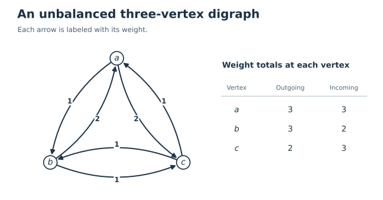

Suppose both one-way resistances are known for every pair of vertices. Can we draw the original arcs and label their weights? In a connected balanced graph, centering the table and taking a pseudoinverse suffice. In a general digraph those operations recover all Laplacian row differences. The shares $\tau_k/\sum_s\tau_s$ suffice to recover the rows themselves. A common factor in the potentials cancels. [[en/Directed Graphs/Balanced graphs/One-Way Resistance and Hitting Times#The one-way resistance matrix|The one-way resistance matrix]]

## Two vertices and one arc

Take two digraphs on the same labeled vertices $a,b$. The first has a unit arc $a\to b$ and the second has its reverse. The unique tree points toward $b$ in the first graph and toward $a$ in the second. The rooted potentials in order $a,b$ are $(0,1)$ and $(1,0)$.

On two vertices $\Phi_{ab}=\Phi_{ba}=\tfrac12[b-a]^2$. Multiplying either form by $[a]^2$ or $[b]^2$ gives coefficient $1/2$ at $[a\wedge b]^2$. The potential sums are 1, so both graphs give $r_{ab}=r_{ba}=(1/2+1/2)/1=1$. The same zero-diagonal table with off-diagonal entries 1 also comes from two opposite arcs, each of weight $1/2$. Thus even the number of arcs can be ambiguous. [[en/Directed Graphs/Digraph Polyforms/How to Normalize One-Way Resistance in an Unbalanced Digraph#One rule for every pair|One rule for every pair]]

## What centering preserves

Consider a loopless digraph on $n\ge2$ vertices with nonnegative weights. Write $f_{ij}$ for the total weight of arcs $i\to j$, combining parallel arcs. Row $i$ of $\mathbf L$ corresponds to their tail, so $L_{ij}=-f_{ij}$ for $i\ne j$ and $\mathbf L\mathbf1=0$. In the table $\mathbf r=(r_{ij})$, row $i$ is the start and column $j$ the target. Assume $S=\sum_k\tau_k>0$, so at least one positive-weight spanning tree exists. At $S=0$ this normalization is undefined.

Let $\mathbf1$ be the all-ones column and $\mathbf J=\mathbf I-\mathbf1\mathbf1^{\mathsf T}/n$. Left multiplication by $\mathbf J$ subtracts the mean of all rows from each row. Thus row $i$ of $\mathbf J\mathbf L$ gives the difference between Laplacian row $i$ and the mean row.

> [!info] Recovering the centered Laplacian
> **Theorem.** Under normalization by total rooted potential the table $\mathbf r$ determines
>
> $$
> \boxed{\mathbf K=(-\mathbf J\mathbf r)^+=\mathbf J\mathbf L}
> $$
>
> The superscript $+$ denotes the Moore–Penrose pseudoinverse. Two digraphs on the same vertices with $S>0$ have identical resistance tables if and only if all corresponding Laplacian row differences agree.

> [!note]- Proof using the sum of principal minors
> **Proof.** Put $W=\{x:\mathbf1^{\mathsf T}x=0\}$. In an orthonormal basis whose first vector is proportional to $\mathbf1$ and whose remaining vectors lie in $W$, the first column of $\mathbf L$ is zero. Its lower right block is the restriction of $\mathbf K=\mathbf J\mathbf L$ to $W$. Hence
>
> $$
> \det(z\mathbf I+\mathbf L)
> =z\det(z\mathbf I_W+\mathbf K|_W)
> $$
>
> The coefficient of $z$ on the left is the sum of principal minors of order $n-1$, namely $S$. On the right it is $\det(\mathbf K|_W)$. Thus $\mathbf K$ is invertible on $W$. Extend its inverse on $W$ by zero on the constant vectors to obtain $\mathbf B=\mathbf K^+$, with $\mathbf J\mathbf B=\mathbf B\mathbf J=\mathbf B$.
>
> Let $\mathbf e_i$ be the $i$th coordinate column. The centroid-to-target column in $\Phi_{ij}$ is $\mathbf J\mathbf e_j$ and the start-to-target column is $\mathbf e_j-\mathbf e_i$. Its matrix $\mathbf F=(\mathbf J\mathbf e_j)(\mathbf e_j-\mathbf e_i)^{\mathsf T}$ kills constants and has range in $W$.
>
> Write $S(t)$ for the sum of the order-$n-1$ principal minors of $\mathbf L+t\mathbf F$. The linear coefficient in each minor is the corresponding root coefficient, so $r_{ij}=S'(0)/S$. The same block determinant gives $S(t)=\det((\mathbf K+t\mathbf F)|_W)$. Differentiation on $W$ gives
>
> $$
> r_{ij}=\frac{S'(0)}{S}
> =(\mathbf e_j-\mathbf e_i)^{\mathsf T}\mathbf B\mathbf J\mathbf e_j
> =B_{jj}-B_{ij}
> $$
>
> Each column $j$ of $\mathbf r$ is the constant column $B_{jj}\mathbf1$ minus column $j$ of $\mathbf B$. Centering removes the constant, giving $-\mathbf J\mathbf r=\mathbf B$. Its pseudoinverse returns $\mathbf K$. Conversely, $\mathbf K$ gives $\mathbf B=\mathbf K^+$ and every difference $B_{jj}-B_{ij}$. Centered matrices agree precisely when all row differences agree. $\square$

In a connected balanced graph the Laplacian has zero column sums, hence zero mean row and $\mathbf J\mathbf L=\mathbf L$. In an unbalanced graph centering removes the same row from every row of the Laplacian. How can the trees supply the missing information?

## How the rooted potentials restore the weights

Put the shares $\pi_k=\tau_k/S$ in a column $\pi$. They sum to 1. Each $\tau_k$ can be extracted from the polyform by multiplication by $[a_k]^2$. Only their relative values are needed for reconstruction. [[en/Directed Graphs/Digraph Polyforms/Computing a Rooted Spanning-Tree Potential from a Digraph Polyform|Computing a Rooted Spanning-Tree Potential from a Digraph Polyform]]

> [!info] Recovering the arc weights
> **Theorem.** Given $\mathbf r$ and $\pi$, compute $\mathbf K=(-\mathbf J\mathbf r)^+$, then subtract from each row the mean of its rows weighted by $\pi_k$. The original Laplacian and arc weights are
>
> $$
> \boxed{\mathbf L=\mathbf K-\mathbf1(\pi^{\mathsf T}\mathbf K)},
> \qquad f_{ij}=-L_{ij}\quad(i\ne j)
> $$
>
> Individual rooted potentials may vanish.

> [!note]- Proof from the rooted potentials
> **Proof.** Since $S>0$ and $\mathbf L\mathbf1=0$, the rank is $n-1$. Each column of the adjugate lies in the nullspace of $\mathbf L$ and is constant. Its diagonal entry in column $k$ is $\tau_k$. Thus the adjugate equals $\mathbf1(\tau_1,\ldots,\tau_n)$. Its product on the right with $\mathbf L$ is zero, giving $\pi^{\mathsf T}\mathbf L=0$.
>
> Write $m^{\mathsf T}$ for the mean row of $\mathbf L$. Then $\mathbf K=\mathbf L-\mathbf1m^{\mathsf T}$. Multiply on the left by $\pi^{\mathsf T}$ and use $\pi^{\mathsf T}\mathbf1=1$ to obtain $\pi^{\mathsf T}\mathbf K=-m^{\mathsf T}$. Substitution gives the formula. $\square$

## The graph with rooted potentials 5, 4 and 7

Use vertex order $a,b,c$. Summing root coefficients gave $r_{ab}=4/16$, $r_{ba}=3/16$. The other entries follow from the same minor calculation. Begin with the table alone.

$$
\mathbf r=\frac1{16}
\begin{pmatrix}0&4&4\\3&0&5\\4&4&0\end{pmatrix},
\qquad
-\mathbf J\mathbf r=\frac1{48}
\begin{pmatrix}7&-4&-3\\-2&8&-6\\-5&-4&9\end{pmatrix}
$$

Taking the pseudoinverse gives

$$
\mathbf K=\frac13
\begin{pmatrix}9&-4&-5\\-6&8&-2\\-3&-4&7\end{pmatrix}
$$

To check the calculation, both $\mathbf K$ and $-\mathbf J\mathbf r$ kill the constant column and have zero column sums. Their product in either order is $\mathbf J$.

Now use $\pi=(5,4,7)^{\mathsf T}/16$. Multiplying the three rows of $\mathbf K$ by $5/16,4/16,7/16$ and adding yields $(0,-1/3,1/3)$. Subtract this row from every row of $\mathbf K$.

$$
\mathbf L=
\begin{pmatrix}3&-1&-2\\-2&3&-1\\-1&-1&2\end{pmatrix}
$$

In row $a$, columns $b,c$ contain $-1,-2$. Thus $a\to b$ weighs 1 and $a\to c$ weighs 2. Row $b$ gives weight 2 for the reverse arc $b\to a$. Compare these weights with Fig. 1.

*Fig. 1. The recovered arcs $a\to c$ and $b\to a$ have weight 2, and the other four have weight 1. The principal minors of the recovered Laplacian are $5,4,7$.*

## A path with zero resistance along an arc

In the unit path $a\to b\to c\to d$ the only tree points toward $d$, giving $\pi=(0,0,0,1)^{\mathsf T}$. Independently, start with the path Laplacian and compute each $r_{ij}$ by summing minors. This gives the table on the left. Center and take its pseudoinverse to obtain the matrix on the right.

$$
\mathbf r=
\begin{pmatrix}0&0&0&3\\1&0&0&2\\1&1&0&1\\1&1&1&0\end{pmatrix},
\qquad
\mathbf K=\frac14
\begin{pmatrix}3&-4&0&1\\-1&4&-4&1\\-1&0&4&-3\\-1&0&0&1\end{pmatrix}
$$

In particular $K_{ad}=1/4$. Reading that entry as $-f_{ad}$ would give a negative weight. The root correction is essential. Here $\pi^{\mathsf T}\mathbf K$ is the $d$ row, $(-1,0,0,1)/4$. Subtract it from all rows. The sink row becomes zero and the Laplacian is

$$
\mathbf L=
\begin{pmatrix}1&-1&0&0\\0&1&-1&0\\0&0&1&-1\\0&0&0&0\end{pmatrix}
$$

Cell $(b,c)$ of the table had $r_{bc}=0$. The corresponding Laplacian entry is $L_{bc}=-1$, giving weight 1 to $b\to c$. The entire table and the relative potentials together recover the positive arc weight.

The same table can also measure two distinct vectors directly. This calculation uses one mixed form. [[en/Directed Graphs/Digraph Polyforms/Computing the Directed Scalar Product of Two Vectors in a Digraph|Computing the Directed Scalar Product of Two Vectors in a Digraph]]

[[ru/Направленные графы/Полиформы орграфов/Можно ли восстановить орграф по матрице односторонних резистенсов|Русский]]
