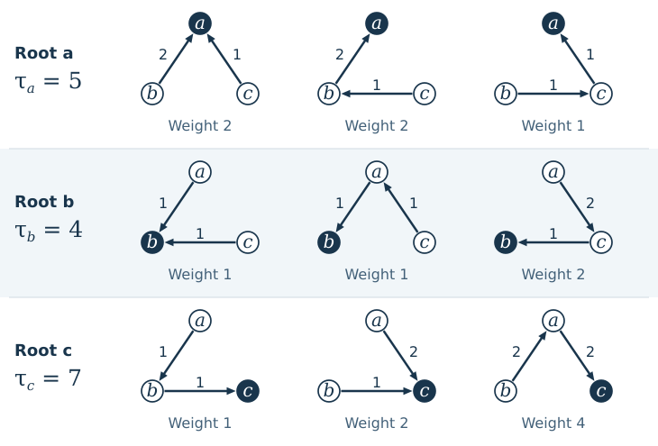
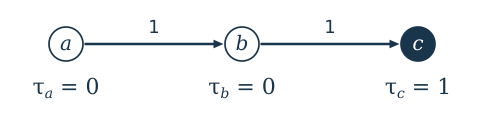

How do we extract one number from the polyform once a root is chosen? Take vertex $b$ in the digraph on $a,b,c$ with two opposite arcs per pair. The arcs $b\to a$ and $a\to c$ weigh 2 and the remaining four weigh 1. Its highest grade is

$$
M_2=[5\,b\wedge c+4\,c\wedge a+7\,a\wedge b,\,(abc)]
$$

Here $(abc)=a\wedge b+b\wedge c+c\wedge a$. The six arcs give $M_2$ by the forest expansion. We now extract the rooted spanning-tree potential at $b$. [[en/Directed Graphs/Digraph Polyforms/How Arcs Form the Polyform of a Digraph#The result for six arcs|The result for six arcs]]

## What the vertex form selects

The quadratic form of $b$ is $[b]^2=[b,b]$. Take exterior products in both arguments. On the left, terms containing $b$ vanish and only $4c\wedge a$ survives. On the right only $c\wedge a$ in $(abc)$ survives. Thus

$$
M_2[b]^2
=4[c\wedge a\wedge b,\,(abc)\wedge b]
=4[a\wedge b\wedge c]^2
$$

The coefficient of the full simplex form is $4$, the potential $\tau_b$. Multiplication by $[a]^2$ or $[c]^2$ selects the other two coefficients, giving $(\tau_a,\tau_b,\tau_c)=(5,4,7)$.

The vertex's own form $[b]^2$ extracts its potential. In the product with $M=e+L+M_2$, the terms $e[b]^2$ and $L[b]^2$ have grades 1 and 2. The required number appears in grade 3 of $M[b]^2$.

## Why only trees toward the chosen root remain

*Fig. 1. In each row the filled vertex is the root. Arrows point toward it. Each arrow carries its weight and the number below each tree is the product of its two arc weights.*

Read the middle row from left to right. In $a\to b\leftarrow c$ both arcs lead directly to $b$ and the weight is $1\cdot1=1$. In $c\to a\to b$ the path goes through $a$ and again weighs $1\cdot1=1$. The tree $a\to c\to b$ uses the arc $a\to c$ of weight 2. The middle row gives $1+1+2=4$, the top row $2+2+1=5$ and the bottom row $1+2+4=7$.

Every middle-row tree has tails $a,c$. Only its root $b$ is absent from the left exterior product. In each of the other six trees an arc leaves $b$, so multiplication by $[b]^2$ repeats $b$ on the left and gives zero.

## The rule for a general digraph

Let $a_1,\ldots,a_n$ be the vertex basis of a finite loopless digraph, $n\ge2$. An arc $i\to j$ has weight $f_{ij}\ge0$. Trees use positive-weight arcs. Row $i$ of the outgoing Laplacian has $L_{ii}=\sum_j f_{ij}$ and $L_{ij}=-f_{ij}$ for $i\ne j$. Write $L$ for the Laplacian form and $M=\exp L$ for its exponential.

> [!info] Extracting a rooted potential
> **Proposition.** For any vertex $a_r$ the component of grade $n$ is
>
> $$
> (M[a_r]^2)_n=M_{n-1}[a_r]^2
> =\tau_r[a_1\wedge\cdots\wedge a_n]^2
> $$
>
> The potential $\tau_r$ is the total weight of the spanning trees directed toward $a_r$. It also equals the principal minor
>
> $$
> \tau_r=\det\mathbf L_{\widehat r,\widehat r}
> $$
>
> The hat denotes deletion of the row and column of $a_r$.

> [!note]- Why each tree has a positive sign
> **Proof.** In the forest expansion each term of $M_{n-1}$ represents a spanning tree. If its root differs from $a_r$, an arc leaves $a_r$ and multiplication by $[a_r]^2$ repeats that vertex on the left. [[en/Directed Graphs/Digraph Polyforms/How Arcs Form the Polyform of a Digraph#Which sets of arcs survive|Which sets of arcs survive]]
>
> For a tree rooted at $a_r$, order its vertices by decreasing tree distance from the root, placing the root last. The parent $a_j$ of each nonroot $a_i$ occurs later. On the left list all tails in order and append $a_r$. On the right take $a_i-a_j$ for each tail and append $a_r$. This triangular change of basis has diagonal entries 1, so the two full exterior products agree. Returning to vertex order gives the same sign on each side. Their product is $+1$, leaving precisely the product of the arc weights. $\square$

> [!note]- Why the coefficient is a principal minor
> **Proof.** Group arcs by tail and set $v_i=\sum_jL_{ij}a_j$. Then $L=\sum_i[a_i,v_i]$. The row forms commute and their squares vanish, giving $M=\prod_i(e+[a_i,v_i])$.
>
> In $M_{n-1}[a_r]^2$ only the product of the rows $i\ne r$ survives. The missing vertex $a_r$ is appended on the left. On the right, the coefficient of the exterior product on the same indices in the product of the $v_i$ is the determinant with row and column $r$ deleted. Moving the appended $a_r$ to position $r$ gives identical signs on both sides. $\square$

To check Fig. 1 for root $b$, delete the second row and column in vertex order $a,b,c$. The remaining rows and columns correspond to $a,c$.

$$
\mathbf L=
\begin{pmatrix}
3&-1&-2\\
-2&3&-1\\
-1&-1&2
\end{pmatrix},
\qquad
\tau_b=\begin{vmatrix}3&-2\\-1&2\end{vmatrix}
=3\cdot2-2=4
$$

What happens when we add $t$ to the weight of $a\to b$? No arc leaves $a$ in a tree rooted at $a$. The first two trees in the middle row contain the modified arc and their other arc weighs 1. In the bottom row only $a\to b\to c$ contains it, and $b\to c$ weighs 1. The potentials therefore become $(5,4+2t,7+t)$ for $1+t\ge0$.

## When a rooted potential vanishes

> [!info] Reachability criterion
> **Corollary.** For nonnegative weights, $\tau_r>0$ exactly when every vertex can reach $a_r$ along positive-weight arcs. If any vertex cannot reach $a_r$, then $\tau_r=0$.

> [!note]- Constructing a tree from paths
> **Proof.** A tree directed toward $a_r$ supplies a path from every vertex. Conversely, when all vertices can reach $a_r$, select at each nonroot the first arc of a shortest path to $a_r$, counting arcs. Each step reduces the distance by one. No cycle is possible and every selected path reaches $a_r$. This spanning tree has positive weight, and all other tree weights are nonnegative. $\square$

*Fig. 2. Both unit arcs point along the path toward $c$. Together they form its only spanning tree.*

In this path $a$ can reach $b$, but $c$ cannot. Its top component is $M_2=[a\wedge b,(abc)]$. Multiplication by $[a]^2$ or $[b]^2$ gives zero on the left, while $[c]^2$ gives $[a\wedge b\wedge c]^2$. Thus $(\tau_a,\tau_b,\tau_c)=(0,0,1)$.

Does zero potential identify a pure source? The first grade $M_1=L$ distinguishes local vertex types. A pure source has an outgoing arc and a zero off-diagonal column. A pure sink has an incoming arc and a zero row. An isolated vertex has both a zero row and a zero column. Here $b$ has zero potential and both an incoming and an outgoing arc. A zero potential alone cannot identify a source. On two or more vertices a pure source always has zero potential. A pure sink has positive potential precisely when every vertex can reach it.

## Why all roots agree in a connected balanced graph

Balance means that incoming and outgoing weights agree at each vertex. If the positive-weight graph is connected after directions are forgotten, balance makes it strongly connected. Every root then has positive potential. For the outgoing Laplacian $\mathbf L^{\mathsf T}\boldsymbol\tau=0$. A positive principal minor of order $n-1$ and the zero row sums give rank $n-1$. The left nullspace is one-dimensional and balance puts $\mathbf1$ in it. Hence all $\tau_r$ equal one common spanning-tree coefficient. [[en/Directed Graphs/Balanced graphs/Balanced Graphs and Spanning-Tree Potentials#A balance criterion using spanning-tree potentials|A balance criterion using spanning-tree potentials]]

In the unit cycle $a\to b\to c\to a$, exactly one tree of weight 1 leads to each root. The vertex forms select different trees with the same coefficient. This gives the unit normalization used to compare the arc and resistance forms. [[en/Directed Graphs/Digraph Polyforms/The Arc Form and the One-Way Resistance Form|The Arc Form and the One-Way Resistance Form]]

[[ru/Направленные графы/Полиформы орграфов/Как вычислить остовной потенциал вершины по полиформе орграфа|Русский]]
