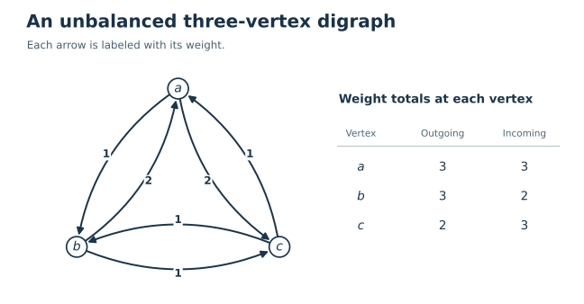

From $a$ draw $(ab)=b-a$ and $(ac)=c-a$. First use $(ab)$ as source and $(ac)$ as receiver, then exchange their roles. On the unbalanced digraph in Fig. 1 the results are $1/4$ and $1/8$. Which forms produce these numbers? Can we calculate them directly from the resistance table?

The balanced-graph series calls this operation a *directional pairing*. We use **directed scalar product** and write $\beta(u,v)$. “Directed” specifies the order of the roles. An ordinary real inner product is symmetric and is positive on the diagonal for a nonzero vector. Both properties can be tested in digraphs. [[en/Getting Started and Foundations/Foundations/PMG terminology#Measurement forms of digraphs|Measurement forms of digraphs]] [[en/Directed Graphs/Balanced graphs/The Gram Matrix and Directional Coordinates of a Balanced Graph#Sources and receivers|Sources and receivers]]

## One mixed form for two vectors

Consider a loopless digraph with nonnegative weights and Laplacian rows indexed by arc tails. Let $\tau_k$ be the total weight of spanning trees directed toward $a_k$. Assume $S=\sum_k\tau_k>0$. The all-root normalization then applies even when individual $\tau_k$ vanish.

> [!info] Directed scalar product
> **Definition.** For zero-sum vectors $u,v$ in the vertex basis, use $u$ as source and $v$ as receiver and put
>
> $$
> \boxed{\beta(u,v)=u^{\mathrm{out}}\cdot v^{\mathrm{in}}=P_M^\Sigma([u,v])}
> $$
>
> Here $M=\exp L$ denotes the exponential in the polyform algebra. For each root $a_k$ take the coefficient of $[a_1\wedge\cdots\wedge a_n]^2$ in $M[u,v][a_k]^2$. Sum the coefficients and divide by $S$.

The two vectors occupy the two slots of **one** grade-one form. Exchanging roles gives $[v,u]$. Multiplying two segment measurement forms produces a grade-two form, which is used for a triangle. [[en/Directed Graphs/Digraph Polyforms/How to Normalize One-Way Resistance in an Unbalanced Digraph#One rule for every pair|One rule for every pair]]

Write $x_j$ for the vector from the centroid of all vertices to $a_j$ and $a_{ij}=a_j-a_i$. The ordered-pair form is $\Phi_{ij}=[x_j,a_{ij}]$, giving $r_{ij}=\beta(x_j,a_{ij})$. Using $a_{ij}$ in both slots instead gives the symmetric pair resistance.

$$
\beta(a_{ij},a_{ij})=P_M^\Sigma([a_{ij}]^2)=r_{ij}+r_{ji}
$$

The last equality follows from $\Phi_{ij}+\Phi_{ji}=[a_{ij}]^2$. For the same pair, changing the left argument selects either the one-way resistance or the product of the pair vector with itself.

## Computing the product from the resistance table

> [!info] Formula for two vectors
> **Proposition.** Let $\mathbf u,\mathbf v$ be the coordinate columns and let $\mathbf r=(r_{ij})$ have start $i$ as row and target $j$ as column. Then
>
> $$
> \boxed{\beta(u,v)=-\mathbf v^{\mathsf T}\mathbf r\,\mathbf u}
> $$
>
> Multiply the table on the right by the first vector's column and on the left by the transpose of the second vector's column. Negate the result.

> [!note]- Proof from the ordered-pair forms
> **Proof.** Let $u_j,v_i$ be the vertex coefficients. Since $\sum_j u_j=\sum_i v_i=0$, they also give $u=\sum_j u_jx_j$ and $v=\sum_i v_ix_i$ in centroid vectors. As $a_{ij}=x_j-x_i$, substitute $r_{ij}=\beta(x_j,x_j)-\beta(x_j,x_i)$ into the matrix product to get
>
> $$
> -\sum_{i,j}v_i r_{ij}u_j
> =-\sum_j u_j\beta(x_j,x_j)\sum_i v_i
> +\sum_{i,j}v_i u_j\beta(x_j,x_i)
> $$
>
> The first sum vanishes. Bilinearity makes the second sum $\beta(u,v)$. $\square$

For a connected balanced graph this is $\mathbf v^{\mathsf T}\mathbf L^+\mathbf u$. In a general digraph center the Laplacian before inverting it on the zero-sum space. The corresponding inverse there is $\mathbf B=-\mathbf J\mathbf r$, with $\mathbf J=\mathbf I-\mathbf1\mathbf1^{\mathsf T}/n$. Since $\mathbf v^{\mathsf T}\mathbf J=\mathbf v^{\mathsf T}$, the two expressions agree. Once the table is given, individual rooted potentials are unnecessary. [[en/Directed Graphs/Digraph Polyforms/Can the One-Way Resistance Matrix Recover a Digraph#What centering preserves|What centering preserves]]

## Two orders on the same digraph

*Fig. 1. The arcs $a\to c$ and $b\to a$ have weight 2 and the other four have weight 1. We measure $(ab)$ and $(ac)$ in both orders.*

Here $(\tau_a,\tau_b,\tau_c)=(5,4,7)$ and $S=16$. Put $u=b-a$, $v=c-a$. For three vertices only the first grade of $M$, namely $L$, contributes to the top grade of $M[u,v][a_k]^2$. In $L[u,v]$ each arc $i\to j$ contributes $f_{ij}[a_i\wedge u,(a_i-a_j)\wedge v]$.

Write $(abc)=(b-a)\wedge(c-a)$. For $v=c-a$ the arcs between $a$ and $c$ vanish on the right. For $a\to b,b\to a,b\to c,c\to b$ the right factors are respectively $-(abc),(abc),(abc),-(abc)$. With their weights, the left argument becomes $(-a+3b-c)\wedge u$. In the reverse order the arcs between $a$ and $b$ vanish, leaving $(2a+b-2c)\wedge v$. Expanding gives

$$
\begin{aligned}
L[u,v]&=[b\wedge c+c\wedge a+2a\wedge b,\,(abc)]\\
L[v,u]&=[b\wedge c+a\wedge b,\,(abc)]
\end{aligned}
$$

Multiplication by $[a]^2$ selects the coefficient of $b\wedge c$ on the left, $[b]^2$ selects $c\wedge a$ and $[c]^2$ selects $a\wedge b$. The two lists of root coefficients are $(1,1,2)$ and $(1,0,1)$. Thus

$$
\beta((ab),(ac))=\frac{1+1+2}{16}=\frac14,
\qquad
\beta((ac),(ab))=\frac{1+0+1}{16}=\frac18
$$

Check both numbers against the one-way resistance table of the same graph. In vertex order $a,b,c$ it is

$$
\mathbf r=\frac1{16}\begin{pmatrix}0&4&4\\3&0&5\\4&4&0\end{pmatrix}
$$

Each coordinate column has just two nonzero entries. Since $r_{aa}=0$, each matrix product uses three table entries.

$$
\begin{aligned}
\beta((ab),(ac))&=r_{ab}+r_{ca}-r_{cb}=(4+4-4)/16=1/4\\
\beta((ac),(ab))&=r_{ac}+r_{ba}-r_{bc}=(4+3-5)/16=1/8
\end{aligned}
$$

## Polarization and circulation

If only $q(u)=\beta(u,u)$ is known, polarization recovers the symmetric part. Expanding $q(u+v)$ by bilinearity gives the two mixed terms with the same sign, so

$$
g(u,v)=\frac{q(u+v)-q(u)-q(v)}2
=\frac{\beta(u,v)+\beta(v,u)}2
$$

Write $\gamma(u,v)=(\beta(u,v)-\beta(v,u))/2$ for the antisymmetric part. In this example $g((ab),(ac))=3/16$ and $\gamma((ab),(ac))=1/16$. The difference between the two orders gives the triangle's circulation

$$
\chi_{abc}=\beta((ab),(ac))-\beta((ac),(ab))
=(r_{ab}+r_{bc}+r_{ca})-(r_{ac}+r_{cb}+r_{ba})=\frac18
$$

A cyclic change of start preserves both sums. Reversing the traversal exchanges them and gives $\chi_{acb}=-1/8$. Circulation distinguishes traversals in grade one. The norm of the boundary $(abc)$ is a grade-two measurement. [[en/Directed Graphs/Balanced graphs/Resistance Geometry and Circulation#What circulation measures|What circulation measures]]

Polarization guarantees symmetry of $g$. To test positivity, take the path $a\to b\to c$ with weights 1 and 20 and the zero-sum vector $z=-a+3b-2c$. Its only tree ends at $c$ and weighs 20. In $\mathbf L+t\mathbf z\mathbf z^{\mathsf T}$, the principal minors omitting $a,b,c$ are $-40t$, $4t$ and $20+26t$. Their linear coefficients are the root contributions of $[z]^2$. Thus $g(z,z)=\beta(z,z)=(-40+4+26)/20=-1/2$ despite positive arc weights. [[en/Directed Graphs/Digraph Polyforms/How to Normalize One-Way Resistance in an Unbalanced Digraph#Computing the coefficients with minors|Computing the coefficients with minors]]

For a triangle, the full directed scalar product gives a Gram determinant. The same boundary norm can be evaluated by summing three products of side forms. [[en/Directed Graphs/Digraph Polyforms/What Does the Product of Two Side Forms of a Triangle Measure|What Does the Product of Two Side Forms of a Triangle Measure?]]

[[ru/Направленные графы/Полиформы орграфов/Как вычислить направленное скалярное произведение двух векторов в орграфе|Русский]]
