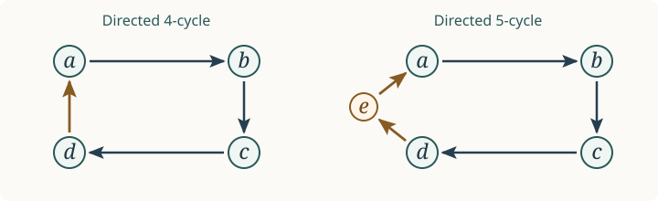

An interval has two endpoints, and the two opposite measurement forms sum to its quadratic form. A triangle has three vertices and its quadratic form is the sum of three products of side forms. Why count vertices when there are many more traversal orders? At every grade, fixing the start makes the product independent of the order of the remaining vertices. After measurement the sum over starts is one Gram determinant of directed scalar products. [[en/Directed Graphs/Digraph Polyforms/What Does the Product of Two Side Forms of a Triangle Measure#Three starts give one boundary form|Three starts give one boundary form]]

## One term per starting vertex

Choose $k+1$ distinct vertices $a_0,\ldots,a_k$ from the $n$ vertices of a graph, with $1\le k\le n-1$. Their grade-$k$ boundary is

$$
(a_0\ldots a_k)=(a_1-a_0)\wedge\cdots\wedge(a_k-a_0)
$$

Let $x_j$ be the vector from the centroid of **all** $n$ vertices to $a_j$. The ordered-pair form $\Phi_{ij}=[x_j,a_j-a_i]$ exists whether or not there is an arc $a_i\to a_j$. For the term starting at $a_i$, list the selected vertices as $a_{j_0},a_{j_1},\ldots,a_{j_k}$ with $j_0=i$. Multiply the $k$ forms of consecutive pairs, stopping at the last vertex.

$$
F_i=\Phi_{j_0j_1}\Phi_{j_1j_2}\cdots\Phi_{j_{k-1}j_k}
$$

> [!info] Decomposition before choosing a metric
> **Theorem.** For fixed start $a_i$ all $k!$ orders of the remaining vertices give the same form $F_i$. The sum over the $k+1$ starts is
>
> $$
> \boxed{\sum_{i=0}^k F_i=[(a_0\ldots a_k)]^2}
> $$

> [!note]- Proof by expanding the boundary
> **Proof.** On the left of $F_i$ stands $x_{j_1}\wedge\cdots\wedge x_{j_k}$. On the right are the successive differences $a_{j_m}-a_{j_{m-1}}$. Replacing each difference by the sum of the original differences up to that position preserves their exterior product and gives the boundary $(a_{j_0}\ldots a_{j_k})$ based at the start. Exchanging two vertices after the start changes both signs. The form is unchanged.
>
> Now move $a_i$ to the first position, leaving all other vertices in their original order. The right argument is $(-1)^i(a_0\ldots a_k)$. Move its sign to the left. Summing the left arguments gives
>
> $$
> \sum_{i=0}^k(-1)^i x_0\wedge\cdots\wedge\widehat{x_i}\wedge\cdots\wedge x_k
> =(x_1-x_0)\wedge\cdots\wedge(x_k-x_0)
> $$
>
> A hat omits the indicated factor. Expand the right side. Every term containing $x_0$ twice vanishes. Since $x_j-x_0=a_j-a_0$, the sum on the left equals the common right argument $(a_0\ldots a_k)$. $\square$

For $k=1$ the terms are $\Phi_{ab}$ and $\Phi_{ba}$. For $k=2$ they are $\Phi_{ab}\Phi_{bc}$, $\Phi_{bc}\Phi_{ca}$ and $\Phi_{ca}\Phi_{ab}$. If all vertices are selected, $\sum_{i=0}^k x_i=0$. Substituting $x_0=-\sum_{j=1}^k x_j$ in the expansion makes all signed left arguments equal. Each $F_i$ then equals $1/(k+1)$ times $[(a_0\ldots a_k)]^2$ before any measurement.

## The full norm from the directed Gram matrix

Consider a digraph with nonnegative weights, its outgoing Laplacian and metric polyform $M=\exp L$. Numerical evaluation requires $S=\sum_s\tau_s>0$, with $\tau_s$ the total weight of spanning trees directed toward $s$. To find $P_M^\Sigma(F)$ multiply $MF$ by each root form in turn, sum the top-grade coefficients and divide by $S$. At $S=0$ the form identity still holds but this normalization gives no number. [[en/Directed Graphs/Digraph Polyforms/How to Normalize One-Way Resistance in an Unbalanced Digraph#One rule for every pair|One rule for every pair]]

> [!info] Two calculations of the full norm
> **Theorem.** Let $S>0$, $u_p=a_p-a_0$ for $1\le p\le k$, and $\beta(u,v)=P_M^\Sigma([u,v])$. Then
>
> $$
> \boxed{P_M^\Sigma([(a_0\ldots a_k)]^2)
> =\sum_{i=0}^k P_M^\Sigma(F_i)
> =\det\bigl(\beta(u_p,u_q)\bigr)_{p,q=1}^k}
> $$
>
> From the one-way resistance table $\mathbf r$, each Gram entry is $-\mathbf u_q^{\mathsf T}\mathbf r\,\mathbf u_p$. The column for the first argument goes on the right and the transpose for the second goes on the left. [[en/Directed Graphs/Digraph Polyforms/Computing the Directed Scalar Product of Two Vectors in a Digraph#Computing the product from the resistance table|Computing the product from the resistance table]]

> [!note]- Proof by extracting a coefficient
> **Proof.** The sum follows from the form identity and linearity of $P_M^\Sigma$. For the determinant choose left and right vectors independently. Assemble the zero-sum columns $u_p,v_p$ in $\mathbf U,\mathbf V$ and put $\mathbf D=\operatorname{diag}(t_1,\ldots,t_k)$. Let $S(\mathbf t)$ be the sum of the principal minors of order $n-1$ of $\mathbf L+\mathbf U\mathbf D\mathbf V^{\mathsf T}$. The perturbed exponential equals $M\prod_p(e+t_p[u_p,v_p])$. Each factor is linear in its parameter because repeating $u_p$ in an exterior product gives zero. Hence the coefficient of $t_1\cdots t_k$ in $S(\mathbf t)/S$ is $P_M^\Sigma(\prod_p[u_p,v_p])$.
>
> On the zero-sum space $W$, the matrix $\mathbf K=\mathbf J\mathbf L$ is invertible with determinant $S$. Here $\mathbf J$ is orthogonal projection onto $W$. The perturbation is already centered, so $S(\mathbf t)$ is the determinant on $W$ after adding $\mathbf U\mathbf D\mathbf V^{\mathsf T}$. Write $\mathbf B$ for the inverse of $\mathbf K$ on $W$. Sylvester's determinant identity gives
>
> $$
> \frac{S(\mathbf t)}{S}=\det(\mathbf I_k+\mathbf D\mathbf V^{\mathsf T}\mathbf B\mathbf U)
> $$
>
> The coefficient of the product of all $k$ parameters is $\det(\mathbf V^{\mathsf T}\mathbf B\mathbf U)$. Since $\beta(u,v)=\mathbf v^{\mathsf T}\mathbf B\mathbf u$, this is the determinant of the transpose of $(\beta(u_p,v_q))$. Thus
>
> $$
> P_M^\Sigma([u_1\wedge\cdots\wedge u_k,\,v_1\wedge\cdots\wedge v_k])
> =\det\bigl(\beta(u_p,v_q)\bigr)_{p,q=1}^k
> $$
>
> Substituting $v_p=u_p=a_p-a_0$ gives the claimed formula. [[en/Directed Graphs/Digraph Polyforms/Can the One-Way Resistance Matrix Recover a Digraph#What centering preserves|What centering preserves]] $\square$

The Gram matrix uses the **full directed scalar product**, including its antisymmetric part. Evaluation extends bilinearly in the left and right arguments to linear combinations of simple boundaries. Here “norm” means the normalized potential of the quadratic form. In an undirected graph, divide this norm by $(k!)^2$ to obtain the squared Euclidean volume of the simplex. [[en/Getting Started and Foundations/Introduction/Metric of Higher-Grade Objects#Areas and volumes of simplices|Areas and volumes of simplices]] [[en/Getting Started and Foundations/Foundations/Core specification#Higher grades and geometric interpretation|Higher grades and geometric interpretation]]

## A tetrahedron in two directed cycles

Fix vertices $a,b,c,d$ and measure the grade-three boundary $(abcd)$. Begin with the unit cycle $a\to b\to c\to d\to a$. Then insert $e$ between $d$ and $a$, keeping all arc weights equal to 1. The tetrahedron has the same four vertices in both graphs.

*Fig. 1. In the four-cycle, one arc leads from $d$ to the next selected vertex $a$. In the five-cycle the path goes through $e$, which also enters the graph centroid.*

| Directed cycle | Start $a$ | Start $b$ | Start $c$ | Start $d$ | Full norm |
| --- | --- | --- | --- | --- | --- |
| $abcda$ | $1/4$ | $1/4$ | $1/4$ | $1/4$ | $1$ |
| $abcdea$ | $1/5$ | $1/5$ | $1/5$ | $2/5$ | $1$ |

Why does the numerator double at $d$? In a unit cycle on $n$ vertices, $r_{ij}$ is the number of arcs from $i$ to $j$ along the cycle divided by $n$. List the four marked vertices along the cycle as $b_0,b_1,b_2,b_3$, beginning at the start to be measured. Let $\ell_j$ count arcs from $b_j$ to the next marked vertex. The four lengths sum to $n$. [[en/Directed Graphs/Balanced graphs/One-Way Resistance and Hitting Times#Markov interpretation|Markov interpretation]]

In the product of the three side forms the left arguments are the centroid vectors to $b_1,b_2,b_3$, and the right arguments are successive differences. The rows of the cycle resistance table are cyclic shifts with the same mean, so the centroid correction cancels when subtracting two rows. The entry for target $b_i$ and column $b_j-b_{j-1}$ is $r(b_{j-1},b_i)-r(b_j,b_i)$, where $r(p,q)$ is the resistance from $p$ to $q$. For a target different from the start of this segment the difference is $\ell_{j-1}/n$. When the target is $b_{j-1}$ the first resistance is zero and the second path follows the rest of the cycle. The entry becomes $\ell_{j-1}/n-1$. By the mixed determinant formula the contribution from $b_0$ is

$$
\det\begin{pmatrix}
\ell_0/n & \ell_1/n-1 & \ell_2/n\\
\ell_0/n & \ell_1/n & \ell_2/n-1\\
\ell_0/n & \ell_1/n & \ell_2/n
\end{pmatrix}
=\frac{\ell_0}{n}
$$

Subtract the third row from the first two and expand along the first column. For start $d$ the first segment has length 1 in the four-cycle and length 2 in the five-cycle. This gives $1/4$ and $2/5$ in the table.

For a direct check of the full norm, the resistance table of either cycle gives the same Gram matrix for $b-a,c-a,d-a$,

$$
\begin{pmatrix}1&0&0\\1&1&0\\1&1&1\end{pmatrix}
$$

Its determinant is 1, the sum of the four contributions. Direct multiplication by each cycle polyform independently gives the table entries. The calculation also applies with zero individual rooted potentials. In the unit path $a\to b\to c\to d$ only $d$ can be the root, so $S=1$. Multiplying $[(abcd)]^2$ by any of the four vertex forms gives top coefficient 1. The full norm is 4, and since all vertices are selected each start contributes 1.

## Starting vertex and orientation

On an interval, exchanging the start reverses direction. For $k\ge2$ one can keep the start fixed and exchange two other vertices. The boundary orientation reverses while $F_i$ stays the same. Starting-vertex contributions therefore extend to every simplex dimension and always add to the full norm.

Can the full norm for $k\ge2$ be split into two distinguishable shares that exchange under orientation reversal and remain unchanged when the start moves? In the five-cycle, moving the start from $a$ to $d$ changes its share from $1/5$ to $2/5$ despite equal rooted potentials at every vertex. An orientation-only measurement would require an additional rule.

[[ru/Направленные графы/Полиформы орграфов/Как вычислить норму границы произвольного порядка в орграфе|Русский]]
