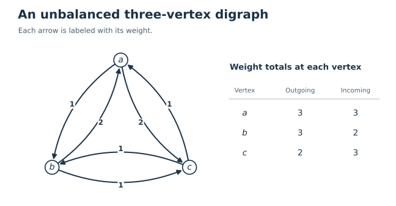

Vertex $a$ in the diagram has two outgoing arcs. Choose both and their product vanishes. Choose $a\to b$ and $b\to c$ instead and a term survives. Which sets of arcs does the polyform retain?

*Fig. 1. Each pair carries opposite arcs. The arcs $b\to a$ and $a\to c$ have weight 2. The other four have weight 1. At $b$ the total outgoing weight is 3 and the incoming weight is 2. At $c$ these totals are reversed.*

## Reading an arc in the matrix and in the form

Keep the vertex order $a,b,c$. In the adjacency matrix $\mathbf C$ used here, a **column** specifies the tail and a **row** the head. The 2 in row $a$, column $b$, therefore means an arc $b\to a$ of weight 2. The matrix is

$$
\mathbf C=
\begin{pmatrix}
0&2&1\\
1&0&1\\
2&1&0
\end{pmatrix}
$$

In PMG the first index of $f_{ij}$ specifies the tail of $i\to j$, so $f_{ij}=C_{ji}$. In the outgoing Laplacian, $L_{ij}=-f_{ij}$ for $i\ne j$. Its diagonal entry is the total outgoing weight of the row vertex. Row $b$ has entries $-2$ for $b\to a$, $-1$ for $b\to c$ and $3$ on the diagonal. This gives

$$
\mathbf L=
\begin{pmatrix}
3&-1&-2\\
-2&3&-1\\
-1&-1&2
\end{pmatrix}
$$

Each row sums to zero. Each column sums to the outgoing weight minus the incoming weight at its vertex. The three column sums are $0,1,-1$. Reversing every arc changes the outgoing weight at $b$ to 2, while transposition preserves $L_{bb}=3$. Reversal gives the transpose precisely when incoming and outgoing weights agree at every vertex. [[en/Getting Started and Foundations/Foundations/Core specification#The Laplacian, balance, and rooted potentials|The Laplacian, balance, and rooted potentials]]

How does a form encode the same row? Write $(ab)=b-a$ and $(ba)=a-b$. A unit arc $a\to b$ contributes

$$
H_{a\to b}=[a,(ba)]=[a,a]-[a,b]
$$

The left argument $a$ selects the row. The right argument places $+1$ in column $a$ and $-1$ in column $b$. The reverse arc gives $H_{b\to a}=[b,(ab)]$. Adding both unit forms gives $[b-a,b-a]=[(ab)]^2$, the form of an undirected edge. Multiply an arc form by its weight to obtain its contribution to the Laplacian.

## One factor per arc

Let the $n\ge2$ vertices $a_1,\ldots,a_n$ of $G$ form a formal basis. Include in $E(G)$ the positive-weight arcs between distinct vertices. Isolated vertices are allowed. Write $L$ for the Laplacian form and $e$ for the unit of the polyform algebra. Then

$$
H_{i\to j}=[a_i,a_i-a_j],\qquad
L=\sum_{(i\to j)\in E(G)} f_{ij}H_{i\to j}
$$

Multiplication takes the exterior product separately in each argument, giving $[u,v][x,y]=[u\wedge x,v\wedge y]$. Exchanging factors changes both signs, so forms commute. The square of $H_{i\to j}$ vanishes because $a_i$ is repeated on the left. Thus $\exp(f_{ij}H_{i\to j})=e+f_{ij}H_{i\to j}$.

> [!info] The polyform of a digraph
> **Definition.** The digraph polyform is the exponential of its Laplacian form. Its arc factorization is
>
> $$
> M=\exp L=\prod_{(i\to j)\in E(G)}(e+f_{ij}H_{i\to j})
> $$

Grade $M_k=L^k/k!$ is obtained by choosing the arc term from $k$ factors and $e$ from the rest. The coefficient is the product of the selected weights. In particular $M_0=e$ and $M_1=L$. All differences $a_i-a_j$ belong to the $(n-1)$-dimensional space of zero-sum vectors. The exterior product of $n$ such right arguments vanishes.

## Three choices in the diagram

**Two arcs with a common tail.** The left arguments of $a\to b$ and $a\to c$ both equal $a$. Whatever the weights,

$$
H_{a\to b}H_{a\to c}=[a\wedge a,(a-b)\wedge(a-c)]=0
$$

**A directed cycle.** The tails of $a\to b$, $b\to c$, $c\to a$ are distinct. The product vanishes on the right because $(a-b)+(b-c)+(c-a)=0$. The differences around any directed cycle sum to zero. Two opposite arcs already give such a cycle.

**A path toward a root.** The arcs $a\to b$ and $b\to c$ have different tails and form no cycle. Write the triangular boundary as $(abc)=(ab)\wedge(bc)$. Then

$$
H_{a\to b}H_{b\to c}=[a\wedge b,(a-b)\wedge(b-c)]
=[a\wedge b,(abc)]
$$

Both weights are 1. From either $a$ or $b$, following the arrows leads to $c$. Hence $c$ is the root. No selected arc leaves $c$, although two arcs leave it in the original graph.

## Which sets of arcs survive

> [!info] Directed forest expansion
> **Proposition.** The nonzero terms of the arc expansion in grade $M_k$ correspond to spanning forests with $k$ arcs. In each component the arcs point toward its root. An isolated vertex is a rooted tree on one vertex. Each forest occurs once with the product of its arc weights.

> [!note]- Why the conditions suffice
> **Proof.** A surviving term has distinct tails. Following the unique chosen outgoing arc, if present, must lead to a vertex with no outgoing arc or to a cycle. A cycle would give zero. The endpoints of each chosen arc therefore lead to the same root, and the entire component has one root. In a component of $m$ vertices each of the $m-1$ nonroot vertices has one outgoing arc. A connected graph on $m$ vertices with $m-1$ edges is a tree.
>
> Conversely, in a forest directed toward its roots the left arguments are distinct basis vertices. In a linear combination of the edge differences, a leaf coordinate occurs only in the term for its incident edge. If the combination vanishes, that coefficient vanishes. Repeated leaf removal eliminates all coefficients. Both exterior products are therefore nonzero, and the arc set specifies exactly one choice of factors. $\square$

This expansion also holds for unbalanced digraphs and for digraphs without a spanning tree. A spanning tree is needed for a nonzero term of grade $n-1$. Balance enters when all rooted potentials of a connected graph are required to agree. [[en/Directed Graphs/Balanced graphs/The Laplacian Exponential of a Balanced Graph#The spanning-tree form and common coefficient|The spanning-tree form and common coefficient]]

## The result for six arcs

Of the 15 pairs of arcs, three share a tail and three are pairs of opposites. Nine trees remain, three per root. Those rooted at $c$ have $a\wedge b$ on the left when the right argument is $(abc)$. The path $a\to b\to c$ weighs $1\cdot1$, the two direct arcs to $c$ weigh $2\cdot1$, and $b\to a\to c$ weighs $2\cdot2$. The coefficient is $1+2+4=7$. Deleting row and column $c$ of the Laplacian gives the same minor, $3\cdot3-(-1)(-2)=7$.

The trees $b\to a\leftarrow c$, $c\to b\to a$ and $b\to c\to a$ give $2+2+1=5$ at $a$. At $b$, the trees $a\to b\leftarrow c$, $c\to a\to b$ and $a\to c\to b$ give $1+1+2=4$. Higher grades vanish, so the full polyform is

$$
\boxed{M=e+L+[5\,b\wedge c+4\,c\wedge a+7\,a\wedge b,\,(abc)]}
$$

All nine trees can use the same oriented right argument $(abc)=a\wedge b+b\wedge c+c\wedge a$. The missing vertex in the left argument identifies the root. Multiplication by its vertex form extracts the corresponding coefficient. [[en/Directed Graphs/Digraph Polyforms/Computing a Rooted Spanning-Tree Potential from a Digraph Polyform|Computing a Rooted Spanning-Tree Potential from a Digraph Polyform]]

The unit directed cycle gives a direct comparison of the arc form and the measurement form. [[en/Directed Graphs/Digraph Polyforms/The Arc Form and the One-Way Resistance Form|The Arc Form and the One-Way Resistance Form]]

[[ru/Направленные графы/Полиформы орграфов/Как из дуг получается полиформа орграфа|Русский]]
