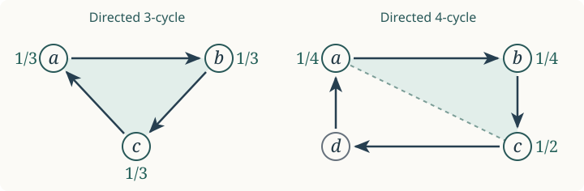

Take two successive sides of the triangular boundary $(abc)$, starting in turn at $a,b,c$. The three products add to $[(abc)]^2$ **before a metric is chosen**. Linearity then expresses the full norm as a sum of three contributions. A second calculation uses a separate fact. The coefficient of a product of two parameters in a sum of minors equals the Gram determinant of the boundary vectors. What does each contribution remember about the traversal?

## Three starts give one boundary form

Choose $a,b,c$ from $n\ge3$ vertices. Write $x_j$ for the vector from the centroid of **all** $n$ vertices to $j$. The form measuring $(ab)$ is $\Phi_{ab}=[x_b,b-a]$. It exists even in the absence of an arc $a\to b$. Multiplication takes exterior products separately in the two arguments. For example,

$$
\Phi_{ab}\Phi_{bc}
=[x_b\wedge x_c,(b-a)\wedge(c-b)]
=[x_b\wedge x_c,(abc)]
$$

Here $(abc)=(b-a)\wedge(c-a)$. Replacing $c-a$ by $c-b$ preserves the exterior product because the two vectors differ by $b-a$.

> [!info] Decomposing the quadratic triangle boundary form
> **Proposition.** For any three distinct vertices $a,b,c$,
>
> $$
> \boxed{\Phi_{ab}\Phi_{bc}+\Phi_{bc}\Phi_{ca}+\Phi_{ca}\Phi_{ab}=[(abc)]^2}
> $$
>
> The terms correspond to two-side paths starting at $a,b,c$, respectively.

> [!note]- Proof
> **Proof.** A cyclic permutation preserves the orientation of a triangle, so all three right arguments equal $(abc)$. The left arguments sum to
>
> $$
> x_b\wedge x_c+x_c\wedge x_a+x_a\wedge x_b
> =(x_b-x_a)\wedge(x_c-x_a)=(abc)
> $$
>
> Apply bilinearity in the arguments of the form. $\square$

Reversing the traversal while keeping $a$ first changes $abc$ to $acb$. The left argument changes from $x_b\wedge x_c$ to $x_c\wedge x_b$ and the right from $(abc)$ to $(acb)$. Both signs change, giving $\Phi_{ab}\Phi_{bc}=\Phi_{ac}\Phi_{cb}$. Moving the start from $a$ to $c$ cyclically preserves the right argument but replaces the left by $x_a\wedge x_b$. This choice can change the measured value.

## Two ways to compute the full norm

Let $M=\exp L$ be the metric polyform and $S=\sum_k\tau_k>0$ the total rooted potential. For each root $a_k$ multiply $MF$ by $[a_k]^2$. Sum the coefficients of $[a_1\wedge\cdots\wedge a_n]^2$ and divide by $S$ to obtain the linear functional $P_M^\Sigma$. The form identity also holds at $S=0$. Its numerical evaluation here requires $S>0$. [[en/Directed Graphs/Digraph Polyforms/How to Normalize One-Way Resistance in an Unbalanced Digraph#One rule for every pair|One rule for every pair]]

> [!info] Full norm from side forms and from the Gram matrix
> **Proposition.** Put $u=b-a$, $v=c-a$ and let $\beta(u,v)=P_M^\Sigma([u,v])$ be the directed scalar product. For $R_{abc}=P_M^\Sigma([(abc)]^2)$ we have
>
> $$
> \begin{aligned}
> R_{abc}
> &=P_M^\Sigma(\Phi_{ab}\Phi_{bc})+P_M^\Sigma(\Phi_{bc}\Phi_{ca})+P_M^\Sigma(\Phi_{ca}\Phi_{ab})\\
> &=\det\begin{pmatrix}\beta(u,u)&\beta(u,v)\\ \beta(v,u)&\beta(v,v)\end{pmatrix}
> \end{aligned}
> $$
>
> Both argument orders occur in the Gram matrix. They can be computed from the one-way resistance table. [[en/Directed Graphs/Digraph Polyforms/Computing the Directed Scalar Product of Two Vectors in a Digraph#Computing the product from the resistance table|Computing the product from the resistance table]]

> [!note]- Why the determinant gives the norm in an unbalanced digraph
> **Proof.** The first equality follows by linearity. For the second, assemble the coordinate columns of $u,v$ in $\mathbf U=(\mathbf u,\mathbf v)$. Add $s\mathbf u\mathbf u^{\mathsf T}+t\mathbf v\mathbf v^{\mathsf T}$ to the Laplacian. Let $S(s,t)$ be the sum of the resulting principal minors of order $n-1$. The perturbed exponential is $M(e+s[u]^2)(e+t[v]^2)$, where $e$ is the unit. Hence the coefficient of $st$ in $S(s,t)/S$ is $P_M^\Sigma([u]^2[v]^2)=R_{abc}$.
>
> On the zero-sum space $W$ the centered Laplacian $\mathbf K=\mathbf J\mathbf L$ is invertible and $\det(\mathbf K|_W)=S$. Here $\mathbf J$ is orthogonal projection onto $W$. Both perturbations are centered, so $S(s,t)$ is likewise the perturbed determinant on $W$. With $\mathbf B$ the inverse on $W$, the identity $\det(\mathbf I+\mathbf A\mathbf C)=\det(\mathbf I+\mathbf C\mathbf A)$ gives
>
> $$
> \frac{S(s,t)}{S}=\det\!\left(\mathbf I_2+
> \begin{pmatrix}s&0\\0&t\end{pmatrix}\mathbf U^{\mathsf T}\mathbf B\mathbf U\right)
> $$
>
> The coefficient of $st$ is $\det(\mathbf U^{\mathsf T}\mathbf B\mathbf U)$. Since $\beta(u,v)=\mathbf v^{\mathsf T}\mathbf B\mathbf u$, this matrix is the transpose of the directed Gram matrix. Their determinants agree. [[en/Directed Graphs/Digraph Polyforms/Can the One-Way Resistance Matrix Recover a Digraph#What centering preserves|What centering preserves]] $\square$

In an undirected graph $R_{abc}$ is the squared area of the parallelogram on $u,v$. The triangle's squared area is $R_{abc}/4$. In a digraph $R_{abc}$ denotes the normalized potential of $[(abc)]^2$. Replacing the full directed scalar product by its symmetric part can change the determinant. [[en/Directed Graphs/Balanced graphs/Resistance Geometry and Circulation#Three-vertex resistance|Three-vertex resistance]]

## Three vertices give one third per start

If the graph has only three vertices, $x_a+x_b+x_c=0$. Thus $x_b\wedge x_c=x_c\wedge x_a=x_a\wedge x_b$. Their sum is $(abc)$, so before evaluation each product of side forms equals $\tfrac13[(abc)]^2$.

In the unit cycle $a\to b\to c\to a$ the rooted potentials are $(1,1,1)$. For $[(abc)]^2$ the three root coefficients are 1 because $(abc)\wedge a$, $(abc)\wedge b$ and $(abc)\wedge c$ all equal $a\wedge b\wedge c$. Thus $R_{abc}=3/3=1$, with $1/3$ from each start.

In the unbalanced example with rooted potentials $(5,4,7)$ the root coefficients of $[(abc)]^2$ remain 1, while $S=16$. Each start contributes $1/16$. Check the sum using $(ab),(ac)$. Their diagonal Gram entries are $r_{ab}+r_{ba}=7/16$ and $r_{ac}+r_{ca}=8/16$. The two mixed entries are $1/4$ and $1/8$. [[en/Directed Graphs/Digraph Polyforms/Computing the Directed Scalar Product of Two Vectors in a Digraph#Two orders on the same digraph|Two orders on the same digraph]]

$$
R_{abc}=\det\!\left(\frac1{16}\begin{pmatrix}7&4\\2&8\end{pmatrix}\right)
=\frac{56-8}{16^2}=\frac3{16}
$$

## Four vertices and the choice of start

Measure the same $(abc)$ in the unit cycle $a\to b\to c\to d\to a$. Although there is no direct arc between $a$ and $c$, both $\Phi_{ac}$ and $\Phi_{ca}$ exist. The fourth vertex enters the centroid, so $x_a+x_b+x_c=-x_d$.

*Fig. 1. The arrows are unit arcs. Fractions by the vertices give the contributions from the indicated starts. Both graphs measure the same triangle. The dashed side in the four-cycle joins $a$ and $c$.*

| Starting vertex | Forward order | Reverse order from the same start | Contribution in either order |
| --- | --- | --- | --- |
| $a$ | $abc$ | $acb$ | $1/4$ |
| $b$ | $bca$ | $bac$ | $1/4$ |
| $c$ | $cab$ | $cba$ | $1/2$ |

Why does the last row give one half? Multiply by the cycle polyform. Before multiplication by the root form we need grade 3. The side product already has grade 2, so only $L$ contributes. In its product with $[x_b\wedge x_c,(abc)]$, the arcs $a\to b$ and $b\to c$ vanish on the right. Write $(abcd)=(b-a)\wedge(c-b)\wedge(d-c)$. The arcs $c\to d$ and $d\to a$ give $-(abcd)$ and $(abcd)$ on the right, respectively. Thus

$$
L\Phi_{ab}\Phi_{bc}=[(d-c)\wedge x_b\wedge x_c,(abcd)]
$$

For start $a$ substitute $x_b\wedge x_c=x_b\wedge(c-b)$ and $4x_b=(b-a)+(b-c)+(b-d)$. Only $b-a$ survives on the left because $b-c$ and $b-d$ lie in the span of $c-b$ and $d-c$. The coefficient of $(abcd)$ is $1/4$.

For start $b$ the left argument is $(d-c)\wedge x_c\wedge(a-c)$. Only $c-b$ survives in $4x_c=(c-a)+(c-b)+(c-d)$, again giving $1/4$. For start $c$ the left argument is $(d-c)\wedge x_a\wedge(b-a)$. Now **two** terms survive in $4x_a=(a-b)+(a-c)+(a-d)$. The difference between $a-c$ and $a-d$ lies along $d-c$, so both contribute $1/4$.

Each root has one unit tree, so $S=4$. Multiplying $[(abcd)]^2$ by any root form gives top coefficient 1. Normalization preserves the coefficients just found and their sum is $1/4+1/4+1/2=1$. As a check, $r_{ij}$ is the directed distance in arcs divided by four. For $(ab),(ac)$ the Gram matrix has rows $(1,0)$ and $(1,1)$ and determinant 1.

The difference between $abc$ and $cba$ in the table comes from moving the start from $a$ to $c$. Reversing traversal at the same start preserves its contribution. Splitting the full norm between starts is therefore exact. Finding two distinct areas depending only on the triangle's orientation remains open. The starting-vertex decomposition and determinant rule extend to every grade. [[en/Directed Graphs/Digraph Polyforms/Computing the Norm of a Boundary of Any Grade in a Digraph|Computing the Norm of a Boundary of Any Grade in a Digraph]]

[[ru/Направленные графы/Полиформы орграфов/Что измеряет произведение форм двух сторон треугольника|Русский]]
