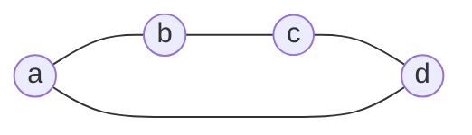

In [[Varying several couplings together|joint variations of couplings]], mixed coefficients are expressed by Gram determinants of several affine vectors. Polyform algebra associates a single formal object with such a system of vectors and allows operations on it before a numerical metric is specified.

The construction is based on exterior algebra. Forms and their product are introduced by separate definitions, which require no inner product. The connection with the resistance metric is discussed at the end of this note and developed in [[Metric of Higher-Grade Objects]].

## Points and affine vectors

Let $V$ be a real vector space with a **linearly independent** basis $a_1,\ldots,a_n$. The basis elements represent vertices. The sum of the coefficients is called the affine weight and is denoted by $\varepsilon$:

$$
\varepsilon\left(\sum_i x_i a_i\right)=\sum_i x_i
$$

An object of the space is an arbitrary structure of grade one. Affine weight distinguishes elements from affine vectors. Below, “element” has the specialized meaning of weight $1$; ordinary phrases such as “matrix element” carry no such restriction.

> [!info] Elements and vectors
> **Definition.** A combination $x=\sum_i x_i a_i$ is an element if $\sum_i x_i=1$, and an affine vector if $\sum_i x_i=0$.
>
> Denote the space of affine vectors by
>
> $$
> W=\ker\varepsilon=\left\{\sum_i u_i a_i:\sum_i u_i=0\right\},\qquad \dim W=n-1
> $$

For example, $(a+b)/2$ is an element, while $a+b-2c$ is an affine vector. The object $a+b$ has weight $2$ and is neither an element nor a vector. The difference of two elements belongs to $W$. A graph vertex, or node, is an element; the graph term imposes no norm condition.

A **point**, or **local element**, is an element of zero norm once a metric on objects is specified. The algebra here is constructed without that metric, so locality is not assumed. In the [[The Null Vector, Isotropic Representation, and the Boundary|isotropic model]], vertices can be chosen to be points; an arbitrary affine combination of these points remains an element but need not have zero norm.

> [!info] Two-point and multipoint vectors
> **Definition.** For an ordered pair of basis vertices, the **vertex-pair vector** is defined by
>
> $$
> a_{ij}=a_j-a_i
> $$
>
> Its direction is specified by the vertex order: $a_{ji}=-a_{ij}$. An edge need not be present for the vector to be defined.
>
> If the endpoints are points, their difference is a **two-point vector**. In a local basis, an affine-vector expression with three or more nonzero coefficients is **multipoint**. Without locality, refer to the number of vertices involved.

For example,

$$
u=a_1+a_2-2a_3=(a_1-a_3)+(a_2-a_3)=a_{31}+a_{32}
$$

This is one vector expressed using three vertices as a sum of two vertex-pair vectors. The vertex count refers to the chosen basis. For any element $p$, the object $q=p+u$ also has weight $1$, so $u=q-p$ is a difference of two elements. Their locality does not follow.

The elements $a_i$ must be distinguished from numerical values $x_i$ assigned to them. The difference $a_j-a_i$ is a vector, whereas $x_j-x_i$ is a number. The assignment extends linearly: the object $\sum_i u_i a_i$ is assigned the number $\sum_i u_i x_i$. For example, the vector $u$ above is assigned $x_1+x_2-2x_3$. This numerical value depends on the assigned $x_i$, whereas $u$ itself is specified by its coefficients at the $a_i$.

The connection with the [[Effective Resistance and Graph Geometry#Euclidean geometry of the graph|centered vertex vectors]] can be written explicitly. In the formal space, introduce the centroid and differences

$$
h=\frac1n\sum_i a_i,\qquad p_i=a_i-h\in W
$$

Then $\sum_i p_i=0$, although the original $a_i$ remain linearly independent. For a connected graph, their inner products in the resistance metric are $p_i\cdot p_j=\mathrm{Gr}_{ij}$. The zero-sum relation concerns $p_i$, not the formal vertices $a_i$. Differences are preserved: $p_j-p_i=a_j-a_i$.

## The exterior product and grade

An area requires two vectors and a volume requires three. The exterior product lets us treat them as a single oriented object. For example, $uv$ corresponds to the oriented parallelogram spanned by $u,v$: exchanging the vectors reverses its orientation, while linear dependence makes the object zero. At this stage it is an algebraic object; a numerical area will require a metric.

The exterior product $\wedge$ is bilinear and associative. For elements $x,y\in V$, it satisfies

$$
x\wedge y=-y\wedge x,\qquad x\wedge x=0
$$

> [!info] Exterior objects
> **Definition.** Linear combinations of products $x_1\wedge\cdots\wedge x_k$ form the space $\Lambda^kV$. Its elements are called exterior structures of grade $k$.
>
> The scalar $1$ has grade $0$ and is the identity for the exterior product. The product of structures of grades $k$ and $m$ has grade $k+m$ if it is nonzero.

From this point on, exterior products are written without $\wedge$: $xy$ means $x\wedge y$. A self-product $X\wedge X$ retains the explicit symbol to distinguish it from the numerical norm $X^2$.

An exterior structure of one fixed grade is called **homogeneous**. For homogeneous $X,Y$ of grades $k,m$,

$$
X Y=(-1)^{km}Y X
$$

The exterior product of $k$ objects of grade one vanishes if and only if those elements are linearly dependent.

For example, bilinearity gives $(u+v)v=uv+vv=uv$: adding the second vector to the first leaves the exterior product unchanged. Geometrically, this shear preserves the oriented area of the parallelogram.

An oriented simplex is written as

$$
[a_1\ldots a_k]=a_1 \cdots a_k
$$

Its grade equals the number of vertices. Thus $[abc]$ has grade $3$, although a geometric triangle is two-dimensional. Interchanging two vertices changes the sign; repeating a vertex gives zero. A general exterior structure may be a linear combination of simplices and need not be a single exterior product.

> [!info] The exterior product and grade
> **Definition.** An exterior element is decomposable (also called simple) if it can be expressed as a single exterior product of objects of grade one.

## The boundary operator

The boundary operator sends an oriented simplex to the sum of its oriented faces. For a segment, this is the difference of its endpoints; for a triangle, it is the three sides with consistent signs:

$$
\partial[ab]=b-a,\qquad
\partial[abc]=[bc]-[ac]+[ab]=[ab]+[bc]+[ca]
$$

The arrows specify the orientations of the **sides** $[ab]$, $[bc]$, $[ca]$, which are structures of grade two. Their sum is the triangle boundary. Applying the boundary once more gives the sum of endpoint differences, $(b-a)+(c-b)+(a-c)=0$. This illustrates the rule that the boundary of a boundary is zero.

> [!info] The boundary
> **Definition.** The linear boundary operator is specified by
>
> $$
> \partial1=0,\qquad \partial a_i=1
> $$
>
> and, for $k\ge1$, by the rule
>
> $$
> \partial[a_1\ldots a_k]=\sum_{i=1}^k(-1)^{i-1}[a_1\ldots\widehat{a_i}\ldots a_k]
> \tag{1}
> $$
>
> The hat over $a_i$ indicates omission of that element; the empty exterior product is $1$. A nonzero boundary has grade one less than the original object.

The equality $\partial a_i=1$ is part of the definition: its right-hand side is a scalar of grade $0$, not an additional vertex. By linearity,

$$
\partial\left(\sum_i x_i a_i\right)=\sum_i x_i
$$

Thus the boundary of an affine vector is zero, and the boundary of an element is one.

We denote simplex boundaries by parentheses:

$$
(ab)=\partial[ab]=b-a,\qquad
(abc)=\partial[abc]=[bc]-[ac]+[ab]
$$

In particular, $(a_i a_j)=a_{ij}$. The abbreviated index notation $(ij)$ also means $a_{ij}$. The simplex $[abc]$ and its boundary $(abc)$ are distinct structures of grades $3$ and $2$.

| Object | Simplex and its grade | Boundary | Boundary grade |
|---|---|---|---:|
| Element | $a$, grade $1$ | $1$ | 0 |
| Oriented segment | $[ab]$, grade $2$ | $(ab)=b-a$ | 1 |
| Oriented triangle | $[abc]$, grade $3$ | $(abc)=[bc]-[ac]+[ab]$ | 2 |
| Oriented tetrahedron | $[abcd]$, grade $4$ | $(abcd)=[bcd]-[acd]+[abd]-[abc]$ | 3 |

A nonzero boundary has grade one less than the original simplex. Its grade equals the geometric dimension of a nondegenerate simplex.

> [!info] Properties of the boundary
> **Lemma.** For homogeneous $X$ of grade $k$,
>
> $$
> \partial^2=0,\qquad
> \partial(XY)=(\partial X)Y+(-1)^kX(\partial Y)
> \tag{2}
> $$

For the first equality, each deletion of two vertices in (1) occurs twice with opposite signs. For the second, the terms separate into deletions from $X$ and from $Y$; a deletion from $Y$ is preceded by the $k$ factors of $X$. Both properties then follow by linearity.

## Boundaries and exterior powers of affine vectors

> [!info] The space of boundaries
> **Lemma.** At each grade $k$, the space of boundaries equals $\Lambda^kW$. Equivalently, for $B\in\Lambda^kV$, the following conditions are equivalent: $B$ is a boundary, $\partial B=0$, and $B\in\Lambda^kW$.

> [!note]- Proof
> **Proof.** Fix the basis vertex $a_1$. It complements $W$ in $V$, so every structure $B$ of grade $k\ge1$ has a unique representation
>
> $$
> B=D+a_1 C,\qquad
> D\in\Lambda^kW,\quad C\in\Lambda^{k-1}W
> $$
>
> Every vector in $W$ has zero boundary. By (2), $\partial D=\partial C=0$ and $\partial B=C$. Hence $\partial B=0$ is equivalent to $B\in\Lambda^kW$.
>
> For such a $B$, we have $\partial(a_1 B)=B$, so $B$ is a boundary. Conversely, a boundary satisfies $\partial B=0$ because $\partial^2=0$. For $k=0$, every scalar $s$ equals $\partial(sa_1)$, completing the proof. $\square$

Thus boundaries form a subalgebra of the exterior algebra: a product of boundaries is again a boundary. Nonzero boundaries have grades from $0$ to $n-1$. This bound follows from $\dim W=n-1$.

## Products of simplex boundaries

For base vertices $p,a_1,\ldots,a_r$, formula (1) gives

$$
(pa_1\ldots a_r)=(a_1-p) \cdots (a_r-p)
\tag{3}
$$

Consider the boundaries of two simplices on base vertices, each containing at least two vertices. If their only common vertex $p$ is placed first in both lists, then (3) gives

$$
(pa_1\ldots a_r) (pb_1\ldots b_s)=(pa_1\ldots a_r b_1\ldots b_s)
$$

Other vertex orders introduce the signs of the corresponding permutations. If there are at least two common vertices, the product is zero: choosing one common vertex as $p$, both products in (3) contain the difference between the second common vertex and $p$. If the vertex sets are disjoint, the product is nonzero and remains a product of two boundaries.

These rules apply specifically to boundaries of simplices on base vertices. For arbitrary linear combinations, the product is computed by bilinearity, rather than from the list of vertices appearing in the expression.

> [!example] Products of boundaries
>
> $$
> (ab) (bc)=(b-a) (c-b)=[bc]-[ac]+[ab]=(abc)
> $$
>
> $$
> (abc) (bc)=0,\qquad
> (ab) (cd)=[bd]-[bc]-[ad]+[ac]
> $$

A forest is a graph without cycles; each of its components is a tree or an isolated vertex. In a product over edges, an isolated vertex contributes the empty product, equal to $1$.

> [!info] Products of edge vectors
> **Theorem.** The exterior product of the vectors of selected edges is nonzero if and only if those edges form a forest. For a tree on vertices $p_1,\ldots,p_s$, the product equals $\pm(p_1\ldots p_s)$. For a forest, it is the product of the boundaries of its components, up to an orientation sign.

> [!note]- Proof
> **Proof.** The edge vectors of a cycle are linearly dependent: after their directions are aligned around the cycle, their sum is zero. Thus a cycle makes the entire product vanish, even in the presence of other components.
>
> In a forest, the edge vectors are independent. In any linear dependence, the coefficient of a leaf vertex forces the coefficient of its only incident edge to be zero. Successive removal of leaves makes all coefficients of the dependence zero.
>
> For a tree, applying the rule for merging at one common vertex as leaves are successively attached gives the boundary of the whole tree, up to sign. For a forest, this is done in each component. An isolated vertex contributes the factor $\partial a_i=1$. $\square$

## Forms: bilinearity and basic operations

Reversing orientation changes the sign of an exterior structure. For an unoriented edge, this sign should not affect the result. We therefore introduce a quadratic form $[X]^2$ with $[-X]^2=[X]^2$. To expand $[X+Y]^2$ and multiply forms, we will also need mixed symbols $[X,Y]$. We define their bilinearity first, then obtain the quadratic form by taking equal arguments.

> [!info] Forms of a fixed grade
> **Definition.** For $X,Y\in\Lambda^kV$, introduce formal symbols $[X,Y]$. They generate the vector space of forms of grade $k$, subject only to the bilinearity relations
>
> $$
> [\alpha X+\beta Z,Y]=\alpha[X,Y]+\beta[Z,Y]
> $$
>
> $$
> [X,\alpha Y+\beta Z]=\alpha[X,Y]+\beta[X,Z]
> $$
>
> In each formula, all arguments have grade $k$, and $\alpha,\beta\in\mathbb R$. Symmetry $[X,Y]=[Y,X]$ is not assumed.

This definition specifies a formal object, rather than a number or a scalar-valued bilinear function on $V$. If $E_1,\ldots,E_N$ form a basis of $\Lambda^kV$, then the forms $[E_i,E_j]$ form a basis of the space of forms of that grade.

> [!info] Quadratic forms, transposition, and polar forms
> **Definition.** For arguments of the same grade, set
>
> $$
> [X]^2=[X,X],\qquad [X,Y]^{\mathsf T}=[Y,X]
> $$
>
> $$
> \{X,Y\}=[X,Y]+[Y,X]
> $$
>
> Transposition extends to linear combinations. The polar form is defined without a factor of $1/2$.

Bilinearity gives

$$
[X+Y]^2=[X]^2+\{X,Y\}+[Y]^2
$$

For example, $[a]^2$ is a form of an element, $[(ab)]^2$ is a form of an affine vector, and $[(abc)]^2$ is a form of a boundary of grade two. Reversing the orientation of the argument leaves the quadratic form unchanged: $[-X]^2=[X]^2$.

The notation $[X]^2$ denotes a form. It means neither the exterior product $X\wedge X$ nor a numerical norm. Numerical metric quantities will be defined separately.

## Polyforms and the product of forms

> [!info] A polyform
> **Definition.** A polyform is a finite linear combination of forms, possibly of different grades. If all terms have grade $k$, the polyform is homogeneous. A general polyform has the decomposition
>
> $$
> P=P_0+P_1+\cdots+P_n
> $$
>
> where $P_k$ is its grade component.

> [!info] The product of forms
> **Definition.** For forms of grades $k$ and $m$, set
>
> $$
> [X,Y][A,B]=[XA,YB]
> \tag{4}
> $$
>
> The product extends by bilinearity to polyforms. Its identity is the unit form $e=[1,1]$ of grade $0$.

On the right, $XA$ and $YB$ are exterior products of objects. On the left, the forms use the product defined through them. These are different operations; the type of the factors determines which one applies.

The scalar $1$ and the form $e$ belong to different levels of the construction. By bilinearity, $[s,t]=st\,e$ for scalars $s,t$, and $eF=Fe=F$ for every form.

> [!info] Properties of multiplication
> **Theorem.** The product of polyforms is associative, distributive, and commutative. Grades add for nonzero products of homogeneous forms.

> [!note]- Proof
> **Proof.** Bilinearity of the exterior product ensures that (4) is consistent with the relations defining forms. Associativity and distributivity are inherited from the operations on the arguments.
>
> Interchanging forms of grades $k$ and $m$ introduces a sign $(-1)^{km}$ in each argument. By bilinearity, the two signs multiply:
>
> $$
> [X A,Y B]=(-1)^{2km}[A X,B Y]=[A X,B Y]
> $$
>
> This proves commutativity. Addition of grades follows from (4). $\square$

For quadratic forms,

$$
[X]^2[A]^2=[X A]^2
\tag{5}
$$

> [!example] From two vectors to a boundary form
> First multiply the exterior arguments, then take the form of the result:
>
> $$
> (ab)(bc)=(abc),\qquad
> [(ab)]^2[(bc)]^2=[(abc)]^2
> $$
>
> Interchanging the vectors gives $(bc)(ab)=-(abc)$, but $[-(abc)]^2=[(abc)]^2$. Thus the product of forms does not depend on this orientation sign. The right-hand side is still a formal form, not an area or its square; a numerical value appears only after a metric is chosen.

## Nilpotence and forms on boundaries

For any $v\in V$, set $q_v=[v]^2$. Formula (5) gives

$$
q_v^2=[v\wedge v]^2=0
$$

For a nonzero object $v\in V$, the form $q_v$ itself is nonzero. The identity states that its product with itself is zero.

More generally,

$$
[v_1]^2\cdots[v_r]^2=[v_1 \cdots v_r]^2
\tag{6}
$$

The product (6) vanishes if and only if the objects $v_1,\ldots,v_r\in V$ are linearly dependent. In particular, the product of the forms of the edges of a cycle is zero.

The linear span of forms $[X,Y]$ with $X,Y\in\Lambda^kW$, over all $k=0,\ldots,n-1$, forms the subalgebra of forms on boundaries. It contains $e$, is closed under multiplication, and has grades from $0$ to $n-1$. Hence every polyform $P$ in this subalgebra with $P_0=0$ satisfies $P^n=0$: each term in a product of $n$ factors would have grade at least $n$.

This does not mean that every form of positive grade has square zero. For example, for independent affine vectors $u,v$,

$$
\bigl([u]^2+[v]^2\bigr)^2=2[u v]^2\ne0
$$

## The four-point identity

The familiar name is retained. The algebraic identity holds for any four elements and requires no zero-norm condition.

> [!info] The polar-form identity
> **Lemma.** For any four elements $a_i,a_j,a_k,a_l$ and their affine differences $a_{ij}=a_j-a_i$, the following identity of forms holds:
>
> $$
> \{a_{ij},a_{kl}\}+\{a_{jk},a_{il}\}+\{a_{ik},a_{lj}\}=0
> \tag{7}
> $$
>
> Coincident elements are allowed. No choice of metric is required.

> [!note]- Proof
> **Proof.** Set $u=a_{ij}$, $v=a_{jk}$, $w=a_{kl}$. Then
>
> $$
> a_{il}=u+v+w,\qquad a_{ik}=u+v,\qquad a_{lj}=-v-w
> $$
>
> The left-hand side of (7) is
>
> $$
> \{u,w\}+\{v,u+v+w\}-\{u+v,v+w\}
> $$
>
> By definition, the polar form is bilinear and symmetric, so
>
> $$
> \{v,u+v+w\}=\{u,v\}+\{v,v\}+\{v,w\}
> $$
>
> $$
> \{u+v,v+w\}=\{u,v\}+\{u,w\}+\{v,v\}+\{v,w\}
> $$
>
> Substitution cancels all terms. $\square$

Identity (7) is structural: it expresses a linear dependence among polar forms of differences of four elements. Its scalar version was considered in [[Inner Product of Graph Vectors#The four-point identity|the note on inner products]]. The passage to that version by metric evaluation is described below.

## Metric evaluation

Let the space of affine vectors $W$ carry a positive definite inner product, such as the resistance metric of a connected graph. Assign numerical values to forms of grade one:

$$
[u,v]\longmapsto u\cdot v,\qquad
[u]^2\longmapsto u\cdot u,\qquad
\{u,v\}\longmapsto 2u\cdot v
$$

Evaluation is linear: the value of a sum of forms is the sum of their values with the same coefficients. Each term in (7) therefore gives twice an inner product. Dividing by $2$ yields

$$
a_{ij}\cdot a_{kl}+a_{jk}\cdot a_{il}+a_{ik}\cdot a_{lj}=0
$$

For higher grades, we still need to define an inner product of exterior structures themselves. This is done in [[Metric of Higher-Grade Objects]]. The main rule is already familiar from the [[From Lengths to Areas and Volumes|Gram formula]]: the quadratic form of a vector product receives the value

$$
[u_1\cdots u_k]^2\longmapsto\det(u_i\cdot u_j)_{i,j=1}^k
$$

Thus evaluating a product of forms generally differs from multiplying their separate values. For $[u]^2[v]^2=[uv]^2$, the result is $\|u\|^2\|v\|^2-(u\cdot v)^2$, whereas the product of the separate values is $\|u\|^2\|v\|^2$. The missing term accounts for the angle between the vectors.

A metric on $W$ does not automatically assign a norm to a formal element or an arbitrary simplex in $V$. The higher-grade note defines the metric specifically on boundaries; a form $[X,Y]$ on boundaries then receives the value $X\cdot Y$.

## The polyform representation of the Laplacian

For an undirected graph, set

$$
L=\sum_{i<j}c_{ij}[a_{ij}]^2=\sum_{i<j}c_{ij}[(ij)]^2
\tag{8}
$$

This is a homogeneous polyform of grade one on boundaries. When the matrix representation is needed at the same time, we denote it by $\mathbf L$. The coefficient matrix of the form (8) in the basis forms $[a_i,a_j]$ is the usual Laplacian, since

$$
[a_j-a_i]^2=[a_i]^2+[a_j]^2-\{a_i,a_j\}
$$

To obtain the electrical quadratic form, extend the potential values $\varphi_i$ to a linear functional on $V$ by setting $\varphi(a_i)=\varphi_i$. The substitution $[u,v]\mapsto\varphi(u)\varphi(v)$ in the grade-one form $L$ gives

$$
L\longmapsto\sum_{i<j}c_{ij}(\varphi_j-\varphi_i)^2
=\boldsymbol\varphi^{\mathsf T}\mathbf L\boldsymbol\varphi
$$

Here $\boldsymbol\varphi=(\varphi_1,\ldots,\varphi_n)^{\mathsf T}$ denotes the column of values of the functional at the vertices. This substitution differs from the metric evaluation $[u,v]\mapsto u\cdot v$ and connects the formal Laplacian with the [[Laplacian - graph, electrical network and quadratic form#Quadratic form and network power|electrical-network quadratic form]].

However, multiplication of forms by (4) differs from matrix multiplication, so $L^2$ and $\mathbf L^2$ denote different objects.

Consider the cycle $C_4$ with unit conductances.

> [!example] The matrix and polyform of the cycle
> In vertex order $a,b,c,d$, the matrix Laplacian and the polyform are
>
> $$
> \mathbf L=\begin{pmatrix}
> 2&-1&0&-1\\
> -1&2&-1&0\\
> 0&-1&2&-1\\
> -1&0&-1&2
> \end{pmatrix}
> $$
>
> $$
> L=[(ab)]^2+[(bc)]^2+[(cd)]^2+[(da)]^2
> $$
>
> Two adjacent couplings give $[(ab)]^2[(bc)]^2=[(abc)]^2$, while two nonadjacent couplings give $[(ab)]^2[(cd)]^2=[(ab)(cd)]^2$.
>
> Three consecutive couplings give
>
> $$
> [(ab)]^2[(bc)]^2[(cd)]^2=[(abcd)]^2
> $$
>
> The product of all four forms is zero because $(ab)+(bc)+(cd)+(da)=0$.

> [!example] The highest nonzero power for $C_4$
> In $L^3$, only sets of three distinct edges survive. There are four such sets; each is a spanning tree and gives the form $[(abcd)]^2$. Each set occurs in $3!$ orders, so
>
> $$
> L^3=24[(abcd)]^2,\qquad L^4=0
> $$

The [[en/PythonExamples/Example - Path P5 and Cycle C4 Exponentials#Multiplication: merging, separate components, and vanishing|symbolic Python example]] shows boundaries merging, products of separate components, and a vanishing cycle product.

## Further reading

The note [[Metric of Higher-Grade Objects]] defines inner products of boundaries of the same grade and their numerical norms. The note [[Laplacian Exponential]] combines the powers of $L$ into a single polyform; the grade bound proved here makes its exponential series finite.

In [[Further Reading for the PMG Introductory Series|the reading recommendations]], sources [7] and [8] cover exterior algebra, bilinearity, and Gram determinants. The definition of the formal symbols $[X,Y]$ and their product (4) specifies the polyform algebra used in this series.
