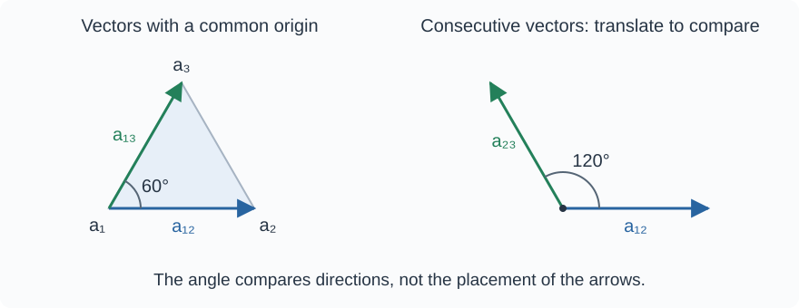

In [[Effective Resistance and Graph Geometry]], resistances determined the squared distances between vertices. We now compute inner products of two-point vectors and use them to find angles. In an electrical network, the same inner product can be measured as the potential difference across one vertex pair when a unit current passes through another pair.

We consider a finite connected undirected graph without loops and with positive coupling strengths on its edges. Its Laplacian is denoted by $L$ and its Green matrix by $\mathrm{Gr}=L^+$. The two-point vector $a_{ij}=a_j-a_i$ has coefficient $-1$ at $a_i$, coefficient $1$ at $a_j$, and zero coefficients at the remaining vertices.

To record these coefficients, let $\mathbf e_i$ denote a list of $n$ numbers with a one in position $i$ and zeros elsewhere. The coefficient list of $a_{ij}$ is then $\mathbf e_{ij}=\mathbf e_j-\mathbf e_i$. For three vertices, for example, $\mathbf e_{13}=(-1,0,1)$. In matrix products we write these lists as columns; $\mathsf T$ transposes a column into a row.

## Inner product through the Green matrix

Let $h=(a_1+\cdots+a_n)/n$ be the centroid and $p_i=a_i-h$ the vector from it to vertex $a_i$. By the definition of the graph metric, $p_i\cdot p_j=\mathrm{Gr}_{ij}$, so

$$
a_{ij}\cdot a_{kl}=(p_j-p_i)\cdot(p_l-p_k)=\mathrm{Gr}_{jl}-\mathrm{Gr}_{jk}-\mathrm{Gr}_{il}+\mathrm{Gr}_{ik}
$$

> [!info] Inner product
> **Lemma.** For any two pairs of vertices,
>
> $$
> a_{ij}\cdot a_{kl}=\mathbf e_{ij}^{\mathsf T}\mathrm{Gr}\mathbf e_{kl}
> \tag{1}
> $$
>
> This number is the inner product of two two-point vectors in the graph metric.

Some indices may coincide. In particular, when the two pairs coincide, (1) gives

$$
a_{ij}\cdot a_{ij}=\|a_{ij}\|^2=R_{ij}
$$

For arbitrary affine vectors

$$
u=\sum_i u_i a_i,\qquad v=\sum_i v_i a_i,\qquad
\sum_i u_i=\sum_i v_i=0
$$

denote their coefficient columns by $\mathbf u=(u_i)$ and $\mathbf v=(v_i)$. Bilinearity and the identity $p_i\cdot p_j=\mathrm{Gr}_{ij}$ give

$$
u\cdot v=\sum_{i,j}u_i\mathrm{Gr}_{ij}v_j=\mathbf u^{\mathsf T}\mathrm{Gr}\mathbf v
$$

## The four-resistance formula

Effective resistances are expressed through the Green matrix as

$$
R_{pq}=\mathrm{Gr}_{pp}+\mathrm{Gr}_{qq}-2\mathrm{Gr}_{pq}
$$

In the combination $R_{il}+R_{jk}-R_{ik}-R_{jl}$, the diagonal entries cancel, giving

$$
R_{il}+R_{jk}-R_{ik}-R_{jl}=2(\mathrm{Gr}_{ik}+\mathrm{Gr}_{jl}-\mathrm{Gr}_{il}-\mathrm{Gr}_{jk})
$$

> [!info] Polarization of resistances
> **Lemma.** The inner product can be recovered from four effective resistances:
>
> $$
> a_{ij}\cdot a_{kl}=\frac12(R_{il}+R_{jk}-R_{ik}-R_{jl})
> \tag{2}
> $$

This is the standard polarization identity for squared Euclidean distances. In an arbitrary coordinate system, the diagonal terms are the norms of the position vectors. Each appears with opposite signs and cancels. The result is therefore independent of the choice of origin, although the norms of the position vectors themselves change under translation.

For general affine vectors whose coefficient sums are zero, the same formula for $R_{ij}$ gives

$$
u\cdot v=-\frac12\mathbf u^{\mathsf T}R\mathbf v
$$

Indeed, in the sum $\sum_{i,j}u_iR_{ij}v_j$, the terms involving $\mathrm{Gr}_{ii}$ and $\mathrm{Gr}_{jj}$ vanish because the coefficient sums are zero, leaving $-2\sum_{i,j}u_i\mathrm{Gr}_{ij}v_j$.

> [!note] Orientation
> Reversing one vector changes the sign of the inner product:
>
> $$
> a_{ji}\cdot a_{kl}=-a_{ij}\cdot a_{kl}
> $$
>
> Reversing both vectors preserves its value. The resistance $R_{ij}$ is independent of orientation.

## Electrical interpretation

Inject a unit current at vertex $l$ and withdraw it at vertex $k$. The external-current column is then $J=\mathbf e_{kl}$. The centered solution of $L\varphi=J$ is

$$
\varphi=\mathrm{Gr}\mathbf e_{kl}
$$

The potential difference across the measurement pair is

$$
\varphi_j-\varphi_i=\mathbf e_{ij}^{\mathsf T}\varphi=\mathbf e_{ij}^{\mathsf T}\mathrm{Gr}\mathbf e_{kl}
$$

> [!info] Measuring an inner product
> **Lemma.** For a unit current injected at $l$ and withdrawn at $k$,
>
> $$
> \varphi_j-\varphi_i=a_{ij}\cdot a_{kl}
> \tag{3}
> $$
>
> For a current of magnitude $I$ in the same direction, the right-hand side is multiplied by $I$.

Interchanging the injection and withdrawal vertices changes the sign of the current column. The difference $\varphi_j-\varphi_i$ also changes sign. Adding a common constant to all potentials does not affect the measurement.

## Reciprocity of measurements

Symmetry of the Green matrix in (1) gives

$$
a_{ij}\cdot a_{kl}=a_{kl}\cdot a_{ij}
$$

This is the reciprocity principle for a linear resistive network. The voltage $\varphi_j-\varphi_i$ produced by unit injection at $l$ and withdrawal at $k$ equals the voltage $\psi_l-\psi_k$ produced by unit injection at $j$ and withdrawal at $i$. Interchanging the current and measurement pairs preserves the result when their orientations are retained.

## The four-point identity

> [!info] Four-point identity
> **Lemma.** For any four points and their affine differences $a_{ij}=a_j-a_i$,
>
> $$
> a_{ij}\cdot a_{kl}+a_{jk}\cdot a_{il}+a_{ik}\cdot a_{lj}=0
> \tag{4}
> $$
>
> The points need not be distinct. The equality holds for any choice of inner product.

For graph vertices, the identity can be derived through effective resistances.

> [!note]- Proof
> **Proof.** By (2),
>
> $$
> 2a_{ij}\cdot a_{kl}=R_{il}+R_{jk}-R_{ik}-R_{jl}
> $$
>
> $$
> 2a_{jk}\cdot a_{il}=R_{jl}+R_{ik}-R_{ij}-R_{kl}
> $$
>
> $$
> 2a_{ik}\cdot a_{lj}=R_{ij}+R_{kl}-R_{il}-R_{jk}
> $$
>
> All resistance terms cancel upon addition. For arbitrary points, the same argument applies to the squared distances $R_{pq}=\|a_q-a_p\|^2$, since the polarization formula (2) remains valid. $\square$

Equality (4) follows from the bilinearity and symmetry of the inner product and the relations between differences of four points. It does not depend on the graph structure or on particular resistance values. In the note on [[Basic Objects and Operations of Polyform Algebra|polyform algebra]], it will be written as an equality of polar forms that holds before a metric is chosen.

By (3), the same relation holds for three electrical measurements with the corresponding current and measurement pairs. Each of the three values equals minus the sum of the other two.

## Angles and further reading

For nonzero vectors, that is, when $i\ne j$ and $k\ne l$, the angle $\theta$ between them is determined by

$$
\cos\theta=\frac{a_{ij}\cdot a_{kl}}{\sqrt{R_{ij}R_{kl}}}
$$

A positive inner product means $0\le\theta<90^\circ$, a zero inner product means orthogonality, and a negative inner product means $90^\circ<\theta\le180^\circ$. Electrically, the sign determines the sign of the measured potential difference for the chosen orientations of the pairs.

## Example: a triangle

Consider the complete graph $K_3$ with unit conductances on all edges.

> [!example] Resistances and inner products
> Between any pair of vertices, an edge of resistance $1$ is in parallel with a two-edge path of total resistance $2$. Hence
>
> $$
> R_{12}=R_{23}=R_{13}=\frac{1\cdot2}{1+2}=\frac23
> $$
>
> By (2),
>
> $$
> a_{12}\cdot a_{13}=\frac12(R_{13}+R_{21}-R_{11}-R_{23})=\frac13
> $$
>
> For the consecutively oriented vectors,
>
> $$
> a_{12}\cdot a_{23}=\frac12(R_{13}+R_{22}-R_{12}-R_{23})=-\frac13
> $$
>
> All three vectors have squared length $2/3$. Hence
>
> $$
> \cos\angle(a_{12},a_{13})=\frac{1/3}{2/3}=\frac12,\qquad
> \cos\angle(a_{12},a_{23})=\frac{-1/3}{2/3}=-\frac12
> $$
>
> The first angle is $60^\circ$ and the second is $120^\circ$. To compare vector directions, translate the vectors to a common origin. The angle between the consecutively directed vectors $a_{12}$ and $a_{23}$ therefore differs from the interior angle at vertex $a_2$.

> [!example] Independent calculation of potentials
> For this graph,
>
> $$
> L=\begin{pmatrix}
> 2&-1&-1\\
> -1&2&-1\\
> -1&-1&2
> \end{pmatrix}
> $$
>
> Inject a unit current at vertex $3$ and withdraw it at vertex $1$. The column $\varphi=(-1/3,0,1/3)^{\mathsf T}$ satisfies $L\varphi=(-1,0,1)^{\mathsf T}$ and $\sum_i\varphi_i=0$. Therefore,
>
> $$
> \varphi_2-\varphi_1=\frac13=a_{12}\cdot a_{13}
> $$
>
> For injection at $3$ and withdrawal at $2$, the centered potentials are $\psi=(0,-1/3,1/3)^{\mathsf T}$, giving
>
> $$
> \psi_2-\psi_1=-\frac13=a_{12}\cdot a_{23}
> $$
>
> Both measurements agree with (3), including the sign.

## Further reading

The next note, [[Laplacian, Green Matrix, and Effective Resistance Matrix]], collects the forward and inverse transformations between $L$, $\mathrm{Gr}$, and $R$. In [[From Lengths to Areas and Volumes]], inner products are used to compute Gram determinants, which express squared areas and volumes.

Sources on resistance geometry and electrical networks are listed in [[Further Reading for the PMG Introductory Series#Graphs, electric networks, and resistance geometry|the first section of the reading recommendations]].

