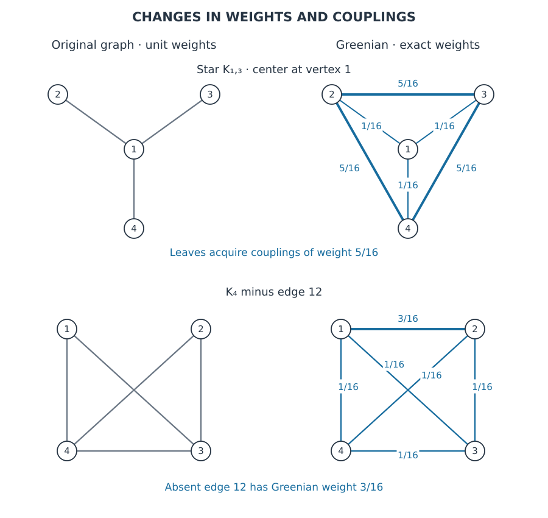
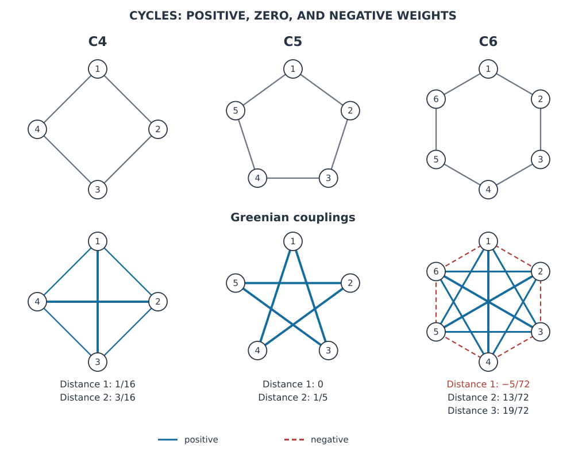
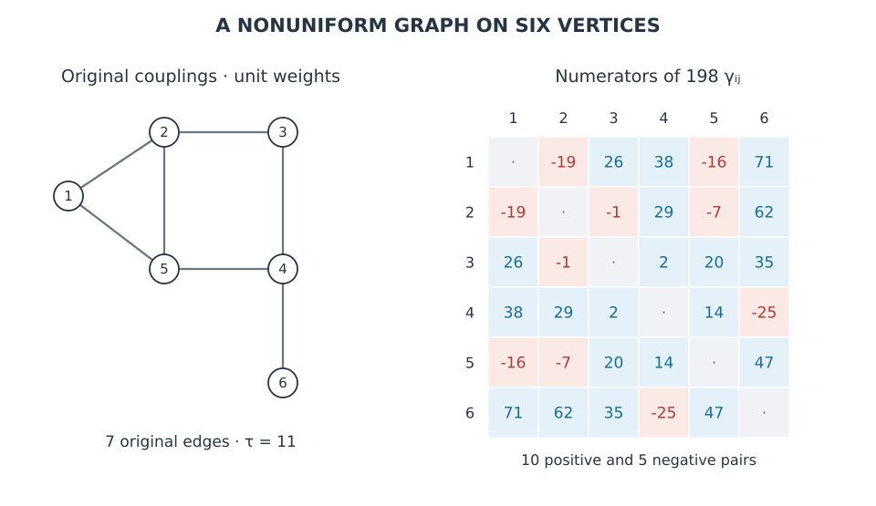
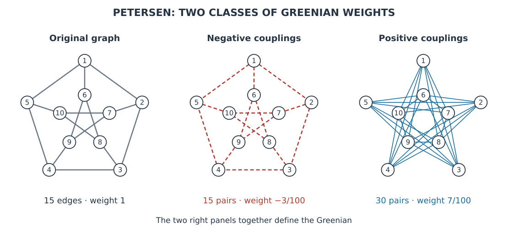

[[ru/Гриниан и дуальность полиформ/Экспоненты гринианов типовых графов|Русский]]

The Greenian exponential is constructed by the same vector-form multiplication rules as the Laplacian exponential. The coefficients change: the original conductances are replaced by $\gamma_{ij}=-\mathrm{Gr}_{ij}$. These values may be positive, negative, or zero; nonzero Greenian couplings need not coincide with edges of the original graph.

Below we calculate the coefficients and exponential grades for several families. On four vertices, every grade is written out in full. For larger examples, exact grouping by partitions specifies each form without listing every forest. The general construction and geometric meaning of the coefficients are presented in [[The Canonical Vector Representation of the Greenian]].

## Conventions and the general expansion method

The original graphs have $n\ge2$ vertices, are connected and undirected, and have positive conductances on existing edges. Unspecified weights equal $1$. The Green matrix is denoted by $\mathbf{Gr}=\mathbf L^+$.

The Greenian $\mathrm{Gr}$ is a grade-one vector form; its exponential is a boundary polyform. To compare complementary grades with $M=\exp L$, we use the dual expression $Q_1$: $\mathcal C(Q_1)=\mathrm{Gr}$, $D=\exp Q_1$, and $\mathcal C(D)=\exp(\mathrm{Gr})$. All coefficients in the tables and figures belong to the Greenian and are preserved by this transfer.

Below, $a_1,\ldots,a_n$ denote **dual elements** with the sole linear relation

$$
\sum_{i=1}^n a_i=0,\qquad a_{ij}=a_j-a_i=(a_i a_j)
$$

They are not the independent vertices of the original direct space. A boundary on dual elements is understood through differences:

$$
(a_{i_1}\ldots a_{i_s})
=(a_{i_2}-a_{i_1})\cdots(a_{i_s}-a_{i_1})
$$

A singleton block contributes the scalar $1$. No functional taking the value $1$ on every $a_i$ needs to be defined on the dual space.

We retain the basic normalization

$$
\boxed{
D=\exp Q_1=\prod_{i<j}\bigl(e+\gamma_{ij}[a_{ij}]^2\bigr),
\qquad Q_k=\frac{Q_1^k}{k!},\qquad Q_0=e
}
\tag{1}
$$

The product is polyform multiplication, not matrix multiplication. Coefficients are calculated using

$$
\gamma_{ij}
=\frac12\left(R_{ij}-\frac{R_i}{n}-\frac{R_j}{n}
+\frac1{n^2}\sum_\ell R_\ell\right),
\qquad R_i=\sum_jR_{ij}
$$

$$
\mathbf{Gr}
=\left(\mathbf L+\frac1n\mathbf1\mathbf1^{\mathsf T}\right)^{-1}
-\frac1n\mathbf1\mathbf1^{\mathsf T}
$$

Both transitions are justified in [[Laplacian, Green Matrix, and Effective Resistance Matrix]].

### Summing over partitions

For a block $B$, let $t_\gamma(B)$ be the total weight of all trees on $B$, with pair weights $\gamma_{ij}$. Set $t_\gamma(\{i\})=1$. A partition $\pi=B_1|\cdots|B_m$ corresponds to the form

$$
\Psi_\pi=[(B_1)\cdots(B_m)]^2
$$

Singleton blocks are omitted from short indices: on four vertices, $\Psi_{123}=[(a_1a_2a_3)]^2$ and $\Psi_{12|34}=[a_{12}a_{34}]^2$. Numbers in these indices designate specific vertices, not a numerical type.

> [!info] Summing over partitions
> **Corollary of the forest expansion.** For $0\le k\le n-1$,
>
> $$
> \boxed{
> Q_k=\sum_{\substack{\pi\text{ a partition of }\{1,\ldots,n\}\\
> \#\pi=n-k}}
> \left(\prod_{B\in\pi}t_\gamma(B)\right)\Psi_\pi
> }
> \tag{2}
> $$

> [!note]- Proof
> **Proof.** By the [[The Canonical Vector Representation of the Greenian#Signed forest grades|forest formula]], $Q_k$ contains forests with $k$ edges. Group them by their components. For a fixed partition, tree choices within blocks are independent, giving the product of $t_\gamma(B)$. All these forests have the same form $\Psi_\pi$. $\square$

Each $t_\gamma(B)$ is a cofactor of the Laplacian of the **induced system of Greenian couplings on $B$**. Its diagonal contains sums only over vertices in $B$. In general, this is not the principal submatrix $\mathbf{Gr}[B,B]$, which also retains couplings to vertices outside $B$.

In particular,

$$
t_\gamma(\{i,j,\ell\})
=\gamma_{ij}\gamma_{i\ell}
+\gamma_{ij}\gamma_{j\ell}
+\gamma_{i\ell}\gamma_{j\ell}
$$

Thus grade two consists of forms of triples and of two disjoint pairs:

$$
Q_2=\sum_{i<j<\ell}t_\gamma(\{i,j,\ell\})\Psi_{ij\ell}
+\sum_{\{ij,pq\}}\gamma_{ij}\gamma_{pq}\Psi_{ij|pq}
$$

The second sum counts each unordered pair of disjoint pairs exactly once.

### Checking the top grade

Write

$$
T^\vee=[a_1\cdots a_{n-1}]^2,\qquad
\Theta=[(a_1\ldots a_n)]^2=n^2T^\vee
$$

Then

$$
Q_{n-1}=\tau_\gamma\Theta=\frac1\tau T^\vee,
\qquad \tau_\gamma=\frac1{n^2\tau}
\tag{3}
$$

The proof and the distinction between the top forms appear in [[The Canonical Vector Representation of the Greenian#The spanning-tree sum and normalization of the top form]]. The factor $n^2$ is retained below.

## The complete graph

Let every edge of $K_n$ have conductance $c>0$. For $\mathbf J=\mathbf I-\mathbf1\mathbf1^{\mathsf T}/n$,

$$
\mathbf L=nc\mathbf J,\qquad
\mathbf{Gr}=\frac1{nc}\mathbf J,\qquad
\gamma_{ij}=\frac1{n^2c}\quad(i\ne j)
$$

> [!info] The complete graph
> **Corollary.** The entire Greenian exponential in its dual representation is
>
> $$
> \boxed{
> \begin{aligned}
> D_{K_n}&=\prod_{i<j}\left(e+\frac1{n^2c}[a_{ij}]^2\right)\\
> &=e+\sum_{k=1}^{n-1}\frac1{n^{k+1}c^k}
> \sum_{\#B=k+1}[(B)]^2
> \end{aligned}
> }
> \tag{4}
> $$
>
> The inner sum runs over vertex subsets of size $k+1$.

> [!note]- Proof
> **Proof.** As proved in [[Symmetric Polyforms of the Complete Graph]], the exponential of the sum of all vector forms with common coefficient $u$ has positive grade $u^kn^{k-1}\sum_{\#B=k+1}[(B)]^2$. This identity on differences is preserved upon passage to dual elements. Substitute $u=1/(n^2c)$. $\square$

If the forest expression (2) is retained, then for a block of size $s\ge2$,

$$
t_\gamma(B)=s^{s-2}(n^2c)^{-(s-1)}
$$

This uses [[Cayley's Theorem and Joining Prescribed Components|Cayley's formula]]. The forest and reduced symmetric expressions are equal as forms, but differ in the coefficients of individual partitions.

### All grades of the unit K4

$$
Q_1=\frac1{16}\sum_{i<j}[a_{ij}]^2
$$

$$
Q_2=\frac1{256}
\left(3\sum_{i<j<\ell}\Psi_{ij\ell}
+\Psi_{12|34}+\Psi_{13|24}+\Psi_{14|23}\right)
=\frac1{64}\sum_{i<j<\ell}\Psi_{ij\ell}
$$

$$
Q_3=\frac1{256}\Theta=\frac1{16}T^\vee,
\qquad D=e+Q_1+Q_2+Q_3
$$

Reducing $Q_2$ uses the tetrahedron identity. The coefficient sums of the two expressions differ, while the forms themselves are equal. The original spanning coefficient is $16$.

## The star

In the unit star $K_{1,n-1}$, vertex $a_1$ is the center and the others are leaves. Center-to-leaf resistances equal $1$; resistances between distinct leaves equal $2$. Hence

$$
R_1=n-1,\qquad R_i=2n-3\ (i>1),\qquad
\sum_iR_i=2(n-1)^2
$$

Substitution into the coefficient formula gives

$$
\boxed{
\gamma_{1i}=\frac1{n^2},\qquad
\gamma_{ij}=\frac{n+1}{n^2}\quad(1<i<j)
}
\tag{5}
$$

The Greenian coupling system is complete, and every coupling is positive. Set $p=1/n^2$, $q=(n+1)/n^2$. Then

$$
D=\prod_{i=2}^{n}(e+p[a_{1i}]^2)
\prod_{2\le i<j\le n}(e+q[a_{ij}]^2)
$$

### A formula for all grades

In (2), it suffices to substitute the following block coefficients:

$$
t_\gamma(B)=
\begin{cases}
1,&\#B=1\\
s^{s-2}q^{s-1},&1\notin B,\quad s=\#B\ge2\\
p(p+rq)^{r-1},&1\in B,\quad r=\#B-1\ge1
\end{cases}
$$

> [!note]- Proof
> **Proof.** A block consisting of leaves is a complete graph of weight $q$. For a block containing the center and $r$ leaves, delete the center's row and column from its Laplacian. The resulting matrix is $(p+rq)\mathbf I_r-q\mathbf1\mathbf1^{\mathsf T}$, with eigenvalues $p$ and $p+rq$, the latter of multiplicity $r-1$. Its determinant is the stated product. $\square$

At $r=n-1$, we have $p+rq=1$, so $\tau_\gamma=p=1/n^2$, in agreement with $\tau=1$.

### All grades of the star on four vertices

$$
Q_1=\frac1{16}
\left([a_{12}]^2+[a_{13}]^2+[a_{14}]^2
+5[a_{23}]^2+5[a_{24}]^2+5[a_{34}]^2\right)
$$

$$
\begin{aligned}
Q_2=\frac1{256}\bigl(&11\Psi_{123}+11\Psi_{124}+11\Psi_{134}
+75\Psi_{234}+{}\\
&+5\Psi_{12|34}+5\Psi_{13|24}+5\Psi_{14|23}\bigr)
\end{aligned}
$$

$$
Q_3=\frac1{16}\Theta=T^\vee,
\qquad D=e+Q_1+Q_2+Q_3
$$

The coefficient $11/256$ is obtained as $(1\cdot1+1\cdot5+1\cdot5)/16^2$. The triple of leaves gives $3\cdot5^2/16^2=75/256$.

*Figure 1. Each row shows the original graph on the left and Greenian coefficients on the right. The star acquires couplings between leaves. For $K_4$ without edge $12$, the absent original coupling corresponds to the largest Greenian weight. All Greenian weights here are positive. The vertex layout is schematic and does not depict resistance geometry.*

## Cycles

Let $C_n$, $n\ge3$, have unit weights. Two vertices are separated by $s$ edges in one direction around the cycle. The two paths joining them have resistances $s$ and $n-s$; their parallel connection gives

$$
R(s)=\frac{s(n-s)}n,\qquad 1\le s\le n-1
$$

Every row of the resistance matrix has the same sum:

$$
R_i=\sum_{s=1}^{n-1}\frac{s(n-s)}n=\frac{n^2-1}{6}
$$

Therefore

$$
\boxed{
\gamma(s)=\frac{s(n-s)}{2n}-\frac{n^2-1}{12n}
}
\tag{6}
$$

The formula is symmetric under $s\leftrightarrow n-s$, so the shortest distance along the cycle may be used. The sign is determined by comparing $6s(n-s)$ with $n^2-1$.

All grades are specified by formula (2) with these weights, and the factorization is

$$
D_{C_n}=\prod_{i<j}\bigl(e+\gamma(s_{ij})[a_{ij}]^2\bigr)
$$

Since $\tau(C_n)=n$, the top grade is

$$
Q_{n-1}=\frac1{n^3}\Theta=\frac1nT^\vee
$$

### All grades of C4

On edges $12,23,34,14$, the coefficient is $1/16$; on diagonals $13,24$, it is $3/16$:

$$
Q_1=\frac1{16}
\left([a_{12}]^2+[a_{23}]^2+[a_{34}]^2+[a_{14}]^2
+3[a_{13}]^2+3[a_{24}]^2\right)
$$

$$
Q_2=\frac1{256}
\left(7\sum_{i<j<\ell}\Psi_{ij\ell}
+\Psi_{12|34}+9\Psi_{13|24}+\Psi_{14|23}\right)
$$

$$
Q_3=\frac1{64}\Theta=\frac14T^\vee,
\qquad D=e+Q_1+Q_2+Q_3
$$

### The five-cycle: the Greenian coupling system is again a cycle

For $C_5$,

$$
\gamma(1)=0,\qquad \gamma(2)=\frac15
$$

The nonzero Greenian couplings form a cycle with vertex order $1,3,5,2,4,1$. Denote its edge set by $E'$. Then

$$
D_{C_5}=\prod_{ij\in E'}\left(e+\frac15[a_{ij}]^2\right)
$$

All grades have a uniform expression:

$$
Q_k=\frac1{5^k}
\sum_{\substack{S\subseteq E'\\\#S=k}}
\left[\prod_{ij\in S}a_{ij}\right]^2
\quad(0\le k\le4)
$$

Every proper subset of the five-cycle's edges is a forest. Grades $0,1,2,3,4$ have $1,5,10,10,5$ forest terms, respectively. In grade four, all five forms coincide:

$$
Q_4=\frac5{5^4}\Theta=\frac1{125}\Theta=\frac15T^\vee
$$

The agreement in graph shape after relabeling vertices and rescaling weights is specific to $C_5$, not to arbitrary cycles.

### The six-cycle: negative couplings

For $C_6$,

$$
\gamma(1)=-\frac5{72},\qquad
\gamma(2)=\frac{13}{72},\qquad
\gamma(3)=\frac{19}{72}
$$

There are six pairs at distance one, six at distance two, and three at distance three. Therefore

$$
D_{C_6}
=\prod_{s_{ij}=1}\left(e-\frac5{72}[a_{ij}]^2\right)
\prod_{s_{ij}=2}\left(e+\frac{13}{72}[a_{ij}]^2\right)
\prod_{s_{ij}=3}\left(e+\frac{19}{72}[a_{ij}]^2\right)
$$

For example, the consecutive triple $123$ gives

$$
t_\gamma(\{1,2,3\})
=\frac{25-65-65}{72^2}
=-\frac{35}{1728}
$$

Not only individual coupling weights but also coefficients of combined grade-two boundary forms may be negative. The top grade is positive:

$$
Q_5=\frac1{216}\Theta=\frac16T^\vee
$$

*Figure 2. The upper row shows the original cycles; the lower row shows Greenian couplings. Solid blue lines denote positive weights, dashed red lines negative weights. Zero couplings are omitted. All six pairs are positive for $C_4$; only diagonals remain for $C_5$; every original edge has negative weight for $C_6$. Within each panel, line width increases with absolute weight.*

## The complete graph minus one edge

Remove edge $12$ from the unit $K_4$. Let $\mathbf b$ be the coordinate column of the difference between vertices $1,2$. Then

$$
\mathbf L=4\mathbf J-\mathbf b\mathbf b^{\mathsf T},
\qquad \mathbf b^{\mathsf T}\mathbf b=2
$$

The Laplacian has eigenvalue $2$ along $\mathbf b$ and eigenvalue $4$ on its orthogonal complement in $\mathbf1^\perp$. Therefore

$$
\mathbf{Gr}=\frac14\mathbf J+\frac18\mathbf b\mathbf b^{\mathsf T}
$$

We obtain $\gamma_{12}=3/16$; the other five coefficients equal $1/16$:

$$
Q_1=\frac1{16}
\left(3[a_{12}]^2+[a_{13}]^2+[a_{14}]^2
+[a_{23}]^2+[a_{24}]^2+[a_{34}]^2\right)
$$

$$
\begin{aligned}
Q_2=\frac1{256}\bigl(&7\Psi_{123}+7\Psi_{124}
+3\Psi_{134}+3\Psi_{234}+{}\\
&+3\Psi_{12|34}+\Psi_{13|24}+\Psi_{14|23}\bigr)
\end{aligned}
$$

$$
Q_3=\frac1{128}\Theta=\frac18T^\vee,
\qquad D=e+Q_1+Q_2+Q_3
$$

The original Laplacian cofactor is $\tau=8$. The absent original edge corresponds to a positive Greenian coupling three times as large as the others. This is a result of this calculation, not a general rule for incomplete graphs.

## A path with arbitrary positive weights

For the path $a_1-a_2-a_3-a_4$ with conductances $p,q,r>0$, set

$$
u=\frac1p,\qquad v=\frac1q,\qquad w=\frac1r
$$

Pair resistances are sums of these resistances along the path. Substitution into the formula for $\gamma$ gives

| Pair | Greenian coefficient |
|---|---|
| $12$ | $(3u-4v-w)/16$ |
| $13$ | $(3u+4v-w)/16$ |
| $14$ | $(3u+4v+3w)/16$ |
| $23$ | $(-u+4v-w)/16$ |
| $24$ | $(-u+4v+3w)/16$ |
| $34$ | $(-u-4v+3w)/16$ |

The table specifies $Q_1=\sum_{i<j}\gamma_{ij}[a_{ij}]^2$ and the six exponential factors. For any $u,v,w>0$, the other grades are

$$
Q_0=e
$$

$$
\begin{aligned}
Q_2={}&\sum_{i<j<\ell}
(\gamma_{ij}\gamma_{i\ell}
+\gamma_{ij}\gamma_{j\ell}
+\gamma_{i\ell}\gamma_{j\ell})\Psi_{ij\ell}+{}\\
&+\gamma_{12}\gamma_{34}\Psi_{12|34}
+\gamma_{13}\gamma_{24}\Psi_{13|24}
+\gamma_{14}\gamma_{23}\Psi_{14|23}
\end{aligned}
$$

$$
Q_3=\frac{uvw}{16}\Theta=uvw\,T^\vee,
\qquad D=e+Q_1+Q_2+Q_3
$$

Signs may change as the positive original conductances vary continuously. For example, the sign of $\gamma_{12}$ is determined by the sign of $3u-4v-w$.

### An exact numerical example

For $(p,q,r)=(2,3,5)$,

$$
(\gamma_{12},\gamma_{13},\gamma_{14},\gamma_{23},\gamma_{24},\gamma_{34})
=\frac1{480}(-1,79,103,19,43,-37)
$$

$$
\begin{aligned}
Q_2=\frac1{230400}\bigl(&1403\Psi_{123}+4283\Psi_{124}
+1403\Psi_{134}-1477\Psi_{234}+{}\\
&+37\Psi_{12|34}+3397\Psi_{13|24}+1957\Psi_{14|23}\bigr)
\end{aligned}
$$

$$
Q_3=\frac1{480}\Theta=\frac1{30}T^\vee
$$

Here $3397=79\cdot43$ and $1957=103\cdot19$ are products of weights of disjoint couplings. Triple coefficients include the sum of three tree contributions.

## The graph from the article on the Kirchhoff matrix

The “Example” section of article [1] gives the matrix of a graph with six vertices and seven unit edges:

$$
E=\{12,15,23,25,34,45,46\}
$$

It consists of the triangle $125$ and the four-cycle $2345$ sharing edge $25$, together with the pendant edge $46$. The edge list fixes the example independently of the vertex layout.

$$
\mathbf L=
\begin{pmatrix}
2&-1&0&0&-1&0\\
-1&3&-1&0&-1&0\\
0&-1&2&-1&0&0\\
0&0&-1&3&-1&-1\\
-1&-1&0&-1&3&0\\
0&0&0&-1&0&1
\end{pmatrix}
$$

### The first form and its signs

Direct inversion gives the following numerators $198\gamma_{ij}$. The diagonal is unused.

| $i\backslash j$ | $1$ | $2$ | $3$ | $4$ | $5$ | $6$ |
|---|---:|---:|---:|---:|---:|---:|
| $1$ | - | $-19$ | $26$ | $38$ | $-16$ | $71$ |
| $2$ | $-19$ | - | $-1$ | $29$ | $-7$ | $62$ |
| $3$ | $26$ | $-1$ | - | $2$ | $20$ | $35$ |
| $4$ | $38$ | $29$ | $2$ | - | $14$ | $-25$ |
| $5$ | $-16$ | $-7$ | $20$ | $14$ | - | $47$ |
| $6$ | $71$ | $62$ | $35$ | $-25$ | $47$ | - |

Ten Greenian couplings are positive and five are negative. The negative ones are $12,15,23,25,46$. Original edges $34,45$ give positive coefficients, as do all eight absent original couplings.

Denote the table numerators by $m_{ij}$. Then

$$
Q_1=\frac1{198}\sum_{i<j}m_{ij}[a_{ij}]^2,\qquad
D=\prod_{i<j}\left(e+\frac{m_{ij}}{198}[a_{ij}]^2\right)
$$

*Figure 3. Left: the original graph with unit conductances. Right: the numerators $198\gamma_{ij}$; blue cells indicate positive weights, red cells negative weights. For pendant vertex $6$, the sole original coupling $46$ becomes negative; its other five Greenian couplings are positive. The values are calculated from the displayed matrix.*

### All grades

For a block $B$, construct the integer matrix

$$
(\mathbf K_B)_{ij}=
\begin{cases}
-m_{ij},&i\ne j\\
\displaystyle\sum_{\ell\in B\setminus\{i\}}m_{i\ell},&i=j
\end{cases}
\qquad(i,j\in B)
$$

Then, for $\#B\ge2$ and any vertex $b\in B$,

$$
t_\gamma(B)=
\frac{\det(\mathbf K_B)_{\widehat b,\widehat b}}{198^{\#B-1}}
$$

Together with (2), this specifies every coefficient of every grade $Q_0,\ldots,Q_5$. For example,

$$
t_\gamma(\{1,2,3\})
=\frac{(-19)\cdot26+(-19)\cdot(-1)+26\cdot(-1)}{198^2}
=-\frac{167}{13068}
$$

For a triple with three negative couplings, by contrast,

$$
t_\gamma(\{1,2,5\})
=\frac{(-19)(-16)+(-19)(-7)+(-16)(-7)}{198^2}
=\frac{61}{4356}
$$

Both coefficients belong to grade two. The sign is determined by the sum of products of weights.

Let $s_k$ be the coefficient sum specifically in expansion (2). This is an auxiliary numerical check, not a replacement for the grade polyform.

| Grade $k$ | Partitions | Coefficient sum $s_k$ |
|---:|---:|---:|
| $0$ | $1$ | $1$ |
| $1$ | $15$ | $46/33$ |
| $2$ | $65$ | $149/198$ |
| $3$ | $90$ | $273535/1293732$ |
| $4$ | $31$ | $326/9801$ |
| $5$ | $1$ | $1/396$ |

The original Laplacian cofactor is $11$, so

$$
Q_5=\frac1{396}\Theta=\frac1{11}T^\vee
$$

## The Petersen graph

Use the standard representation of the Petersen graph: an outer five-cycle on vertices $1,\ldots,5$, an inner five-pointed star on $6,\ldots,10$, and five connecting pairs [2]:

$$
\begin{aligned}
E=\{&12,23,34,45,15,\ 16,27,38,49,5\,10,\ {}\\
&6\,8,8\,10,7\,10,7\,9,6\,9\}
\end{aligned}
$$

In expressions such as $5\,10$, the space separates two vertex numbers. There are $10$ vertices and $15$ edges. Each vertex has three neighbors; adjacent vertices have no common neighbors, and nonadjacent vertices have exactly one.

### Two Greenian weights

Let $\mathbf A$ be the adjacency matrix and $\mathbf U=\mathbf1\mathbf1^{\mathsf T}$. The listed properties give

$$
\mathbf A\mathbf1=3\mathbf1,\qquad
\mathbf A^2=2\mathbf I-\mathbf A+\mathbf U,\qquad
\mathbf L=3\mathbf I-\mathbf A
$$

> [!info] Two Greenian weights
> **Proposition.** The Green matrix is
>
> $$
> \boxed{
> \mathbf{Gr}=\frac25\mathbf I+\frac1{10}\mathbf A-\frac7{100}\mathbf U
> }
> \tag{7}
> $$

> [!note]- Proof
> **Proof.** Its row sums are $2/5+3/10-7/10=0$. Using the expression for $\mathbf A^2$, direct calculation gives
>
> $$
> (3\mathbf I-\mathbf A)
> \left(\frac25\mathbf I+\frac1{10}\mathbf A-\frac7{100}\mathbf U\right)
> =\mathbf I-\frac1{10}\mathbf U
> $$
>
> The symmetric matrix (7) inverts the Laplacian on $\mathbf1^\perp$ and annihilates constant columns. These are the defining properties of $\mathbf{Gr}$. $\square$

Its diagonal entries are $33/100$; off-diagonal entries are $3/100$ for adjacent vertices and $-7/100$ for nonadjacent vertices. Therefore

$$
\boxed{
\gamma_{ij}=
\begin{cases}
-3/100,&ij\in E\\
7/100,&ij\notin E,\quad i\ne j
\end{cases}
}
\tag{8}
$$

All fifteen original edges receive negative Greenian weights; the other thirty pairs receive positive weights. The full exponential is

$$
\boxed{
D=\prod_{ij\in E}\left(e-\frac3{100}[a_{ij}]^2\right)
\prod_{\substack{i<j\\ij\notin E}}
\left(e+\frac7{100}[a_{ij}]^2\right)
}
\tag{9}
$$

As an additional check, resistances are $3/5$ on original edges and $4/5$ on nonadjacent pairs.

*Figure 4. Left: the original Petersen graph. Center: the fifteen negative Greenian couplings of weight $-3/100$. Right: the thirty positive couplings of weight $7/100$. The center and right panels together specify $Q_1$. Vertices have identical positions in all panels; line crossings are not vertices.*

### Grade two by classes of forms

A vertex triple contains $r=0,1$ or $2$ original edges, since the Petersen graph has no triangles. The coefficient of its boundary form is

$$
t_\gamma(B)=\frac{147-140r+100\binom r2}{10000}
$$

For two disjoint pairs, the product of weights depends on how many selected pairs are original edges. This gives the full expansion of $Q_2$ into six classes:

| Form type | Original edges $r$ | Number of forms | Coefficient of each form |
|---|---:|---:|---:|
| $\Psi_{ij\ell}$ | $0$ within the triple | $30$ | $147/10000$ |
| $\Psi_{ij\ell}$ | $1$ within the triple | $60$ | $7/10000$ |
| $\Psi_{ij\ell}$ | $2$ within the triple | $30$ | $-33/10000$ |
| $\Psi_{ij\mid pq}$ | $0$ among the selected pairs | $285$ | $49/10000$ |
| $\Psi_{ij\mid pq}$ | $1$ among the selected pairs | $270$ | $-21/10000$ |
| $\Psi_{ij\mid pq}$ | $2$ among the selected pairs | $75$ | $9/10000$ |

In the lower rows, edges between different blocks are not counted. The triple counts follow as follows: $10\binom32=30$ triples contain two edges; each of the $15$ edges has four vertices adjacent to neither endpoint, giving $60$ triples with one edge; the remaining $30$ triples contain no edges.

There are $3\binom{10}4=630$ partitions into two pairs. Two disjoint original edges can be chosen in $\binom{15}2-10\binom32=75$ ways. There are $15\binom82-2\cdot75=270$ cases with exactly one original edge, leaving $285$ cases with none.

The table lists all $120+630=750$ terms of the grouped second grade. Some coefficients are negative even though the form itself is an exterior power of a positive definite form on the dual space.

### All higher grades through induced subgraphs

For a block $B$ of size $s\ge2$, let $\mathbf L_B$ be the ordinary Laplacian of the induced **original** Petersen graph on $B$, with unit edge weights. By (8), the Laplacian of Greenian couplings within the block is

$$
\mathbf K_B
=\frac7{100}(s\mathbf I_s-\mathbf1\mathbf1^{\mathsf T})
-\frac1{10}\mathbf L_B
$$

Consequently,

$$
\boxed{
t_\gamma(B)=\det(\mathbf K_B)_{\widehat b,\widehat b},
\qquad
Q_k=\sum_{\#\pi=10-k}
\left(\prod_{B\in\pi}t_\gamma(B)\right)\Psi_\pi
}
\tag{10}
$$

Here $b$ is any vertex of the block; for a singleton block, $t_\gamma(B)=1$. Formula (10) specifies all grades $Q_0,\ldots,Q_9$ exactly. It requires cofactors on blocks rather than enumeration of trees in the complete graph on ten vertices. Petersen automorphisms map blocks to blocks with equal coefficients.

For verification, the table gives the number of partitions before zero coefficients are excluded, and the coefficient sum $s_k$ specifically for this expression:

| Grade $k$ | Partitions | Coefficient sum $s_k$ |
|---:|---:|---:|
| $0$ | $1$ | $1$ |
| $1$ | $45$ | $33/20$ |
| $2$ | $750$ | $1281/1000$ |
| $3$ | $5880$ | $61621/100000$ |
| $4$ | $22827$ | $815913/4000000$ |
| $5$ | $42525$ | $97821897/2000000000$ |
| $6$ | $34105$ | $8701417/1000000000$ |
| $7$ | $9330$ | $457167/400000000$ |
| $8$ | $511$ | $207/2000000$ |
| $9$ | $1$ | $1/200000$ |

The sums do not replace the full forms and cannot recover them. Formula (10) retains the specific blocks and specifies every term.

### The top grade and an independent check

On $\mathbf1^\perp$, the identity for $\mathbf A^2$ gives eigenvalues $1$ and $-2$ for $\mathbf A$. Their multiplicities $5$ and $4$ follow from dimension $9$ and trace $\operatorname{tr}\mathbf A=0$, accounting for the eigenvalue $3$ on the constant column. Thus the nonzero eigenvalues of $\mathbf L$ are $2$ five times and $5$ four times:

$$
\tau=\frac1{10}2^5\,5^4=2000
$$

The Green matrix has nonzero eigenvalues $1/2$ and $1/5$ with the same multiplicities. Its cofactor is

$$
\tau_\gamma=\frac1{10}\left(\frac12\right)^5
\left(\frac15\right)^4=\frac1{200000}
$$

Consequently,

$$
Q_9=\frac1{200000}\Theta=\frac1{2000}T^\vee
$$

The signed sum of all Greenian tree contributions is positive, although every original edge has negative Greenian weight.

## Meaning of the examples and the transition to toponomes

Completeness, sign, and symmetry of Greenian couplings are different characteristics. The complete graph and star give only positive weights. Some couplings vanish for the five-cycle. Original edges become negative for the six-cycle and Petersen graph. The graph from the Kirchhoff matrix article shows mixed signs even among its original edges.

A negative coefficient does not mean negative resistance. It is the negative inner product of the corresponding centroid vectors in the original resistance metric. Positive definiteness of $\mathbf{Gr}$ on $\mathbf1^\perp$ is compatible with negative individual vector coefficients.

The positivity of norms of all nonzero exterior objects in the metric $N=\exp(\mathrm{Gr})$ is proved in [[The Greenian Metric and Potentials]]. Their potentials are calculated by determinants of the original Laplacian; exact values for a path, triangle, and complete graph are given there. These are evaluations of specified forms and must be distinguished from exponential coefficients.

When the exponential is expanded, signs pass into products of weights, followed by cancellations between trees of the same block. The weight of an individual forest, the coefficient of a partition form in (2), and the result of further reduction by structural identities must be distinguished.

To construct a toponome of the Greenian exponential, labeled partitions in (2) can be replaced by component types and their coefficients combined. This should be done after fixing the vector forest expansion. Equal forms after structural transformations may yield different toponomes, as discussed in [[Toponomes and Structural Identities]]. In [[Toponomes of the Greenian Exponential and Dual Pairs]], this grouping is carried out for two paths and the complete graph; a negative coefficient of an individual type is exhibited, and coefficient reversal for rooted spectral polynomials is proved.

## Status of results and reproducible checks

The formulas for complete graphs, stars, and cycles are derived for entire families. For the weighted path, formulas are obtained for arbitrary positive conductances. The Petersen Green matrix is verified directly by multiplication. The coefficients of the six-vertex graph and the numerical weighted example are calculated exactly.

The [verification code](https://github.com/magin67/pmg-notes/blob/v5/checks/dual/verify_typical.py) uses the Python standard library. Run:

    python checks/dual/verify_typical.py

In nine examples on 4–10 vertices, expansion of vector factors in every grade was compared with all minors of the inverse reduced Laplacian. For the Petersen graph, this comprises $48620$ coefficients in bilinear exterior bases, including zeros; the count is $\sum_{k=0}^9\binom9k^2$.

All partitions were also summed independently through induced cofactors. After each partition coefficient was multiplied by the product of its block sizes, the sums were checked against coefficients of $\det(\mathbf I+t\mathbf{Gr})$, calculated through complementary principal minors of the original Laplacian. These are independent calculation methods, not repeated substitution into (3). The role of rooted factors is explained in [[Forest Coefficients and the Laplacian Polynomial]].

The general coefficients for complete graphs and stars were additionally checked for $2\le n\le8$. Finite checks supplement the proofs but do not replace them.

## Sources

1. [Kirchhoff matrix, “Example” section (in Russian)](https://ru.wikipedia.org/w/index.php?title=Матрица_Кирхгофа&oldid=148067100). Permanent link to the revision of 23 August 2025. Source of the specific matrix and numbering of the six-vertex graph; the Greenian coefficients are calculated here.
2. Brouwer A. E. [The Petersen graph](https://aeb.win.tue.nl/graphs/Petersen.html). Construction, strongly regular parameters, and spectrum. The Green matrix and Greenian weights are derived in the text.
3. [[The Canonical Vector Representation of the Greenian]]: coefficients, factorization, signed forests, and top normalization.
4. [[Symmetric Polyforms of the Complete Graph]] and [[Cayley's Theorem and Joining Prescribed Components]]: symmetric reduction of the exponential and tree coefficients of blocks.
5. [[The Exterior Exponential and Representations of the Greenian]]: the exponential law and representation of grades through minors.

Series contents and reading routes: [[en/Greenian and polyform duality/Greenian and Polyform Duality|Greenian and Polyform Duality]].
