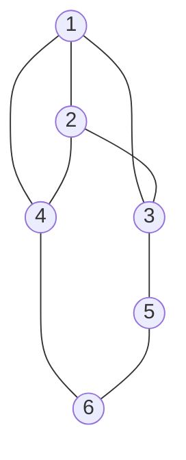

A vertex property can be defined through the change in a parameter of the whole graph after that vertex is removed. Here we compare the spanning-tree coefficient and resistance radius. For each parameter, we distinguish between deleting a vertex together with its edges and removing a point from a set while preserving the metric of the remaining points.

The radius and Gram matrix are defined in [[Resistance Radius and Diameter of a Graph]] and [[Resistance Radius of a Set - Gram Matrix and Volume]]. We also use the [[Centroid, Spanning-Tree, and Eigenvector Centralities|expected spanning-tree degree and circumcenter coordinates]] and [[Vertex Elimination and Induced Couplings|elimination by a Schur complement]].

## Two types of removal

Let $G$ be a connected undirected loopless graph on $n\ge3$ vertices. The conductances of existing edges are positive; parallel conductors have been combined by summing their conductances. Write

$$
d_i=\sum_jc_{ij},\qquad
\tau(G)=\sum_{T\text{ is a spanning tree}}\prod_{e\in T}c_e,\qquad
\rho=\rho(G)
$$

For unit conductances, $\tau(G)$ is the number of spanning trees. The PMG norm is quadratic: $\rho=R_{\mathrm{sph}}^2$, and the resistance diameter is $4\rho$.

**Deletion from the network.** The graph $H_i=G-i$ is obtained by deleting vertex $i$ and all its incident edges. The conductances of the remaining edges are unchanged, but the resistances must be recomputed. The graph may become disconnected.

**Removal preserving the metric.** Row and column $i$ are deleted from the Gram matrix of local vertices, $\mathbf G=-\mathbf R/2$. All resistances between the remaining vertices are preserved. This metric corresponds to a connected graph $\widehat G_i$ obtained by eliminating the vertex through a Schur complement; new edges may appear between its neighbors. This is classical Kron reduction [1].

Let $S=V\setminus\{i\}$ and $\mathbf c=(c_{ij})_{j\in S}$. The two resulting Laplacian matrices are

$$
\mathbf L_{H_i}=\mathbf L_{SS}-\operatorname{diag}(\mathbf c),
\qquad
\mathbf L_{\widehat G_i}=\mathbf L_{SS}-\frac{\mathbf c\mathbf c^{\mathsf T}}{d_i}
$$

The first formula subtracts the lost contributions to the degrees. In the second, the induced conductances are $\widehat c_{jk}=c_{jk}+c_{ij}c_{ik}/d_i$ for $j\ne k$.

> [!info] Two types of removal
> **Definition.** We describe the effect of removal by the ratios of the new values to the original ones:

| Operation | Spanning-tree ratio | Radius ratio |
| --- | --- | --- |
| Deletion from the network | $s_i=\tau(H_i)/\tau(G)$ | $\gamma_i=\rho(H_i)/\rho$ |
| Preservation of the metric | $\widehat s_i=\tau(\widehat G_i)/\tau(G)$ | $\widehat\gamma_i=\rho(\widehat G_i)/\rho$ |

If $H_i$ is disconnected, we set $\tau(H_i)=0$, so $s_i=0$. There is no common finite radius in the adopted model; we leave $\gamma_i$ undefined. Resistance-diameter ratios coincide with radius ratios.

For weighted graphs, $s_i,\widehat s_i$ have the dimension of inverse conductance: under $c_e\mapsto a c_e$, $a>0$, they are divided by $a$. The ranking of vertices within a graph is preserved. Radius ratios are dimensionless and independent of the overall conductance scale.

## The spanning-tree ratio and leaf probability

Choose a random spanning tree according to $\Pr(T)=\prod_{e\in T}c_e/\tau(G)$. Let $p_{i,1}=\Pr\{\deg_T(i)=1\}$ be the probability that vertex $i$ is a leaf of the spanning tree.

> [!info] Two spanning-tree ratios
> **Theorem.** Under the stated assumptions,
>
> $$
> \boxed{
> \widehat s_i=\frac1{d_i},\qquad
> s_i=\frac{p_{i,1}}{d_i},\qquad
> \frac{s_i}{\widehat s_i}=p_{i,1}
> }
> $$

> [!note]- Counting spanning trees and taking a Schur complement
> **Proof.** Each spanning tree of $H_i$ extends to a spanning tree of $G$ in which $i$ is a leaf by choosing one edge incident to $i$. The total weight of these extensions is the weight of the original tree multiplied by $d_i$. Conversely, removing leaf $i$ from such a tree gives a spanning tree of $H_i$. Hence
>
> $$
> \sum_{T:\,\deg_T(i)=1}\prod_{e\in T}c_e=d_i\tau(H_i)
> $$
>
> Dividing by $\tau(G)$ gives the formula for $s_i$. If $H_i$ is disconnected, both sides are zero.
>
> For the second ratio, choose a reference vertex $r\in S$ and delete its row and column from $\mathbf L$. The Schur complement with respect to the remaining entry $d_i$ is the reduced Laplacian of $\widehat G_i$. Determinant factorization and Kirchhoff's theorem give
>
> $$
> \tau(G)=d_i\tau(\widehat G_i)
> $$
>
> This yields the formula for $\widehat s_i$ and the ratio of the two measures. $\square$

Counting by attaching a leaf in the unweighted case is used, for example, in [2, Section 2]; above, the argument includes conductances. Even when the original graph has unit conductances, $\widehat G_i$ generally has nonunit conductances, so $\tau(\widehat G_i)$ need not be an integer.

**Corollaries.** We have $0\le s_i\le\widehat s_i$. For an original graph with unit conductances, $0\le s_i\le1/d_i\le1$. Moreover,

$$
s_i=0
\quad\Longleftrightarrow\quad
H_i\text{ is disconnected}
\quad\Longleftrightarrow\quad
i\text{ is an articulation vertex}
$$

The geometric spanning-tree ratio $\widehat s_i$ is determined entirely by the weighted degree. The ratio $s_i$ also requires the leaf probability. Thus the formula separates two contributions to the ratio: the vertex's degree and its role in a random spanning tree.

## The radius ratio under preservation of the metric

Let $\alpha_i$ be the bi-coordinate of the circumcenter and $\delta_i=\mathbb E[\deg_T(i)]$ the expected spanning-tree degree. The [[Centroid, Spanning-Tree, and Eigenvector Centralities#Removing a point while preserving the metric|formula for geometric removal]] establishes

$$
\rho-\rho(\widehat G_i)=\frac{\alpha_i^2}{d_i},
\qquad
\alpha_i=1-\frac{\delta_i}{2}
$$

Consequently,

$$
\boxed{
\widehat\gamma_i
=1-\frac{\alpha_i^2}{d_i\rho}
=1-\frac{(1-\delta_i/2)^2}{d_i\rho}
}
$$

Geometrically, the circumcenter of the remaining points is the projection of the original circumcenter onto the affine hull of the opposite facet of the simplex. The difference between the radii equals the norm of the center's displacement. Hence $0<\widehat\gamma_i\le1$, with equality to one when $\alpha_i=0$, or equivalently $\delta_i=2$.

This formula does not apply to $\gamma_i$ after deletion from the network: the metric itself changes. The computation uses the new Laplacian; the examples below show both an increase and a decrease in radius.

## Vertex properties through polyforms

Separate the part of the Laplacian formed by the edges incident to the vertex:

$$
L=\sum_{j<k}c_{jk}[a_k-a_j]^2,\qquad
L_i=\sum_jc_{ij}[a_j-a_i]^2,\qquad
M=\exp L
$$

All products and exponentials in this section are polyform operations. The functional $\tau(P)$ extracts the coefficient of the fixed spanning-tree form $T_n=[(a_1\ldots a_n)]^2$ of the original set.

> [!info] Vertex properties through polyforms
> **Definition.** Mark all edges incident to vertex $i$ with a common factor $t$:
>
> $$
> F_i(t)=\frac{\tau\!\left(\exp(L-L_i+tL_i)\right)}{\tau(G)}
> $$

This is an ordinary scalar polynomial obtained from the polyform. Its coefficients describe the spanning-tree degree distribution:

$$
\boxed{
F_i(t)=\sum_{k\ge1}p_{i,k}t^k,\qquad
p_{i,k}=\Pr\{\deg_T(i)=k\}
}
$$

> [!note]- Marked factors in the forest expansion
> **Proof.** In the [[Laplacian Exponential#The exponential in the algebra of forms|factorization of the exponential]], each edge corresponds to a factor $e+c_{jk}[a_k-a_j]^2$. After the substitution $c_{ij}\mapsto tc_{ij}$, each spanning tree acquires a factor $t^{\deg_T(i)}$. Extracting the top-grade coefficient sums the spanning-tree weights, and dividing by $\tau(G)$ turns the weights into probabilities. $\square$

Derivatives of a single polynomial give two different vertex characteristics:

$$
F_i'(1)=\delta_i,\qquad
F_i'(0)=p_{i,1}
$$

Thus the three ratios already expressed above can be written as

$$
s_i=\frac{F_i'(0)}{d_i},\qquad
\widehat s_i=\frac1{d_i},\qquad
\widehat\gamma_i
=1-\frac{(1-F_i'(1)/2)^2}{d_i\rho}
$$

### Which grades are involved

Set $M^{(-i)}=\exp(L-L_i)$. Vertex $i$ is now isolated in the original set, so $\tau(M^{(-i)})=0$ and $F_i(0)=0$. The spanning-tree coefficient of $H_i$ occurs one grade lower:

$$
M^{(-i)}_{n-2}=\tau(H_i)T_S,\qquad
T_S=[(a_{j_1}\ldots a_{j_{n-1}})]^2,\quad S=\{j_1,\ldots,j_{n-1}\}
$$

If $H_i$ is disconnected, this component is zero. Differentiating the exponential gives

$$
\boxed{
s_i=\frac{\tau(M^{(-i)}_{n-2}L_i)}{d_i\tau(G)},
\qquad
\delta_i=\frac{\tau(M_{n-2}L_i)}{\tau(G)}
}
$$

In the first formula, the isolated vertex is attached by one edge to a spanning tree of the remaining vertices. The second uses two-component spanning forests of the original graph; after an edge is added, each spanning tree is counted once for each of its edges incident to $i$.

Removal preserving the metric is expressed by a different operation: [[Vertex Elimination and Induced Couplings#Factoring the exponential and preserving the metric|projection of the exponential]], $\widehat M_i=\pi_i(M)$. Here $\pi_i$ is the map on forms induced by orthogonal projection onto the space of affine vectors of the remaining vertices.

The fourth ratio, $\gamma_i$, also has a polyform computation. If $H_i$ is connected, let $\tau_S$ denote extraction of the coefficient of $T_S$. Its new metric is determined by

$$
R^{H_i}_{jk}
=\frac{\tau_S\!\left(M^{(-i)}_{n-3}[a_k-a_j]^2\right)}{\tau(H_i)},
\qquad j,k\in S
$$

Grade $n-3$ is the next-to-top grade for a graph on $n-1$ vertices. From the resulting matrix $\mathbf R^{H_i}$, we find $\rho(H_i)$ using the [[Resistance Radius and Diameter of a Graph#Computation from the resistance matrix|circumcenter system]]

$$
\mathbf R^{H_i}\boldsymbol\alpha^{H_i}=2\rho(H_i)\mathbf1,\qquad
\mathbf1^{\mathsf T}\boldsymbol\alpha^{H_i}=1
$$

Thus the top-grade coefficient of the new exponential determines the spanning-tree ratio, while its next-to-top-grade component determines the new metric and radius. The functionals $\tau$ and $\tau_S$ refer to different spanning-tree forms; they are not interchangeable.

## Small examples

### Triangle and path

All conductances of the original graphs in the table are $1$.

| Original graph and removed vertex | $s_i$ | $\widehat s_i$ | $\gamma_i$ | $\widehat\gamma_i$ |
| --- | ---: | ---: | ---: | ---: |
| $K_3$, any vertex | $1/3$ | $1/2$ | $9/8$ | $3/4$ |
| $P_4$, endpoint | $1$ | $1$ | $2/3$ | $2/3$ |
| $P_4$, internal vertex | $0$ | $1/2$ | Undefined: disconnected graph | $1$ |

For the triangle, $\tau=3$, $\rho=2/9$, and $F_i(t)=(2t+t^2)/3$. Deletion from the network leaves a unit-conductance edge with $\tau=1$, $\rho=1/4$. Preserving the metric leaves an edge of conductance $3/2$, since the original resistance between the pair is $2/3$; its radius is $1/6$.

The path $P_4$ has a unique spanning tree and $\rho=3/4$. At an endpoint, $F_i(t)=t$: both operations leave a unit-conductance $P_3$ with radius $1/2$. At an internal vertex, $F_i(t)=t^2$. Geometric removal preserves the radius because $\delta_i=2$, whereas deletion from the network breaks the path.

This gives three different outcomes for the radius after deletion from the network: an increase, a decrease, and the absence of a common finite value. A value $\gamma_i<1$ does not by itself mean that the remaining network has become stronger: the vertex set has also become smaller.

### A limitation of the criticality interpretation

A small $s_i$ means a large relative loss of spanning-tree count in a graph with unit conductances. It does not imply that the remaining graph must be less resilient to the next deletion.

Consider the following graph with unit conductances on six vertices:

The diagram specifies only the edge topology. The edge set is $\{12,13,14,23,24,35,46,56\}$, where $jk$ denotes an unordered pair. Direct counting gives $\tau(G)=32$.

| Removed vertex | $\tau(H_i)$ | $s_i$ | Remaining graph | $\lambda_2(H_i)$ |
| --- | ---: | ---: | --- | ---: |
| $1$ | $5$ | $5/32$ | Cycle $2-3-5-6-4-2$ | $1.3820$ |
| $5$ | $8$ | $1/4$ | $K_4$ on $1,2,3,4$ without edge $34$, with leaf $6$ attached to vertex $4$ | $0.8299$ |

By the spanning-tree ratio, vertex $1$ is more critical. Yet after it is deleted, the graph remains connected upon deletion of any one further vertex. After vertex $5$ is deleted, deleting vertex $4$ disconnects the graph. Thus rankings by spanning-tree loss and by resilience to the next deletion differ even within the same original graph.

The spectral connection explains another distinction: for a connected graph $H$ on $m$ vertices [3],

$$
\tau(H)=\frac1m\prod_{k=2}^{m}\lambda_k(H)
$$

Here $0=\lambda_1<\lambda_2\le\ldots\le\lambda_m$ are its Laplacian eigenvalues. The spanning-tree count involves the product of the entire nonzero spectrum, whereas $\lambda_2$ singles out its smallest element. Both remaining graphs in the table have five vertices; the lower spanning-tree count comes with higher algebraic connectivity. The $\lambda_2$ values provide an additional comparison, rather than a definition of universal criticality.

## Status of the results and an open question

The formulas for the two Laplacians and the geometric change in radius rely on the linked notes. The spanning-tree ratios, leaf probability, and polyform expressions are derived here. The criterion $s_i=0$ is exact; the example disproves a universal interpretation of small positive values as proximity to the next disconnection.

> [!example]- Independent computational checks
> The spanning-tree coefficients and radii in the tables were checked in exact rational arithmetic. Spanning-tree coefficients were computed independently by determinants and by enumerating spanning trees. Radii were obtained from the resistance matrix and checked against the Green-matrix formula; for geometric removal, the submatrix of the original resistance matrix was compared with the Schur complement. Polyform coefficients were obtained directly from forest products through determinants of the exterior factors and compared with the matrix values. The checks covered all vertices of the triangle, the path $P_4$, the star $K_{1,3}$, a weighted triangle and path, and the six-vertex counterexample. Spectral values were computed numerically with a check of the eigenvector equation.

A compact formula for $\rho(G-i)$ in terms of a small number of vertex characteristics in the original graph remains an open question. Computation through the new metric is specified; no expression solely in terms of $d_i$ and $\delta_i$ is asserted here.

## Sources

1. F. Dörfler, F. Bullo. *Kron Reduction of Graphs with Applications to Electrical Networks*. [Open version](https://arxiv.org/abs/1102.2950). Schur complements and preservation of resistances; the polyform representation is discussed in [[Vertex Elimination and Induced Couplings]].
2. S. Wagner, R. Wang. *The distribution of subtrees in dense graphs and the roots of the subtree polynomial*. [Preprint](https://arxiv.org/abs/2605.03583), 2026, Section 2. Counting extensions of a spanning tree of the graph without a vertex by attaching that vertex as a leaf.
3. S. Klee, M. T. Stamps. *Eigenvalues of Graph Laplacians Via Rank-One Perturbations*. The Quarterly Journal of Mathematics, 73(2), 609-616, 2022. [Article](https://doi.org/10.1093/qmath/haab045), Theorem 1.1. The spectral form of Kirchhoff's theorem.
