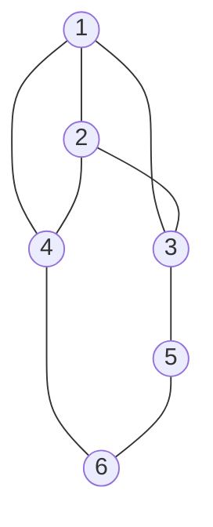

Свойство вершины можно определить через изменение параметра всего графа после её удаления. Здесь сравним остовной коэффициент и резистивный радиус. Для каждого параметра различаем удаление вершины вместе со связями и исключение точки из набора с сохранением метрики остальных точек.

Определения радиуса и грамиана даны в [[Резистивный радиус и диаметр графа]] и [[Резистивный радиус набора - грамиан и объём]]. Используются также [[Центроидная, остовная и спектральная центральности|средняя остовная степень и координаты центра сферы]] и [[Исключение вершин и наведённые связи|исключение через дополнение Шура]].

## Два вида удаления

Пусть $G$ - связный неориентированный граф без петель на $n\ge3$ вершинах. Проводимости существующих связей положительны; параллельные проводники объединены суммированием проводимостей. Обозначим

$$
d_i=\sum_jc_{ij},\qquad
\tau(G)=\sum_{T\text{ - остовное дерево}}\prod_{e\in T}c_e,\qquad
\rho=\rho(G)
$$

При единичных проводимостях $\tau(G)$ является числом остовов. Норма в PMG квадратична: $\rho=R_{\mathrm{sph}}^2$, а резистивный диаметр равен $4\rho$.

**Удаление из сети.** Граф $H_i=G-i$ получается удалением вершины $i$ и всех примыкающих связей. Проводимости остальных связей сохраняются, но резистенсы требуется вычислять заново. Граф может распасться.

**Исключение с сохранением метрики.** Из грамиана локальных вершин $\mathbf G=-\mathbf R/2$ удаляются строка и столбец $i$. Все резистенсы между оставшимися вершинами сохраняются. Этой метрике соответствует связный граф $\widehat G_i$, полученный исключением вершины через дополнение Шура; между её соседями могут появиться новые связи. Это классическая редукция Крона [1].

Пусть $S=V\setminus\{i\}$, $\mathbf c=(c_{ij})_{j\in S}$. Матрицы двух полученных лапласианов имеют вид

$$
\mathbf L_{H_i}=\mathbf L_{SS}-\operatorname{diag}(\mathbf c),
\qquad
\mathbf L_{\widehat G_i}=\mathbf L_{SS}-\frac{\mathbf c\mathbf c^{\mathsf T}}{d_i}
$$

В первой формуле вычитаются утраченные вклады в степени. Во второй наведённые проводимости равны $\widehat c_{jk}=c_{jk}+c_{ij}c_{ik}/d_i$ при $j\ne k$.

**Определение.** Влияние удаления будем описывать отношениями новых значений к исходным:

| Операция | Остовное отношение | Отношение радиусов |
| --- | --- | --- |
| Удаление из сети | $s_i=\tau(H_i)/\tau(G)$ | $\gamma_i=\rho(H_i)/\rho$ |
| Сохранение метрики | $\widehat s_i=\tau(\widehat G_i)/\tau(G)$ | $\widehat\gamma_i=\rho(\widehat G_i)/\rho$ |

Если $H_i$ несвязен, полагаем $\tau(H_i)=0$, поэтому $s_i=0$. Общего конечного радиуса в принятой модели нет; $\gamma_i$ оставляем неопределённым. Отношения резистивных диаметров совпадают с отношениями радиусов.

Для взвешенных графов $s_i,\widehat s_i$ имеют размерность обратной проводимости: при $c_e\mapsto a c_e$, $a>0$, они делятся на $a$. Ранжирование вершин одного графа сохраняется. Отношения радиусов безразмерны и от общего масштаба проводимостей не зависят.

## Остовное отношение и вероятность листа

Выбираем случайный остов по распределению $\Pr(T)=\prod_{e\in T}c_e/\tau(G)$. Пусть $p_{i,1}=\Pr\{\deg_T(i)=1\}$ - вероятность того, что вершина $i$ является листом остова.

> [!info] Два остовных отношения
> **Теорема.** При принятых условиях
>
> $$
> \boxed{
> \widehat s_i=\frac1{d_i},\qquad
> s_i=\frac{p_{i,1}}{d_i},\qquad
> \frac{s_i}{\widehat s_i}=p_{i,1}
> }
> $$

> [!proof]- Подсчёт остовов и дополнение Шура
> **Доказательство.** Каждый остов $H_i$ продолжается до остова $G$, в котором $i$ является листом, выбором одного примыкающего к $i$ ребра. Суммарный вес продолжений равен весу исходного остова, умноженному на $d_i$. Обратно, удаление листа $i$ из такого остова даёт остов $H_i$. Поэтому
>
> $$
> \sum_{T:\,\deg_T(i)=1}\prod_{e\in T}c_e=d_i\tau(H_i)
> $$
>
> После деления на $\tau(G)$ получаем формулу для $s_i$. При несвязном $H_i$ обе стороны равны нулю.
>
> Для второго отношения выберем опорную вершину $r\in S$ и удалим её строку и столбец из $\mathbf L$. Дополнение Шура по оставшемуся элементу $d_i$ является редуцированным лапласианом $\widehat G_i$. Факторизация определителя и теорема Кирхгофа дают
>
> $$
> \tau(G)=d_i\tau(\widehat G_i)
> $$
>
> Отсюда следует формула для $\widehat s_i$ и отношение двух показателей. $\square$

Подсчёт через присоединение листа в невзвешенном случае используется, например, в [2, раздел 2]; выше он записан с проводимостями. Даже для исходного единичного графа $\widehat G_i$ обычно имеет неединичные проводимости, поэтому $\tau(\widehat G_i)$ может быть нецелым.

**Следствия.** Имеем $0\le s_i\le\widehat s_i$. Для исходного единичного графа $0\le s_i\le1/d_i\le1$. Кроме того,

$$
s_i=0
\quad\Longleftrightarrow\quad
H_i\text{ несвязен}
\quad\Longleftrightarrow\quad
i\text{ - вершина сочленения}
$$

Геометрическое остовное отношение $\widehat s_i$ полностью определяется взвешенной степенью. Для $s_i$ дополнительно нужна вероятность листа. Таким образом, формула выделяет две составляющие отношения: степень вершины и её роль в случайном остове.

## Отношение радиусов при сохранении метрики

Пусть $\alpha_i$ - би-координата центра описанной сферы, а $\delta_i=\mathbb E[\deg_T(i)]$ - средняя остовная степень. В [[Центроидная, остовная и спектральная центральности#Исключение точки при сохранении метрики|формуле геометрического исключения]] доказано

$$
\rho-\rho(\widehat G_i)=\frac{\alpha_i^2}{d_i},
\qquad
\alpha_i=1-\frac{\delta_i}{2}
$$

Следовательно,

$$
\boxed{
\widehat\gamma_i
=1-\frac{\alpha_i^2}{d_i\rho}
=1-\frac{(1-\delta_i/2)^2}{d_i\rho}
}
$$

Геометрически центр сферы оставшихся точек является проекцией исходного центра на противоположную грань симплекса. Разность радиусов равна норме смещения центра. Поэтому $0<\widehat\gamma_i\le1$, а равенство единице выполняется при $\alpha_i=0$, то есть при $\delta_i=2$.

Для $\gamma_i$ после удаления из сети эта формула не применяется: меняется сама метрика. Вычисление выполняется по новому лапласиану; примеры ниже показывают как увеличение, так и уменьшение радиуса.

## Свойства вершины через полиформы

Выделим часть лапласиана, образованную связями вершины:

$$
L=\sum_{j<k}c_{jk}[a_k-a_j]^2,\qquad
L_i=\sum_jc_{ij}[a_j-a_i]^2,\qquad
M=\exp L
$$

Все произведения и экспоненты в этом разделе полиформные. Функционал $\tau(P)$ извлекает коэффициент при фиксированной остовной форме $T_n=[(a_1\ldots a_n)]^2$ исходного набора.

**Определение.** Пометим все связи вершины $i$ общим множителем $t$:

$$
F_i(t)=\frac{\tau\!\left(\exp(L-L_i+tL_i)\right)}{\tau(G)}
$$

Это обычный скалярный полином, полученный из полиформы. Его коэффициенты описывают распределение остовной степени:

$$
\boxed{
F_i(t)=\sum_{k\ge1}p_{i,k}t^k,\qquad
p_{i,k}=\Pr\{\deg_T(i)=k\}
}
$$

> [!proof]- Помеченные множители лесного разложения
> **Доказательство.** В [[Экспонента лапласиана#Экспонента в алгебре форм|факторизации экспоненты]] каждой связи соответствует множитель $e+c_{jk}[a_k-a_j]^2$. После замены $c_{ij}\mapsto tc_{ij}$ каждый остов приобретает множитель $t^{\deg_T(i)}$. Извлечение старшего коэффициента суммирует веса остовов, а деление на $\tau(G)$ превращает веса в вероятности. $\square$

Производные одного полинома дают две разные характеристики вершины:

$$
F_i'(1)=\delta_i,\qquad
F_i'(0)=p_{i,1}
$$

Отсюда все три уже выраженных отношения можно записать как

$$
s_i=\frac{F_i'(0)}{d_i},\qquad
\widehat s_i=\frac1{d_i},\qquad
\widehat\gamma_i
=1-\frac{(1-F_i'(1)/2)^2}{d_i\rho}
$$

### Какие грейды участвуют

Положим $M^{(-i)}=\exp(L-L_i)$. В исходном наборе вершина $i$ теперь изолирована, поэтому $\tau(M^{(-i)})=0$ и $F_i(0)=0$. Остовной коэффициент графа $H_i$ находится на один грейд ниже:

$$
M^{(-i)}_{n-2}=\tau(H_i)T_S,\qquad
T_S=[(a_{j_1}\ldots a_{j_{n-1}})]^2,\quad S=\{j_1,\ldots,j_{n-1}\}
$$

При несвязном $H_i$ эта компонента равна нулю. Дифференцирование экспоненты даёт

$$
\boxed{
s_i=\frac{\tau(M^{(-i)}_{n-2}L_i)}{d_i\tau(G)},
\qquad
\delta_i=\frac{\tau(M_{n-2}L_i)}{\tau(G)}
}
$$

В первой формуле изолированная вершина присоединяется одним ребром к остову остальных вершин. Во второй используются двухкомпонентные леса исходного графа; после присоединения ребра каждый остов учитывается по числу его рёбер при вершине $i$.

Исключение с сохранением метрики выражается другой операцией: [[Исключение вершин и наведённые связи#Факторизация экспоненты и сохранение метрики|проекцией экспоненты]] $\widehat M_i=\pi_i(M)$. Здесь $\pi_i$ - индуцированная на формах ортогональная проекция на пространство аффинных векторов оставшихся вершин.

Для четвёртого отношения $\gamma_i$ также имеется полиформный способ расчёта. Если $H_i$ связен, обозначим через $\tau_S$ извлечение коэффициента при $T_S$. Его новая метрика определяется формулой

$$
R^{H_i}_{jk}
=\frac{\tau_S\!\left(M^{(-i)}_{n-3}[a_k-a_j]^2\right)}{\tau(H_i)},
\qquad j,k\in S
$$

Грейд $n-3$ является допредельным для графа на $n-1$ вершинах. По полученной матрице $\mathbf R^{H_i}$ находим $\rho(H_i)$ из [[Резистивный радиус и диаметр графа#Вычисление по резистивной матрице|системы центра сферы]]

$$
\mathbf R^{H_i}\boldsymbol\alpha^{H_i}=2\rho(H_i)\mathbf1,\qquad
\mathbf1^{\mathsf T}\boldsymbol\alpha^{H_i}=1
$$

Таким образом, старший коэффициент новой экспоненты задаёт остовное отношение, а её допредельная компонента задаёт новую метрику и радиус. Функционалы $\tau$ и $\tau_S$ относятся к разным остовным формам; их нельзя подменять друг другом.

## Малые примеры

### Треугольник и путь

Все проводимости в таблице равны $1$.

| Исходный граф и удаляемая вершина | $s_i$ | $\widehat s_i$ | $\gamma_i$ | $\widehat\gamma_i$ |
| --- | ---: | ---: | ---: | ---: |
| $K_3$, любая вершина | $1/3$ | $1/2$ | $9/8$ | $3/4$ |
| $P_4$, концевая вершина | $1$ | $1$ | $2/3$ | $2/3$ |
| $P_4$, внутренняя вершина | $0$ | $1/2$ | Не определено: граф несвязен | $1$ |

У треугольника $\tau=3$, $\rho=2/9$ и $F_i(t)=(2t+t^2)/3$. Удаление из сети оставляет единичное ребро с $\tau=1$, $\rho=1/4$. При сохранении метрики остаётся ребро проводимости $3/2$, поскольку исходный резистенс между парой равен $2/3$; его радиус равен $1/6$.

У пути $P_4$ единственный остов и $\rho=3/4$. Для конца $F_i(t)=t$: оба удаления оставляют единичный $P_3$ с радиусом $1/2$. Для внутренней вершины $F_i(t)=t^2$. Геометрическое исключение сохраняет радиус, поскольку $\delta_i=2$, а удаление из сети разрывает путь.

Это даёт три разных исхода для радиуса после удаления из сети: увеличение, уменьшение и отсутствие общего конечного значения. Значение $\gamma_i<1$ само по себе не означает усиления оставшейся сети: одновременно сократился набор вершин.

### Ограничение трактовки критичности

Малое $s_i$ означает большую относительную потерю остовного числа в единичном графе. Из этого не следует, что оставшийся граф обязательно хуже переносит следующее удаление.

Рассмотрим единичный граф на шести вершинах:

Рисунок задаёт только топологию связей. Их множество равно $\{12,13,14,23,24,35,46,56\}$, где $jk$ обозначает неориентированную пару. Прямой подсчёт даёт $\tau(G)=32$.

| Удаляемая вершина | $\tau(H_i)$ | $s_i$ | Оставшийся граф | $\lambda_2(H_i)$ |
| --- | ---: | ---: | --- | ---: |
| $1$ | $5$ | $5/32$ | Цикл $2-3-5-6-4-2$ | $1.3820$ |
| $5$ | $8$ | $1/4$ | $K_4$ на $1,2,3,4$ без ребра $34$ и лист $6$ при вершине $4$ | $0.8299$ |

По остовному отношению вершина $1$ критичнее. Однако после её удаления граф остаётся связным при удалении любой ещё одной вершины. После удаления вершины $5$ удаление вершины $4$ разрывает граф. Поэтому ранжирование по потере остовного числа и по устойчивости к следующему удалению различается уже внутри одного исходного графа.

Спектральная связь поясняет ещё одно различие: для связного графа $H$ на $m$ вершинах [3]

$$
\tau(H)=\frac1m\prod_{k=2}^{m}\lambda_k(H)
$$

Здесь $0=\lambda_1<\lambda_2\le\ldots\le\lambda_m$ - собственные значения его лапласиана. Остовное число учитывает произведение всего ненулевого спектра, а $\lambda_2$ выделяет его наименьший элемент. В таблице оба оставшихся графа имеют по пять вершин; более низкое остовное число сочетается с более высокой алгебраической связностью. Значения $\lambda_2$ приведены как дополнительное сопоставление, а не как определение универсальной критичности.

## Статус результатов и открытый вопрос

Формулы двух лапласианов и геометрического изменения радиуса опираются на связанные заметки. Формулы остовных отношений, вероятность листа и полиформные выражения выведены здесь. Критерий $s_i=0$ точен; универсальная трактовка малых положительных значений как близости к следующему распаду опровергнута приведённым примером.

Остовные коэффициенты и радиусы в таблицах проверены точной рациональной арифметикой. Остовные коэффициенты вычислены независимо определителями и перебором остовов. Радиусы найдены из резистивной матрицы и сверены с формулой через матрицу Грина; для геометрического исключения сопоставлены подматрица исходной резистивной матрицы и дополнение Шура. Полиформные коэффициенты получены непосредственно из лесных произведений через определители внешних множителей и сопоставлены с матричными значениями. Проверки выполнены для всех вершин треугольника, пути $P_4$, звезды $K_{1,3}$, взвешенных треугольника и пути, а также графа контрпримера на шести вершинах. Спектральные значения рассчитаны численно с проверкой собственного уравнения.

Открытым остаётся вопрос о компактной формуле для $\rho(G-i)$ через небольшое число характеристик вершины в исходном графе. Вычисление через новую метрику определено; выражения только через $d_i$ и $\delta_i$ здесь не утверждается.

## Источники

1. F. Dörfler, F. Bullo. *Kron Reduction of Graphs with Applications to Electrical Networks*. [Открытая версия](https://arxiv.org/abs/1102.2950). Дополнение Шура и сохранение резистенсов; полиформное представление разобрано в [[Исключение вершин и наведённые связи]].
2. S. Wagner, R. Wang. *The distribution of subtrees in dense graphs and the roots of the subtree polynomial*. [Препринт](https://arxiv.org/abs/2605.03583), 2026, раздел 2. Подсчёт продолжений остова графа без вершины присоединением этой вершины как листа.
3. S. Klee, M. T. Stamps. *Eigenvalues of Graph Laplacians Via Rank-One Perturbations*. The Quarterly Journal of Mathematics, 73(2), 609-616, 2022. [Статья](https://doi.org/10.1093/qmath/haab045), теорема 1.1. Спектральная форма теоремы Кирхгофа.
