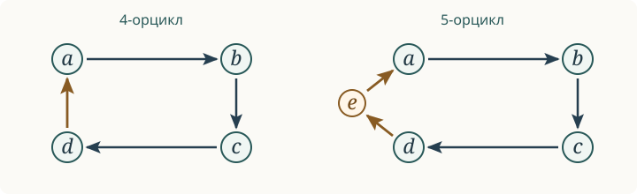

У отрезка два конца, и сумма двух встречных измерительных форм даёт квадратичную форму отрезка. У треугольника три вершины, и его квадратичная форма складывается из трёх произведений форм сторон. Почему слагаемые считаются по вершинам, если последовательностей обхода гораздо больше? Ответ даёт правило для произвольного порядка. Начальную вершину можно выбирать, а перестановка остальных вершин сохраняет соответствующее ей произведение. После измерения сумма вкладов равна одному определителю грамиана направленных скалярных произведений (НСП). [[ru/Направленные графы/Полиформы орграфов/Что измеряет произведение форм двух сторон треугольника#Три выбора начала дают одну форму границы|Случай треугольника]]

## По одному слагаемому на каждое начало

Выберем $k+1$ различных вершин $a_0,\ldots,a_k$ из $n$ вершин графа, где $1\le k\le n-1$. Их граница порядка $k$ равна

$$
(a_0\ldots a_k)=(a_1-a_0)\wedge\cdots\wedge(a_k-a_0)
$$

Пусть $x_j$ есть вектор от центроида **всех** $n$ вершин к $a_j$. Форму измерения упорядоченной пары обозначим $\Phi_{ij}=[x_j,a_j-a_i]$. Она определена и при отсутствии дуги $a_i\to a_j$. Чтобы построить слагаемое для начала $a_i$, запишем выбранные вершины в порядке $a_{j_0},a_{j_1},\ldots,a_{j_k}$ с $j_0=i$. Перемножим формы $k$ последовательных пар, закончив в последней вершине.

$$
F_i=\Phi_{j_0j_1}\Phi_{j_1j_2}\cdots\Phi_{j_{k-1}j_k}
$$

> [!info] Разложение до выбора метрики
> **Теорема.** При фиксированном начале $a_i$ все $k!$ порядков остальных вершин дают одну форму $F_i$. Сумма по $k+1$ началам равна
>
> $$
> \boxed{\sum_{i=0}^k F_i=[(a_0\ldots a_k)]^2}
> $$

> [!note]- Доказательство через раскрытие границы
> **Доказательство.** У произведения $F_i$ слева стоит $x_{j_1}\wedge\cdots\wedge x_{j_k}$. Справа стоят последовательные разности $a_{j_m}-a_{j_{m-1}}$. Заменяя каждую разность суммой исходных разностей вплоть до неё, получаем внешнее произведение разностей от общего начала, то есть $(a_{j_0}\ldots a_{j_k})$. Перестановка двух вершин после начала меняет знак обоих аргументов, поэтому форма сохраняется.
>
> Теперь для каждого $i$ поставим $a_i$ на первое место, оставив остальные вершины в исходном порядке. Правый аргумент равен $(-1)^i(a_0\ldots a_k)$. Перенесём его знак в левый аргумент. Сумма левых аргументов имеет вид
>
> $$
> \sum_{i=0}^k(-1)^i x_0\wedge\cdots\wedge\widehat{x_i}\wedge\cdots\wedge x_k
> =(x_1-x_0)\wedge\cdots\wedge(x_k-x_0)
> $$
>
> Шляпка означает пропуск множителя. Равенство получается раскрытием правой части. Члены с двумя множителями $x_0$ исчезают. Поскольку $x_j-x_0=a_j-a_0$, сумма слева равна тому же $(a_0\ldots a_k)$, что и общий правый аргумент форм. $\square$

При $k=1$ слагаемые равны $\Phi_{ab}$ и $\Phi_{ba}$. При $k=2$ получаем $\Phi_{ab}\Phi_{bc}$, $\Phi_{bc}\Phi_{ca}$ и $\Phi_{ca}\Phi_{ab}$. Если выбраны все вершины, то $\sum_{i=0}^k x_i=0$. Подстановка $x_0=-\sum_{j=1}^k x_j$ в раскрытие границы показывает, что все $k+1$ левых аргументов со своими знаками равны. В этом случае каждое $F_i$ уже на уровне форм составляет $1/(k+1)$ от $[(a_0\ldots a_k)]^2$.

## Полная норма по грамиану НСП

Рассмотрим орграф с неотрицательными весами, лапласианом по исходящим дугам и метрической полиформой $M=\exp L$. Для численного измерения требуется $S=\sum_s\tau_s>0$, где $\tau_s$ есть суммарный вес остовных деревьев с дугами к корню $s$. Чтобы найти $P_M^\Sigma(F)$, умножаем $MF$ на форму каждого корня по очереди, складываем полученные коэффициенты старшего грейда и делим на $S$. При $S=0$ тождество форм сохраняется, а эта нормировка численного значения не задаёт. [[ru/Направленные графы/Полиформы орграфов/Как нормировать односторонний резистенс в небалансовом орграфе#Одно правило для всех пар|Нормировка по остовным потенциалам]]

> [!info] Два расчёта полной нормы
> **Теорема.** Пусть $S>0$, $u_p=a_p-a_0$ для $1\le p\le k$ и $\beta(u,v)=P_M^\Sigma([u,v])$. Тогда
>
> $$
> \boxed{P_M^\Sigma([(a_0\ldots a_k)]^2)
> =\sum_{i=0}^k P_M^\Sigma(F_i)
> =\det\bigl(\beta(u_p,u_q)\bigr)_{p,q=1}^k}
> $$
>
> Для вычисления по таблице односторонних резистенсов $\mathbf r$ каждая ячейка грамиана равна $-\mathbf u_q^{\mathsf T}\mathbf r\,\mathbf u_p$. Столбец первого аргумента умножается справа, транспонированный столбец второго аргумента слева. [[ru/Направленные графы/Полиформы орграфов/Как вычислить направленное скалярное произведение двух векторов в орграфе#Как считать по таблице резистенсов|НСП по таблице резистенсов]]

> [!note]- Доказательство по коэффициенту при произведении параметров
> **Доказательство.** Сумма вкладов следует из тождества форм и линейности $P_M^\Sigma$. Для определителя выведем сразу формулу со независимым выбором векторов в левом и правом аргументах. Пусть $u_p,v_p$ лежат в пространстве $W$ векторов нулевой суммы. Соберём их координатные столбцы в матрицы $\mathbf U,\mathbf V$ и положим $\mathbf D=\operatorname{diag}(t_1,\ldots,t_k)$. Обозначим через $S(\mathbf t)$ сумму главных миноров порядка $n-1$ матрицы $\mathbf L+\mathbf U\mathbf D\mathbf V^{\mathsf T}$. Экспонента возмущённого лапласиана равна $M\prod_p(e+t_p[u_p,v_p])$, где $e$ есть единичная форма. Каждый множитель линеен по $t_p$, поскольку повторение $u_p$ во внешнем произведении даёт нуль. Поэтому в $S(\mathbf t)/S$ коэффициент при $t_1\cdots t_k$ равен $P_M^\Sigma(\prod_p[u_p,v_p])$.
>
> На $W$ матрица $\mathbf K=\mathbf J\mathbf L$ обратима и её определитель равен $S$. Здесь $\mathbf J$ есть ортогональная проекция на $W$. Возмущение уже центрировано, так что $S(\mathbf t)$ вычисляется тем же определителем с добавкой $\mathbf U\mathbf D\mathbf V^{\mathsf T}$. Если $\mathbf B$ есть обратная к $\mathbf K$ на $W$, то по тождеству Сильвестра
>
> $$
> \frac{S(\mathbf t)}{S}=\det(\mathbf I_k+\mathbf D\mathbf V^{\mathsf T}\mathbf B\mathbf U)
> $$
>
> Коэффициент при произведении всех $k$ параметров равен $\det(\mathbf V^{\mathsf T}\mathbf B\mathbf U)$. По формуле $\beta(u,v)=\mathbf v^{\mathsf T}\mathbf B\mathbf u$ это определитель транспонированной матрицы $(\beta(u_p,v_q))$. Тем самым
>
> $$
> P_M^\Sigma([u_1\wedge\cdots\wedge u_k,\,v_1\wedge\cdots\wedge v_k])
> =\det\bigl(\beta(u_p,v_q)\bigr)_{p,q=1}^k
> $$
>
> Подставляя $v_p=u_p=a_p-a_0$, получаем заявленную формулу. [[ru/Направленные графы/Полиформы орграфов/Можно ли восстановить орграф по матрице односторонних резистенсов#Что сохраняется при центрировании|Определитель центрированного лапласиана]] $\square$

В грамиан входит **полное НСП**, включая его антисимметричную часть. Для линейных комбинаций простых границ измерение продолжается билинейно по левому и правому аргументам. Слово «норма» здесь означает нормированный потенциал квадратичной формы. В ненаправленном графе квадрат евклидова объёма самого симплекса равен этой норме, делённой на $(k!)^2$. [[ru/Начало работы и основания/Введение/Метрика объектов высших грейдов#Площади и объёмы симплексов|Норма границы и объём симплекса]] · [[ru/Начало работы и основания/Основания/Спецификация ядра PMG#Высшие грейды и геометрическая трактовка|Определительное правило для балграфа]]

## Тетраэдр в двух орциклах

Зафиксируем четыре вершины $a,b,c,d$ и измерим границу $(abcd)$ третьего грейда. Сначала весь орграф есть единичный орцикл $a\to b\to c\to d\to a$. Затем вставим вершину $e$ между $d$ и $a$, сохранив единичные веса всех дуг. Измеряемый тетраэдр в обоих опытах имеет те же четыре вершины.

*Рис. 1. В 4-орцикле путь от $d$ к следующей выбранной вершине $a$ состоит из одной дуги. В 5-орцикле тот же путь проходит через $e$. Эта вершина участвует в центроиде графа.*

| Орцикл | Начало $a$ | Начало $b$ | Начало $c$ | Начало $d$ | Полная норма |
| --- | --- | --- | --- | --- | --- |
| $abcda$ | $1/4$ | $1/4$ | $1/4$ | $1/4$ | $1$ |
| $abcdea$ | $1/5$ | $1/5$ | $1/5$ | $2/5$ | $1$ |

Почему удвоился именно числитель у $d$? В единичном орцикле на $n$ вершинах $r_{ij}$ равен числу дуг от $i$ до $j$ по циклу, делённому на $n$. Расположим четыре выбранные вершины по ходу цикла, начиная с той, чей вклад вычисляем. Обозначим их в этом порядке $b_0,b_1,b_2,b_3$. Пусть $\ell_j$ есть число дуг от $b_j$ до следующей выбранной вершины. Сумма четырёх чисел $\ell_j$ равна $n$. [[ru/Направленные графы/Балансовые графы/Односторонний резистенс и время достижения#Марковская интерпретация|Односторонний резистенс единичного орцикла]]

В произведении трёх форм сторон слева стоят центроидные векторы к $b_1,b_2,b_3$, а справа три последовательные разности вершин. В единичном орцикле строки таблицы резистенсов являются циклическими сдвигами и имеют одинаковое среднее. Поэтому при вычитании двух строк поправка от центрирования целевой вершины исчезает. Элемент матрицы для строки с целью $b_i$ и столбца $b_j-b_{j-1}$ равен $r(b_{j-1},b_i)-r(b_j,b_i)$, где $r(p,q)$ обозначает резистенс от $p$ к $q$. Если цель отличается от начала участка, разность равна $\ell_{j-1}/n$. Когда цель совпадает с $b_{j-1}$, первый резистенс равен нулю, а путь от $b_j$ к цели проходит остаток цикла. Тогда получаем $\ell_{j-1}/n-1$. По смешанной формуле из доказательства вклад начала $b_0$ равен

$$
\det\begin{pmatrix}
\ell_0/n & \ell_1/n-1 & \ell_2/n\\
\ell_0/n & \ell_1/n & \ell_2/n-1\\
\ell_0/n & \ell_1/n & \ell_2/n
\end{pmatrix}
=\frac{\ell_0}{n}
$$

Последнее равенство видно, если вычесть третью строку из первых двух и разложить по первому столбцу. Для начала $d$ длина первого участка равна $1$ в 4-орцикле и $2$ в 5-орцикле. Отсюда $1/4$ и $2/5$ в таблице.

Проверим полную норму напрямую. Для векторов $b-a,c-a,d-a$ таблица резистенсов каждого из двух орциклов даёт один и тот же грамиан НСП

$$
\begin{pmatrix}1&0&0\\1&1&0\\1&1&1\end{pmatrix}
$$

Его определитель равен $1$, как и сумма четырёх вкладов. Для независимой проверки вклады в таблице вычислены также прямым умножением форм на полиформу каждого орцикла. Расчёт применим и к орграфу с нулевыми потенциалами отдельных вершин. В единичной цепочке $a\to b\to c\to d$ единственный возможный корень есть $d$, поэтому $S=1$. Каждое из четырёх умножений $[(abcd)]^2$ на форму корня даёт старший коэффициент $1$. Полная норма равна $4$, а поскольку выбраны все вершины, каждое начало даёт $1$.

## Начало и ориентация границы

У отрезка смена начала обращает направление. При $k\ge2$ можно оставить начало на месте и переставить две другие вершины. Ориентация границы обратится, но $F_i$ сохранится. Поэтому вклад начальной вершины имеет смысл и для симплекса произвольной размерности, а разложение по началам всегда складывается в полную норму.

Для дальнейшего исследования остаётся отдельный вопрос. Можно ли при $k\ge2$ выделить две различимые доли полной нормы, которые менялись бы местами при обращении ориентации и сохранялись при смене начала? В 5-орцикле перенос начала из $a$ в $d$ меняет вклад с $1/5$ на $2/5$ при равных потенциалах всех вершин. Так что для разложения по двум ориентациям понадобится ещё одно правило измерения.

[[en/Directed Graphs/Digraph Polyforms/Computing the Norm of a Boundary of Any Grade in a Digraph|English]]
