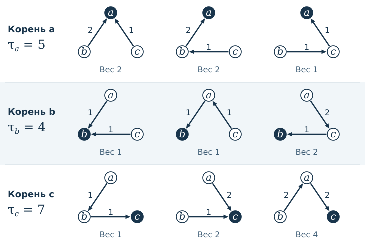
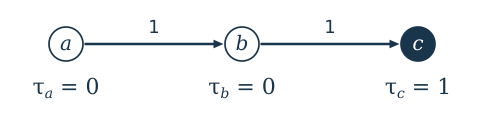

Как получить одно число из полиформы, если корень дерева уже выбран? Возьмём вершину $b$ в орграфе на вершинах $a,b,c$. Между каждой парой проведены встречные дуги. Дуги $b\to a$ и $a\to c$ имеют вес 2, остальные четыре дуги имеют вес 1. Старший грейд его полиформы равен

$$
M_2=[5\,b\wedge c+4\,c\wedge a+7\,a\wedge b,\,(abc)]
$$

Здесь $(abc)=a\wedge b+b\wedge c+c\wedge a$. Построение $M_2$ из шести дуг приведено в заметке [[ru/Направленные графы/Полиформы орграфов/Как из дуг получается полиформа орграфа#Что получилось для шести дуг|Как из дуг получается полиформа орграфа]]. Теперь вычислим остовной потенциал выбранной вершины.

## Что отбирает форма вершины

Квадратичная форма вершины $b$ имеет вид $[b]^2=[b,b]$. При умножении форм внешнее произведение берётся в каждом аргументе отдельно. Слева два члена исчезают из-за повторения $b$. Остаётся $4\,c\wedge a\wedge b$. Справа по той же причине $(abc)\wedge b=c\wedge a\wedge b$. Циклическая перестановка $c,a,b$ даёт порядок $a,b,c$ со знаком плюс. Поэтому

$$
M_2[b]^2
=4[c\wedge a\wedge b,\,(abc)\wedge b]
=4[a\wedge b\wedge c]^2
$$

Коэффициент при форме полного симплекса равен $4$. Это и есть остовной потенциал $\tau_b$. При умножении на $[a]^2$ слева сохраняется только $5\,b\wedge c$, а при умножении на $[c]^2$ только $7\,a\wedge b$. Получаем $(\tau_a,\tau_b,\tau_c)=(5,4,7)$.

Таким образом, для извлечения потенциала вершины служит её собственная форма $[b]^2$. Если умножить на неё всю полиформу $M=e+L+M_2$, то $e[b]^2$ имеет грейд 1, а $L[b]^2$ имеет грейд 2. Нужное число читается в грейде 3 произведения $M[b]^2$.

## Почему остаются деревья именно к этому корню

*Рис. 1. В каждом ряду закрашена корневая вершина, к которой ведут обе дуги дерева. Число у стрелки обозначает вес дуги, под деревом указано произведение двух весов.*

Проследим средний ряд слева направо. В первом дереве $a\to b\leftarrow c$ обе дуги ведут прямо к $b$, вес равен $1\cdot1=1$. Во втором дереве $c\to a\to b$ путь из $c$ проходит через $a$, вес снова равен $1\cdot1=1$. В третьем дереве $a\to c\to b$ используется дуга $a\to c$ веса 2. Получаем ту же четвёрку, $1+1+2=4$. Верхний ряд даёт $2+2+1=5$, нижний даёт $1+2+4=7$.

У всех деревьев среднего ряда начала дуг одни и те же, $a$ и $c$. Только корень $b$ отсутствует в их левом внешнем произведении. В верхнем и нижнем рядах из $b$ выходит дуга. Её левый аргумент уже содержит $b$, поэтому умножение на $[b]^2$ обнуляет вклад каждого из этих шести деревьев.

## Правило для произвольного орграфа

Пусть $a_1,\ldots,a_n$ образуют базис вершин конечного орграфа без петель, $n\ge2$. Вес дуги $i\to j$ равен $f_{ij}\ge0$, в дерево включаются только дуги положительного веса. В лапласиане $\mathbf L$ строка соответствует началу дуги, $L_{ii}=\sum_j f_{ij}$ и $L_{ij}=-f_{ij}$ при $i\ne j$. Форму лапласиана обозначим через $L$, её экспоненту через $M=\exp L$.

> [!info] Извлечение остовного потенциала
> **Утверждение.** Для любой вершины $a_r$ компонента грейда $n$ равна
>
> $$
> (M[a_r]^2)_n=M_{n-1}[a_r]^2
> =\tau_r[a_1\wedge\cdots\wedge a_n]^2
> $$
>
> Остовной потенциал $\tau_r$ равен сумме весов всех остовных деревьев, направленных к $a_r$. Тот же коэффициент даёт главный минор
>
> $$
> \tau_r=\det\mathbf L_{\widehat r,\widehat r}
> $$
>
> Знак $\widehat r$ означает удаление строки и столбца вершины $a_r$.

> [!note]- Почему каждое дерево вносит свой вес со знаком плюс
> **Доказательство.** По [[ru/Направленные графы/Полиформы орграфов/Как из дуг получается полиформа орграфа#Какие наборы дуг сохраняются|разложению по лесам]] каждое слагаемое $M_{n-1}$ соответствует остовному дереву. Если его корень отличен от $a_r$, то из $a_r$ выходит дуга и в левом аргументе при умножении на $[a_r]^2$ повторяется вершина.
>
> Для дерева к $a_r$ расположим вершины по убыванию расстояния до корня вдоль дерева. Корень окажется последним. У каждой некорневой вершины $a_i$ выбрана дуга к её родителю $a_j$, стоящему позже. Слева запишем начала дуг в этом порядке и допишем $a_r$. Справа получим разности $a_i-a_j$ и в конце тот же $a_r$. Замена $a_i$ на $a_i-a_j$ треугольна в выбранном базисе и имеет единицы на диагонали. Значит, полные внешние произведения слева и справа равны. Возврат к порядку $a_1,\ldots,a_n$ даёт один знак в каждом аргументе, и их произведение равно $+1$. Числовым коэффициентом остаётся произведение весов дуг дерева. $\square$

> [!note]- Откуда берётся главный минор
> **Доказательство.** Сгруппируем дуги по началу и положим $v_i=\sum_j L_{ij}a_j$. Тогда $L=\sum_i[a_i,v_i]$. Формы строк коммутируют, а квадрат каждой равен нулю, так что $M=\prod_i(e+[a_i,v_i])$.
>
> В разложении $M_{n-1}$ умножение на $[a_r]^2$ сохраняет только произведение строк с индексами $i\ne r$. Слева дописывается пропущенная вершина $a_r$. Справа в разложении внешнего произведения всех $v_i$ с $i\ne r$ сохраняется коэффициент при произведении вершин с теми же индексами. По полилинейности и антисимметрии он равен определителю матрицы коэффициентов с удалённой строкой и столбцом $r$. Перенос дописанного $a_r$ с последнего места на место $r$ даёт одинаковые знаки слева и справа. Получается указанный главный минор. $\square$

Для графа на рис. 1 проверим корень $b$ непосредственно по матрице. В порядке вершин $a,b,c$ вычёркиваем вторую строку и второй столбец. Остаются строки и столбцы $a,c$.

$$
\mathbf L=
\begin{pmatrix}
3&-1&-2\\
-2&3&-1\\
-1&-1&2
\end{pmatrix},
\qquad
\tau_b=\begin{vmatrix}3&-2\\-1&2\end{vmatrix}
=3\cdot2-2=4
$$

## Когда потенциал равен нулю

> [!info] Критерий достижимости
> **Следствие.** При неотрицательных весах $\tau_r>0$ тогда и только тогда, когда из каждой вершины существует направленный путь к $a_r$ по дугам положительного веса. Если хотя бы из одной вершины такого пути нет, то $\tau_r=0$.

> [!note]- Как построить дерево из путей
> **Доказательство.** Дерево к $a_r$ даёт из каждой вершины путь к корню. Обратно, пусть все вершины достигают $a_r$. Для каждой некорневой вершины выберем первый шаг кратчайшего по числу дуг пути к корню. Каждый шаг уменьшает оставшееся расстояние на единицу. Цикл невозможен, и все выбранные пути приводят в $a_r$. Получилось остовное дерево положительного веса. Поскольку все слагаемые в сумме весов неотрицательны, одного такого дерева достаточно для $\tau_r>0$. $\square$

*Рис. 2. В единичной цепочке обе дуги ведут к $c$. Они составляют единственное остовное дерево к этой вершине.*

Особенно показателен выбор $b$. Из $a$ можно прийти в $b$ за один шаг, но из $c$ к $b$ пути нет. В полиформе цепочки это видно в одном произведении. Её старший грейд равен $M_2=[a\wedge b,(abc)]$. Умножение на $[a]^2$ или на $[b]^2$ обнуляет левый аргумент. Умножение на $[c]^2$ даёт $[a\wedge b\wedge c]^2$. Отсюда $(\tau_a,\tau_b,\tau_c)=(0,0,1)$. В графе на двух и более вершинах чистый исток всегда имеет нулевой потенциал, поскольку в него не входит ни одна дуга. У чистого стока потенциал положителен, если его достигают все вершины.

## Почему у связного балграфа результат один

У балграфа в каждой вершине входящий вес равен исходящему. Если граф положительных дуг связен после забывания направлений, то он также сильно связен и каждый из корневых потенциалов положителен. Для исходящего лапласиана вектор потенциалов лежит в левом ядре, $\mathbf L^{\mathsf T}\boldsymbol\tau=0$. Положительный главный минор порядка $n-1$ и нулевые суммы строк дают $\operatorname{rank}\mathbf L=n-1$. Следовательно, ядро $\mathbf L^{\mathsf T}$ одномерно, а баланс даёт $\mathbf L^{\mathsf T}\mathbf1=0$. Поэтому все $\tau_r$ равны одному остовному коэффициенту. Доказательство этих свойств приведено в заметке [[ru/Направленные графы/Балансовые графы/Балансовые графы и остовные потенциалы#Критерий баланса через остовные потенциалы|Балансовые графы и остовные потенциалы]].

В единичном орцикле $a\to b\to c\to a$ для каждого корня остаётся ровно одно дерево веса 1. Формы $[a]^2,[b]^2,[c]^2$ выбирают разные деревья, но во всех трёх случаях дают коэффициент 1. Именно эта единица служит общей нормировкой в заметке [[ru/Направленные графы/Полиформы орграфов/Форма дуги и форма одностороннего резистенса|Форма дуги и форма одностороннего резистенса]].
