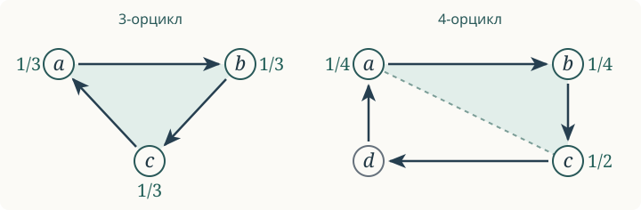

Чтобы измерить треугольную границу $(abc)$, возьмём формы двух последовательных сторон и пройдём треугольник по очереди из $a$, из $b$ и из $c$. Три полученных произведения в сумме дают $[(abc)]^2$. Это равенство выполняется **до выбора метрики**. Поэтому полную норму можно вычислить двумя способами. Можно сложить три измеренных вклада, а можно сразу взять определитель грамиана двух векторов границы. Что же запоминает каждое слагаемое по отдельности?

## Три выбора начала дают одну форму границы

Пусть $a,b,c$ принадлежат множеству из $n\ge3$ вершин. Для вершины $j$ обозначим через $x_j$ вектор от центроида **всех** $n$ вершин к $j$. Форма измерения пары $(ab)$ равна $\Phi_{ab}=[x_b,b-a]$. Она определена для любой пары вершин, даже если в графе нет дуги $a\to b$. При умножении двух форм внешнее произведение берётся отдельно в левом и правом аргументах. Например,

$$
\Phi_{ab}\Phi_{bc}
=[x_b\wedge x_c,(b-a)\wedge(c-b)]
=[x_b\wedge x_c,(abc)]
$$

Здесь $(abc)=(b-a)\wedge(c-a)$. Замена $c-a$ на $c-b$ сохраняет внешнее произведение, поскольку эти два вектора различаются на $b-a$.

> [!info] Разложение квадратичной формы треугольной границы
> **Утверждение.** Для любых трёх различных вершин $a,b,c$ выполняется тождество
>
> $$
> \boxed{\Phi_{ab}\Phi_{bc}+\Phi_{bc}\Phi_{ca}+\Phi_{ca}\Phi_{ab}=[(abc)]^2}
> $$
>
> Три слагаемых отвечают путям по двум сторонам с началами $a,b,c$ соответственно.

> [!note]- Доказательство
> **Доказательство.** Все три правых аргумента равны $(abc)$, поскольку циклическая перестановка сохраняет ориентацию треугольника. Слева получаем сумму трёх внешних произведений.
>
> $$
> x_b\wedge x_c+x_c\wedge x_a+x_a\wedge x_b
> =(x_b-x_a)\wedge(x_c-x_a)=(abc)
> $$
>
> Осталось воспользоваться билинейностью формы по её аргументам. $\square$

При обращении обхода с сохранением начала $a$ порядок $abc$ переходит в $acb$. Левый аргумент меняется с $x_b\wedge x_c$ на $x_c\wedge x_b$, а правый с $(abc)$ на $(acb)$. Оба меняют знак, поэтому $\Phi_{ab}\Phi_{bc}=\Phi_{ac}\Phi_{cb}$. Перенос начала, например из $a$ в $c$, сохраняет правый аргумент, но ставит слева $x_a\wedge x_b$. Именно этот выбор может изменить измеренное число.

## Два способа вычислить полную норму

Пусть $M=\exp L$ есть метрическая полиформа орграфа, а $S=\sum_k\tau_k>0$ есть сумма остовных потенциалов. Для измерения формы $F$ умножаем $MF$ на $[a_k]^2$ для каждого корня $a_k$, складываем коэффициенты при $[a_1\wedge\cdots\wedge a_n]^2$ и делим на $S$. Получаем линейный функционал $P_M^\Sigma$. Формальное тождество предыдущего раздела применимо и при $S=0$, а для численных значений далее нужна указанная нормировка. [[ru/Направленные графы/Полиформы орграфов/Как нормировать односторонний резистенс в небалансовом орграфе#Одно правило для всех пар|Правило измерения по всем корням]]

> [!info] Полная норма по формам сторон и по грамиану
> **Утверждение.** Положим $u=b-a$, $v=c-a$. Пусть $\beta(u,v)=P_M^\Sigma([u,v])$ есть направленное скалярное произведение (НСП). Тогда для $R_{abc}=P_M^\Sigma([(abc)]^2)$ имеем
>
> $$
> \begin{aligned}
> R_{abc}
> &=P_M^\Sigma(\Phi_{ab}\Phi_{bc})+P_M^\Sigma(\Phi_{bc}\Phi_{ca})+P_M^\Sigma(\Phi_{ca}\Phi_{ab})\\
> &=\det\begin{pmatrix}\beta(u,u)&\beta(u,v)\\ \beta(v,u)&\beta(v,v)\end{pmatrix}
> \end{aligned}
> $$
>
> В грамиан входят оба порядка НСП. Их можно вычислить по таблице односторонних резистенсов. [[ru/Направленные графы/Полиформы орграфов/Как вычислить направленное скалярное произведение двух векторов в орграфе#Как считать по таблице резистенсов|Расчёт НСП]]

> [!note]- Почему определитель даёт норму в небалансовом орграфе
> **Доказательство.** Первая строка следует из линейности $P_M^\Sigma$. Для второй обозначим координатные столбцы $u,v$ через $\mathbf u,\mathbf v$ и положим $\mathbf U=(\mathbf u,\mathbf v)$. Прибавим к матрице лапласиана $s\mathbf u\mathbf u^{\mathsf T}+t\mathbf v\mathbf v^{\mathsf T}$. Пусть $S(s,t)$ есть сумма главных миноров порядка $n-1$ полученной матрицы. В алгебре полиформ экспонента возмущённого лапласиана равна $M(e+s[u]^2)(e+t[v]^2)$, где $e$ есть единица. Значит, коэффициент при $st$ в $S(s,t)/S$ равен $P_M^\Sigma([u]^2[v]^2)=R_{abc}$.
>
> С другой стороны, на пространстве $W$ векторов нулевой суммы центрированный лапласиан $\mathbf K=\mathbf J\mathbf L$ обратим и $\det(\mathbf K|_W)=S$. Здесь $\mathbf J$ есть ортогональная проекция на $W$. Оба возмущения уже центрированы, поэтому тем же способом $S(s,t)$ вычисляется как определитель возмущённой матрицы на $W$. Обозначим обратную на $W$ через $\mathbf B$. По тождеству $\det(\mathbf I+\mathbf A\mathbf C)=\det(\mathbf I+\mathbf C\mathbf A)$ получаем
>
> $$
> \frac{S(s,t)}{S}=\det\!\left(\mathbf I_2+
> \begin{pmatrix}s&0\\0&t\end{pmatrix}\mathbf U^{\mathsf T}\mathbf B\mathbf U\right)
> $$
>
> Коэффициент при $st$ равен $\det(\mathbf U^{\mathsf T}\mathbf B\mathbf U)$. Поскольку $\beta(u,v)=\mathbf v^{\mathsf T}\mathbf B\mathbf u$, матрица под этим последним определителем есть транспонированный грамиан НСП. Их определители равны. [[ru/Направленные графы/Полиформы орграфов/Можно ли восстановить орграф по матрице односторонних резистенсов#Что сохраняется при центрировании|Связь суммы миноров с определителем на пространстве векторов]] $\square$

В ненаправленном графе $R_{abc}$ равен квадрату площади параллелограмма на $u,v$, а квадрат площади самого треугольника равен $R_{abc}/4$. В орграфе $R_{abc}$ обозначает нормированный потенциал формы $[(abc)]^2$. Замена полного НСП его симметричной частью может изменить определитель. [[ru/Направленные графы/Балансовые графы/Резистивная геометрия и циркуляция#Резистенс трёх вершин|Норма границы и евклидова площадь в балграфе]]

## Три вершины. Каждое начало даёт треть

Если в графе всего три вершины, то $x_a+x_b+x_c=0$. Поэтому $x_b\wedge x_c=x_c\wedge x_a=x_a\wedge x_b$. Их сумма равна $(abc)$, откуда каждое произведение двух форм сторон равно $\tfrac13[(abc)]^2$ ещё до измерения.

В единичном орцикле $a\to b\to c\to a$ остовные потенциалы равны $(1,1,1)$. Для $[(abc)]^2$ каждый из трёх корневых коэффициентов равен единице. Действительно, $(abc)\wedge a$, $(abc)\wedge b$ и $(abc)\wedge c$ равны $a\wedge b\wedge c$. Поэтому $R_{abc}=3/3=1$, а три начала дают по $1/3$.

То же разложение работает в небалансовом графе серии с потенциалами $(5,4,7)$. Корневые коэффициенты $[(abc)]^2$ по-прежнему равны единице, но теперь $S=16$. Вклады трёх начал равны $1/16$ каждый. Проверим их сумму по грамиану векторов $(ab),(ac)$. Диагональные значения равны $r_{ab}+r_{ba}=7/16$ и $r_{ac}+r_{ca}=8/16$. Оба смешанных значения вычислены в шестой заметке. [[ru/Направленные графы/Полиформы орграфов/Как вычислить направленное скалярное произведение двух векторов в орграфе#Два порядка на одном орграфе|Сквозной пример]]

$$
R_{abc}=\det\!\left(\frac1{16}\begin{pmatrix}7&4\\2&8\end{pmatrix}\right)
=\frac{56-8}{16^2}=\frac3{16}
$$

## Четыре вершины. Что меняет выбор начала

Возьмём единичный орцикл $a\to b\to c\to d\to a$ и измерим ту же границу $(abc)$. Прямой дуги между $a$ и $c$ здесь нет. Тем не менее обе измерительные формы $\Phi_{ac}$ и $\Phi_{ca}$ определены. Четвёртая вершина входит в центроид, и теперь $x_a+x_b+x_c=-x_d$.

*Рис. 1. Стрелками показаны единичные дуги, дробями у вершин отмечены вклады начал. В обоих графах измеряется одна тройка $a,b,c$. Пунктир справа замыкает измеряемый треугольник.*

| Начальная вершина | Прямой порядок | Обратный порядок из той же вершины | Вклад при каждом из двух порядков |
| --- | --- | --- | --- |
| $a$ | $abc$ | $acb$ | $1/4$ |
| $b$ | $bca$ | $bac$ | $1/4$ |
| $c$ | $cab$ | $cba$ | $1/2$ |

Откуда взялась половина в последней строке? Выполним умножение на полиформу цикла. До умножения на форму корня нам нужен третий грейд. У измерительной формы грейд второй, поэтому из $M$ участвует только $L$. В его произведении с $[x_b\wedge x_c,(abc)]$ дуги $a\to b$ и $b\to c$ исчезают справа. Если записать $(abcd)=(b-a)\wedge(c-b)\wedge(d-c)$, то дуги $c\to d$ и $d\to a$ дают справа соответственно $-(abcd)$ и $(abcd)$. Поэтому

$$
L\Phi_{ab}\Phi_{bc}=[(d-c)\wedge x_b\wedge x_c,(abcd)]
$$

Для начала $a$ подставим $x_b\wedge x_c=x_b\wedge(c-b)$ и $4x_b=(b-a)+(b-c)+(b-d)$. В левом аргументе выживает лишь $b-a$, потому что $b-c$ и $b-d$ лежат в линейной оболочке $c-b$ и $d-c$. Коэффициент при $(abcd)$ равен $1/4$.

Для начала $b$ слева стоит $(d-c)\wedge x_c\wedge(a-c)$. В сумме $4x_c=(c-a)+(c-b)+(c-d)$ остаётся только $c-b$, что снова даёт $1/4$. Для начала $c$ получаем $(d-c)\wedge x_a\wedge(b-a)$. Здесь в сумме $4x_a=(a-b)+(a-c)+(a-d)$ сохраняются **два** слагаемых. Разность между $a-c$ и $a-d$ пропорциональна уже имеющемуся $d-c$, поэтому оба дают один и тот же вклад $1/4$.

К каждому из четырёх корней ведёт одно дерево веса $1$, так что $S=4$. При умножении $[(abcd)]^2$ на форму любого корня старший коэффициент равен единице. Поэтому нормировка сохраняет найденные коэффициенты, а сумма вкладов равна $1/4+1/4+1/2=1$. Проверка полной нормы по НСП даёт тот же результат. В этом орцикле $r_{ij}$ равно числу дуг от $i$ до $j$ по циклу, делённому на четыре. Для $(ab),(ac)$ грамиан имеет строки $(1,0)$ и $(1,1)$, и его определитель равен единице.

Таким образом, разницу между $abc$ и $cba$ в таблице объясняет перенос начала из $a$ в $c$. Обращение обхода из той же вершины сохраняет вклад. Три произведения форм сторон дают точное разложение полной нормы по началам. Вопрос о двух различных площадях, которые зависели бы только от ориентации треугольника, остаётся открытым. Разложение по началам и определительное правило обобщены в заключительной заметке. [[ru/Направленные графы/Полиформы орграфов/Как вычислить норму границы произвольного порядка в орграфе|Как вычислить норму границы произвольного порядка в орграфе?]]
