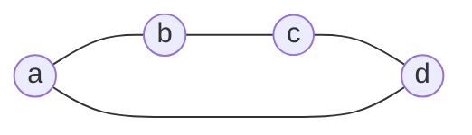

В [[Совместная вариация нескольких связей|совместных вариациях связей]] смешанные коэффициенты выражаются определителями Грама нескольких аффинных векторов. Алгебра полиформ позволяет сопоставить такой системе векторов один формальный объект и выполнять операции с ним до задания численной метрики.

Основой служит внешняя алгебра. Формы и их произведение вводятся отдельными определениями; скалярное произведение для этих определений не требуется. Связь с резистивной метрикой рассматривается в конце заметки и развивается в [[Метрика объектов высших грейдов]].

## Точки и аффинные векторы

Пусть $V$ является вещественным линейным пространством с **линейно независимым** базисом $a_1,\ldots,a_n$. Базисные элементы представляют вершины. Сумму коэффициентов называем аффинным весом и обозначаем через $\varepsilon$:

$$
\varepsilon\left(\sum_i x_i a_i\right)=\sum_i x_i
$$

Объектом пространства называем произвольную структуру первого грейда. По аффинному весу различаем элементы и аффинные векторы. Слово «элемент» далее имеет специальный смысл: вес $1$. В обычном выражении «элемент матрицы» оно этого смысла не имеет.

> [!info] Элементы и векторы
> **Определение.** Комбинация $x=\sum_i x_i a_i$ является элементом, если $\sum_i x_i=1$, и аффинным вектором, если $\sum_i x_i=0$.
>
> Пространство аффинных векторов обозначим через
>
> $$
> W=\ker\varepsilon=\left\{\sum_i u_i a_i:\sum_i u_i=0\right\},\qquad \dim W=n-1
> $$

Например, $(a+b)/2$ является элементом, а $a+b-2c$ - аффинным вектором. Объект $a+b$ имеет вес $2$ и не является ни элементом, ни вектором. Разность двух элементов принадлежит $W$. Вершина, или узел графа, является элементом; её норма графовым названием не задаётся.

**Точкой**, или **локальным элементом**, называем элемент нулевой нормы, когда метрика на объектах уже задана. Здесь алгебра строится без такой метрики, поэтому локальность не предполагаем. При переходе к [[Нуль-вектор, изотропное представление и граница|изотропной модели]] вершины можно выбрать точками; произвольная аффинная комбинация этих точек остаётся элементом, но не обязана иметь нулевую норму.

> [!info] Двуточечные и многоточечные векторы
> **Определение.** Для упорядоченной пары базисных вершин **вектор пары вершин** определяется как
>
> $$
> a_{ij}=a_j-a_i
> $$
>
> Его направление задаётся порядком вершин: $a_{ji}=-a_{ij}$. Наличие ребра для определения вектора не требуется.
>
> Если концы являются точками, их разность называется **двуточечным вектором**. В локальном базисе запись аффинного вектора с тремя или более ненулевыми коэффициентами называется **многоточечной**. Без условия локальности говорим о числе участвующих вершин.

Например,

$$
u=a_1+a_2-2a_3=(a_1-a_3)+(a_2-a_3)=a_{31}+a_{32}
$$

Это один вектор, записанный через три вершины как сумма двух векторов пар вершин. Число участвующих вершин относится к выбранному базису. Для любого элемента $p$ объект $q=p+u$ также имеет вес $1$, поэтому $u=q-p$ является разностью двух элементов. Их локальность из этого не следует.

Элементы $a_i$ следует отличать от назначенных им числовых значений $x_i$. Разность $a_j-a_i$ - вектор, а $x_j-x_i$ - число. Назначение значений продолжается линейно: объекту $\sum_i u_i a_i$ соответствует число $\sum_i u_i x_i$. Например, вектору $u$ выше соответствует $x_1+x_2-2x_3$. Это числовое значение зависит от назначенных $x_i$, тогда как сам $u$ задан своими коэффициентами при $a_i$.

Связь с [[Эффективное сопротивление и геометрия графа#Евклидова геометрия графа|центрированными векторами вершин]] можно записать явно. В формальном пространстве введём центроид и разности

$$
h=\frac1n\sum_i a_i,\qquad p_i=a_i-h\in W
$$

Тогда $\sum_i p_i=0$, хотя исходные $a_i$ остаются линейно независимыми. В резистивной метрике их скалярные произведения равны $p_i\cdot p_j=\mathrm{Gr}_{ij}$. Соотношение нулевой суммы относится к $p_i$, а не к формальным вершинам $a_i$. Разности сохраняются: $p_j-p_i=a_j-a_i$.

## Внешнее произведение и грейд

Для площади нужны сразу два вектора, для объёма - три. Внешнее произведение позволяет работать с ними как с одним ориентированным объектом. Например, $uv$ соответствует ориентированному параллелограмму на $u,v$: при перестановке векторов ориентация меняется, а при их линейной зависимости объект обращается в нуль. Пока речь идёт об алгебраическом объекте; численную площадь получим после задания метрики.

Внешнее произведение $\wedge$ билинейно, ассоциативно и для объектов $x,y\in V$ удовлетворяет

$$
x\wedge y=-y\wedge x,\qquad x\wedge x=0
$$

> [!info] Внешние структуры
> **Определение.** Линейные комбинации произведений $x_1\wedge\cdots\wedge x_k$ образуют пространство $\Lambda^kV$. Его элементы называются внешними структурами грейда $k$.
>
> Скаляр $1$ имеет грейд $0$ и является единицей внешнего произведения. Произведение структур грейдов $k$ и $m$ имеет грейд $k+m$, если оно ненулевое.

Далее внешнее произведение записываем без знака $\wedge$: $xy$ означает $x\wedge y$. Внешнее самопроизведение $X\wedge X$ сохраняет явный знак, чтобы не смешивать его с численной нормой $X^2$.

Внешняя структура одного фиксированного грейда называется **однородной**. Для однородных $X,Y$ грейдов $k,m$ выполняется

$$
X Y=(-1)^{km}Y X
$$

Внешнее произведение $k$ объектов равно нулю тогда и только тогда, когда эти объекты линейно зависимы.

Например, по билинейности $(u+v)v=uv+vv=uv$: добавление к первому вектору второго не меняет внешнего произведения. Это соответствует сохранению ориентированной площади при таком сдвиге стороны параллелограмма.

Ориентированный симплекс записывается как

$$
[a_1\ldots a_k]=a_1 \cdots a_k
$$

Его грейд равен числу вершин. Поэтому $[abc]$ имеет грейд $3$, хотя геометрический треугольник двумерен. Перестановка двух вершин меняет знак; повторение вершины даёт нуль. Общая внешняя структура может быть линейной комбинацией симплексов и не обязана быть одним внешним произведением.

> [!info] Внешнее произведение и грейд
> **Определение.** Внешняя структура называется простой, если она представима одним внешним произведением объектов.

## Граничный оператор

Граничный оператор переводит ориентированный симплекс в сумму его ориентированных граней. У отрезка это разность концов, у треугольника - три стороны с согласованными знаками:

$$
\partial[ab]=b-a,\qquad
\partial[abc]=[bc]-[ac]+[ab]=[ab]+[bc]+[ca]
$$

На рисунке стрелки задают ориентации **сторон** $[ab]$, $[bc]$, $[ca]$, то есть структур второго грейда. Их сумма является границей треугольника. Если ещё раз применить границу, получим сумму разностей концов $(b-a)+(c-b)+(a-c)=0$. Это поясняет правило «граница границы равна нулю».

> [!info] Граница
> **Определение.** Линейный граничный оператор задаётся условиями
>
> $$
> \partial1=0,\qquad \partial a_i=1
> $$
>
> и для $k\ge1$ правилом
>
> $$
> \partial[a_1\ldots a_k]=\sum_{i=1}^k(-1)^{i-1}[a_1\ldots\widehat{a_i}\ldots a_k]
> \tag{1}
> $$
>
> Знак над $a_i$ означает пропуск этого элемента; пустое внешнее произведение равно $1$. Ненулевая граница имеет грейд на единицу меньше исходного объекта.

Равенство $\partial a_i=1$ входит в определение: справа стоит скаляр грейда $0$, а не дополнительная вершина. По линейности

$$
\partial\left(\sum_i x_i a_i\right)=\sum_i x_i
$$

Поэтому граница аффинного вектора равна нулю, а граница элемента равна единице.

Границы симплексов обозначаем круглыми скобками:

$$
(ab)=\partial[ab]=b-a,\qquad
(abc)=\partial[abc]=[bc]-[ac]+[ab]
$$

В частности, $(a_i a_j)=a_{ij}$. В сокращённой индексной записи $(ij)$ также означает $a_{ij}$. Симплекс $[abc]$ и его граница $(abc)$ являются разными структурами грейдов $3$ и $2$.

| Объект | Симплекс и его грейд | Граница | Грейд границы |
|---|---|---|---:|
| Элемент | $a$, грейд $1$ | $1$ | 0 |
| Ориентированный отрезок | $[ab]$, грейд $2$ | $(ab)=b-a$ | 1 |
| Ориентированный треугольник | $[abc]$, грейд $3$ | $(abc)=[bc]-[ac]+[ab]$ | 2 |
| Ориентированный тетраэдр | $[abcd]$, грейд $4$ | $(abcd)=[bcd]-[acd]+[abd]-[abc]$ | 3 |

Для ненулевой границы грейд на единицу меньше грейда исходного симплекса. Он совпадает с геометрической размерностью невырожденного симплекса.

> [!info] Свойства границы
> **Лемма.** Для однородного $X$ грейда $k$
>
> $$
> \partial^2=0,\qquad
> \partial(XY)=(\partial X)Y+(-1)^kX(\partial Y)
> \tag{2}
> $$

В первом равенстве каждое удаление двух вершин в (1) встречается дважды с противоположными знаками. Во втором слагаемые разделяются на удаления из $X$ и из $Y$; перед удалением из $Y$ находятся $k$ множителей объекта $X$. Это доказывает оба свойства по линейности.

## Границы и внешние степени аффинных векторов

> [!info] Пространство границ
> **Лемма.** Для каждого грейда $k$ пространство границ совпадает с $\Lambda^kW$. Иначе говоря, для $B\in\Lambda^kV$ равносильны условия: $B$ является границей, $\partial B=0$ и $B\in\Lambda^kW$.

> [!note]- Доказательство
> **Доказательство.** Зафиксируем базовую вершину $a_1$. Она дополняет $W$ до $V$, поэтому любая структура $B$ грейда $k\ge1$ единственным образом представляется как
>
> $$
> B=D+a_1 C,\qquad
> D\in\Lambda^kW,\quad C\in\Lambda^{k-1}W
> $$
>
> Граница каждого вектора из $W$ равна нулю. По (2) получаем $\partial D=\partial C=0$ и $\partial B=C$. Поэтому условие $\partial B=0$ равносильно $B\in\Lambda^kW$.
>
> Для такого $B$ имеем $\partial(a_1 B)=B$, то есть $B$ является границей. Обратно, граница удовлетворяет $\partial B=0$ в силу $\partial^2=0$. При $k=0$ любой скаляр $s$ равен $\partial(sa_1)$, что завершает доказательство. $\square$

Таким образом, границы образуют подалгебру внешней алгебры: произведение границ снова является границей. Ненулевые границы имеют грейды от $0$ до $n-1$. Это ограничение следует из $\dim W=n-1$.

## Произведения границ симплексов

Для базовых вершин $p,a_1,\ldots,a_r$ из (1) следует

$$
(pa_1\ldots a_r)=(a_1-p) \cdots (a_r-p)
\tag{3}
$$

Рассмотрим границы двух симплексов на базовых вершинах, каждый из которых содержит не менее двух вершин. Если их единственная общая вершина $p$ поставлена первой в обоих списках, то (3) даёт

$$
(pa_1\ldots a_r) (pb_1\ldots b_s)=(pa_1\ldots a_r b_1\ldots b_s)
$$

При других порядках вершин учитывается знак соответствующих перестановок. Если общих вершин не менее двух, произведение равно нулю: при выборе одной общей вершины $p$ оба произведения в (3) содержат разность со второй общей вершиной. Если множества вершин не пересекаются, произведение ненулевое и остаётся произведением двух границ.

Эти правила относятся именно к границам симплексов на базовых вершинах. Для произвольных линейных комбинаций произведение вычисляется по билинейности, а не по списку встречающихся в записи вершин.

> [!example] Произведения границ
>
> $$
> (ab) (bc)=(b-a) (c-b)=[bc]-[ac]+[ab]=(abc)
> $$
>
> $$
> (abc) (bc)=0,\qquad
> (ab) (cd)=[bd]-[bc]-[ad]+[ac]
> $$

Лес - граф без циклов; каждая его компонента является деревом или изолированной вершиной. В произведении по рёбрам изолированная вершина даёт пустое произведение, равное $1$.

> [!info] Рёберные произведения
> **Теорема.** Внешнее произведение векторов выбранных рёбер ненулевое тогда и только тогда, когда эти рёбра образуют лес. Для дерева на вершинах $p_1,\ldots,p_s$ произведение равно $\pm(p_1\ldots p_s)$. Для леса получается произведение границ его компонент с точностью до ориентационного знака.

> [!note]- Доказательство
> **Доказательство.** Векторы рёбер цикла линейно зависимы: после согласования направлений их сумма равна нулю. Поэтому наличие цикла обнуляет всё произведение, в том числе при наличии других компонент.
>
> В лесу векторы независимы. В любой линейной зависимости коэффициент при вершине-листе заставляет коэффициент её единственного ребра быть нулевым. Последовательное удаление листьев обнуляет все коэффициенты зависимости.
>
> Для дерева правило слияния по одной общей вершине, применяемое при последовательном присоединении листьев, даёт границу всего дерева с точностью до знака. Для леса оно применяется в каждой компоненте. Изолированная вершина даёт множитель $\partial a_i=1$. $\square$

## Формы: билинейность и основные операции

Внешняя структура меняет знак при обращении ориентации. Для неориентированного ребра этот знак не должен влиять на результат. Поэтому введём квадратичную форму $[X]^2$, для которой $[-X]^2=[X]^2$. Чтобы раскрывать форму суммы $[X+Y]^2$ и перемножать формы, понадобятся также смешанные символы $[X,Y]$. Сначала зададим их билинейность, а квадратичную форму получим при совпадении аргументов.

> [!info] Формы одного грейда
> **Определение.** Для $X,Y\in\Lambda^kV$ вводятся формальные символы $[X,Y]$. Они порождают линейное пространство форм грейда $k$ с единственными соотношениями билинейности:
>
> $$
> [\alpha X+\beta Z,Y]=\alpha[X,Y]+\beta[Z,Y]
> $$
>
> $$
> [X,\alpha Y+\beta Z]=\alpha[X,Y]+\beta[X,Z]
> $$
>
> В каждой формуле все аргументы имеют грейд $k$, а $\alpha,\beta\in\mathbb R$. Симметрия $[X,Y]=[Y,X]$ не предполагается.

Такое определение задаёт формальный объект, а не число и не числовую билинейную функцию на $V$. Если $E_1,\ldots,E_N$ образуют базис $\Lambda^kV$, то формы $[E_i,E_j]$ образуют базис пространства форм этого грейда.

> [!info] Квадратичная, транспонированная и полярная формы
> **Определение.** Для аргументов одного грейда полагаем
>
> $$
> [X]^2=[X,X],\qquad [X,Y]^{\mathsf T}=[Y,X]
> $$
>
> $$
> \{X,Y\}=[X,Y]+[Y,X]
> $$
>
> Транспонирование продолжается на линейные комбинации. Полярная форма выбрана без множителя $1/2$.

Из билинейности следует

$$
[X+Y]^2=[X]^2+\{X,Y\}+[Y]^2
$$

Примеры: $[a]^2$ является формой элемента, $[(ab)]^2$ формой аффинного вектора, $[(abc)]^2$ формой границы второго грейда. Обращение ориентации аргумента не меняет квадратичную форму: $[-X]^2=[X]^2$.

Запись $[X]^2$ обозначает форму. Она не означает ни внешнее произведение $X\wedge X$, ни численную норму. Численные метрические величины будут определены отдельно.

## Полиформы и произведение форм

> [!info] Полиформа
> **Определение.** Полиформа является конечной линейной комбинацией форм, в том числе разных грейдов. Если все слагаемые имеют грейд $k$, полиформа однородна. Общая полиформа имеет разложение
>
> $$
> P=P_0+P_1+\cdots+P_n
> $$
>
> где $P_k$ является её грейд-компонентой.

> [!info] Произведение форм
> **Определение.** Для форм грейдов $k$ и $m$ положим
>
> $$
> [X,Y][A,B]=[XA,YB]
> \tag{4}
> $$
>
> Произведение продолжается по билинейности на полиформы. Его единица есть форма $e=[1,1]$ грейда $0$.

В аргументах справа $XA$ и $YB$ обозначают внешние произведения объектов. Между формами слева действует определённое через него произведение форм. Это разные операции, и тип множителей показывает, какая из них применяется.

Скаляр $1$ и форма $e$ принадлежат разным уровням конструкции. По билинейности $[s,t]=st\,e$ для скаляров $s,t$, а $eF=Fe=F$ для любой формы.

> [!info] Свойства умножения
> **Теорема.** Произведение полиформ ассоциативно, дистрибутивно и коммутативно. Грейды ненулевых произведений однородных форм складываются.

> [!note]- Доказательство
> **Доказательство.** Билинейность внешнего произведения обеспечивает согласованность (4) с соотношениями, определяющими формы. Ассоциативность и дистрибутивность наследуются от операций в аргументах.
>
> При перестановке форм грейдов $k$ и $m$ в каждом аргументе возникает знак $(-1)^{km}$. По билинейности оба знака перемножаются:
>
> $$
> [X A,Y B]=(-1)^{2km}[A X,B Y]=[A X,B Y]
> $$
>
> Это доказывает коммутативность. Сложение грейдов следует из (4). $\square$

Для квадратичных форм имеем

$$
[X]^2[A]^2=[X A]^2
\tag{5}
$$

> [!example] От двух векторов к форме границы
> Сначала перемножаем внешние аргументы, затем берём форму результата:
>
> $$
> (ab)(bc)=(abc),\qquad
> [(ab)]^2[(bc)]^2=[(abc)]^2
> $$
>
> При перестановке векторов $(bc)(ab)=-(abc)$, но $[-(abc)]^2=[(abc)]^2$. Поэтому произведение форм не зависит от этого ориентационного знака. Справа всё ещё формальная форма, а не площадь и не её квадрат; численное значение появится после выбора метрики.

## Нильпотентность и формы на границах

Для любого $v\in V$ положим $q_v=[v]^2$. Из (5) следует

$$
q_v^2=[v\wedge v]^2=0
$$

При этом форма $q_v$ ненулевого элемента $v\in V$ сама ненулевая. Свойство означает, что её произведение с самой собой равно нулю.

Более общо,

$$
[v_1]^2\cdots[v_r]^2=[v_1 \cdots v_r]^2
\tag{6}
$$

Произведение (6) равно нулю тогда и только тогда, когда элементы $v_1,\ldots,v_r$ линейно зависимы. В частности, произведение форм рёбер цикла равно нулю.

Линейная оболочка форм $[X,Y]$ с $X,Y\in\Lambda^kW$ по всем $k=0,\ldots,n-1$ образует подалгебру форм на границах. Она содержит $e$, замкнута относительно произведения и имеет грейды от $0$ до $n-1$. Поэтому для любой полиформы $P$ из этой подалгебры с $P_0=0$ выполняется $P^n=0$: каждый член произведения $n$ множителей имел бы грейд не меньше $n$.

Это не означает, что квадрат всякой формы положительного грейда равен нулю. Например, для независимых аффинных векторов $u,v$

$$
\bigl([u]^2+[v]^2\bigr)^2=2[u v]^2\ne0
$$

## Тождество четырёх точек

Сохраняем привычное название тождества. Алгебраическое равенство верно для любых четырёх элементов; условие нулевой нормы не требуется.

> [!info] Тождество полярных форм
> **Лемма.** Для любых четырёх элементов $a_i,a_j,a_k,a_l$ и их аффинных разностей $a_{ij}=a_j-a_i$ выполняется равенство форм
>
> $$
> \{a_{ij},a_{kl}\}+\{a_{jk},a_{il}\}+\{a_{ik},a_{lj}\}=0
> \tag{7}
> $$
>
> Совпадение элементов допускается. Выбор метрики для этого равенства не требуется.

> [!note]- Доказательство
> **Доказательство.** Положим $u=a_{ij}$, $v=a_{jk}$, $w=a_{kl}$. Тогда
>
> $$
> a_{il}=u+v+w,\qquad a_{ik}=u+v,\qquad a_{lj}=-v-w
> $$
>
> Левая часть (7) равна
>
> $$
> \{u,w\}+\{v,u+v+w\}-\{u+v,v+w\}
> $$
>
> По определению полярная форма билинейна и симметрична, поэтому
>
> $$
> \{v,u+v+w\}=\{u,v\}+\{v,v\}+\{v,w\}
> $$
>
> $$
> \{u+v,v+w\}=\{u,v\}+\{u,w\}+\{v,v\}+\{v,w\}
> $$
>
> После подстановки все слагаемые сокращаются. $\square$

Тождество (7) является структурным: оно выражает линейную зависимость полярных форм разностей четырёх элементов. Его скалярная версия рассмотрена в [[Скалярное произведение векторов графа#Тождество четырёх точек|заметке о скалярном произведении]]. Переход к ней через метрическую оценку описан ниже.

## Метрическая оценка

Пусть на пространстве аффинных векторов $W$ задано положительно определённое скалярное произведение, например резистивная метрика связного графа. Формам первого грейда назначим численные значения:

$$
[u,v]\longmapsto u\cdot v,\qquad
[u]^2\longmapsto u\cdot u,\qquad
\{u,v\}\longmapsto 2u\cdot v
$$

Оценка линейна: оценка суммы форм равна сумме их оценок с теми же коэффициентами. Поэтому каждое слагаемое в (7) даёт удвоенное скалярное произведение. После деления на $2$ получаем

$$
a_{ij}\cdot a_{kl}+a_{jk}\cdot a_{il}+a_{ik}\cdot a_{lj}=0
$$

Для высших грейдов нужно ещё определить скалярное произведение самих внешних структур. Это будет сделано в [[Метрика объектов высших грейдов]]. Основное правило уже знакомо по [[От длин к площадям и объёмам|формуле Грама]]: квадратичная форма произведения векторов получает значение

$$
[u_1\cdots u_k]^2\longmapsto\det(u_i\cdot u_j)_{i,j=1}^k
$$

Поэтому оценка произведения форм в общем случае не равна произведению их оценок. Для $[u]^2[v]^2=[uv]^2$ получится $\|u\|^2\|v\|^2-(u\cdot v)^2$, а произведение отдельных оценок равно $\|u\|^2\|v\|^2$. Недостающий член учитывает угол между векторами.

Метрика на $W$ не задаёт автоматически норму формального элемента или произвольного симплекса в $V$. В заметке о высших грейдах метрика определяется именно на границах; затем форма $[X,Y]$ на границах получает значение $X\cdot Y$.

## Полиформное представление лапласиана

Для неориентированного графа положим

$$
L=\sum_{i<j}c_{ij}[a_{ij}]^2=\sum_{i<j}c_{ij}[(ij)]^2
\tag{8}
$$

Это однородная полиформа первого грейда на границах. Если требуется одновременно матричное представление, обозначаем его через $\mathbf L$. Коэффициентная матрица формы (8) в базисных формах $[a_i,a_j]$ совпадает с обычным лапласианом, поскольку

$$
[a_j-a_i]^2=[a_i]^2+[a_j]^2-\{a_i,a_j\}
$$

Чтобы получить электрическую квадратичную форму, продолжим значения потенциалов $\varphi_i$ до линейного функционала на $V$, положив $\varphi(a_i)=\varphi_i$. Подстановка $[u,v]\mapsto\varphi(u)\varphi(v)$ в форму первого грейда $L$ даёт

$$
L\longmapsto\sum_{i<j}c_{ij}(\varphi_j-\varphi_i)^2
=\boldsymbol\varphi^{\mathsf T}\mathbf L\boldsymbol\varphi
$$

Здесь $\boldsymbol\varphi=(\varphi_1,\ldots,\varphi_n)^{\mathsf T}$ обозначает столбец значений функционала на вершинах. Эта подстановка отличается от метрической оценки $[u,v]\mapsto u\cdot v$ и связывает формальный лапласиан с [[Лапласиан - граф, электрическая сеть и квадратичная форма#Квадратичная форма и мощность сети|квадратичной формой электрической сети]].

Однако умножение форм (4) отличается от матричного умножения, поэтому $L^2$ и $\mathbf L^2$ обозначают разные объекты.

Рассмотрим единичный цикл $C_4$.

> [!example] Матрица и полиформа цикла
> В порядке вершин $a,b,c,d$ матричный лапласиан и полиформа равны
>
> $$
> \mathbf L=\begin{pmatrix}
> 2&-1&0&-1\\
> -1&2&-1&0\\
> 0&-1&2&-1\\
> -1&0&-1&2
> \end{pmatrix}
> $$
>
> $$
> L=[(ab)]^2+[(bc)]^2+[(cd)]^2+[(da)]^2
> $$
>
> Две соседние связи дают $[(ab)]^2[(bc)]^2=[(abc)]^2$, а две несмежные дают $[(ab)]^2[(cd)]^2=[(ab)(cd)]^2$.
>
> Три последовательные связи дают
>
> $$
> [(ab)]^2[(bc)]^2[(cd)]^2=[(abcd)]^2
> $$
>
> Произведение всех четырёх форм равно нулю, поскольку $(ab)+(bc)+(cd)+(da)=0$.

> [!example] Старшая степень для $C_4$
> В $L^3$ выживают наборы из трёх различных рёбер. Их четыре, каждый является остовным деревом и даёт форму $[(abcd)]^2$. Каждый набор встречается в $3!$ порядках, поэтому
>
> $$
> L^3=24[(abcd)]^2,\qquad L^4=0
> $$

## Продолжение и литература

Заметка [[Метрика объектов высших грейдов]] определяет скалярные произведения границ одного грейда и их численные нормы. Заметка [[Экспонента лапласиана]] объединяет степени $L$ в одну полиформу; доказанное ограничение грейда делает её экспоненциальный ряд конечным.

В [[Литература к вводной серии PMG|рекомендуемой литературе]] источники [7] и [8] посвящены внешней алгебре, билинейности и определителям Грама. Определение формальных символов $[X,Y]$ и их произведения (4) фиксирует используемую в этой серии алгебру полиформ.
