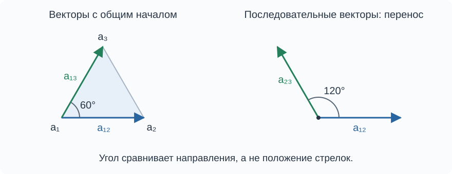

В заметке [[Эффективное сопротивление и геометрия графа]] резистенсы определили квадраты расстояний между вершинами. Теперь вычислим скалярные произведения векторов пар вершин, а по ним - углы. В электрической сети то же скалярное произведение можно измерить как разность потенциалов на одной паре вершин при единичном токе через другую.

Рассматривается конечный связный неориентированный граф без петель с положительными величинами существующих связей. Его лапласиан обозначается $L$, матрица Грина - $\mathrm{Gr}=L^+$. Вектор пары вершин $a_{ij}=a_j-a_i$ имеет коэффициент $-1$ при $a_i$, коэффициент $1$ при $a_j$ и нулевые коэффициенты при остальных вершинах.

Для записи этих коэффициентов обозначим через $\mathbf e_i$ набор из $n$ чисел: единица на месте $i$, остальные числа - нули. Тогда набор коэффициентов вектора $a_{ij}$ равен $\mathbf e_{ij}=\mathbf e_j-\mathbf e_i$. Например, при трёх вершинах $\mathbf e_{13}=(-1,0,1)$. При умножении на матрицу записываем эти наборы столбцами; знак $\mathsf T$ означает переход от столбца к строке.

## Скалярное произведение через матрицу Грина

Пусть $h=(a_1+\cdots+a_n)/n$ - центроид, а $p_i=a_i-h$ - вектор от него к вершине $a_i$. По определению метрики графа $p_i\cdot p_j=\mathrm{Gr}_{ij}$, поэтому

$$
a_{ij}\cdot a_{kl}=(p_j-p_i)\cdot(p_l-p_k)=\mathrm{Gr}_{jl}-\mathrm{Gr}_{jk}-\mathrm{Gr}_{il}+\mathrm{Gr}_{ik}
$$

> [!info] Скалярное произведение
> **Лемма.** Для любых двух пар вершин
>
> $$
> a_{ij}\cdot a_{kl}=\mathbf e_{ij}^{\mathsf T}\mathrm{Gr}\mathbf e_{kl}
> \tag{1}
> $$
>
> Это число, полученное скалярным умножением двух векторов пар вершин в метрике графа.

Совпадение некоторых индексов допускается. В частности, при совпадении обеих пар формула (1) даёт

$$
a_{ij}\cdot a_{ij}=\|a_{ij}\|^2=R_{ij}
$$

Для произвольных аффинных векторов

$$
u=\sum_i u_i a_i,\qquad v=\sum_i v_i a_i,\qquad
\sum_i u_i=\sum_i v_i=0
$$

обозначим столбцы коэффициентов через $\mathbf u=(u_i)$ и $\mathbf v=(v_i)$. По билинейности и равенству $p_i\cdot p_j=\mathrm{Gr}_{ij}$ получаем

$$
u\cdot v=\sum_{i,j}u_i\mathrm{Gr}_{ij}v_j=\mathbf u^{\mathsf T}\mathrm{Gr}\mathbf v
$$

## Формула четырёх сопротивлений

Эффективные сопротивления выражаются через матрицу Грина:

$$
R_{pq}=\mathrm{Gr}_{pp}+\mathrm{Gr}_{qq}-2\mathrm{Gr}_{pq}
$$

В комбинации $R_{il}+R_{jk}-R_{ik}-R_{jl}$ диагональные элементы сокращаются, и получается

$$
R_{il}+R_{jk}-R_{ik}-R_{jl}=2(\mathrm{Gr}_{ik}+\mathrm{Gr}_{jl}-\mathrm{Gr}_{il}-\mathrm{Gr}_{jk})
$$

> [!info] Поляризация сопротивлений
> **Лемма.** Скалярное произведение восстанавливается по четырём эффективным сопротивлениям:
>
> $$
> a_{ij}\cdot a_{kl}=\frac12(R_{il}+R_{jk}-R_{ik}-R_{jl})
> \tag{2}
> $$

Это стандартное тождество поляризации квадратов евклидовых расстояний. В произвольной системе координат диагональные слагаемые являются нормами радиус-векторов. Каждое входит с противоположными знаками и сокращается. Поэтому результат не зависит от выбора начала координат, хотя сами нормы радиус-векторов при переносе меняются.

Для общих аффинных векторов с нулевыми суммами коэффициентов та же формула для $R_{ij}$ даёт

$$
u\cdot v=-\frac12\mathbf u^{\mathsf T}R\mathbf v
$$

Действительно, в сумме $\sum_{i,j}u_iR_{ij}v_j$ слагаемые с $\mathrm{Gr}_{ii}$ и $\mathrm{Gr}_{jj}$ исчезают из-за нулевых сумм коэффициентов; остаётся $-2\sum_{i,j}u_i\mathrm{Gr}_{ij}v_j$.

> [!note] Ориентация
> При обращении одного вектора знак скалярного произведения меняется:
>
> $$
> a_{ji}\cdot a_{kl}=-a_{ij}\cdot a_{kl}
> $$
>
> При обращении обоих векторов значение сохраняется. Сопротивление $R_{ij}$ от ориентации не зависит.

## Электрическая интерпретация

Пусть единичный ток вводится в вершину $l$ и выводится через вершину $k$. Тогда столбец внешних токов равен $J=\mathbf e_{kl}$. Центрированное решение уравнения $L\varphi=J$ имеет вид

$$
\varphi=\mathrm{Gr}\mathbf e_{kl}
$$

Разность потенциалов на измерительной паре равна

$$
\varphi_j-\varphi_i=\mathbf e_{ij}^{\mathsf T}\varphi=\mathbf e_{ij}^{\mathsf T}\mathrm{Gr}\mathbf e_{kl}
$$

> [!info] Измерение скалярного произведения
> **Лемма.** При единичном токе, вводимом в $l$ и выводимом через $k$,
>
> $$
> \varphi_j-\varphi_i=a_{ij}\cdot a_{kl}
> \tag{3}
> $$
>
> Для тока величины $I$ с тем же направлением правая часть умножается на $I$.

При замене ввода в $l$ на ввод в $k$ токовый столбец меняет знак. Разность $\varphi_j-\varphi_i$ также меняет знак. Прибавление общей константы к потенциалам на измерение не влияет.

## Взаимность измерений

Симметричность матрицы Грина в (1) даёт

$$
a_{ij}\cdot a_{kl}=a_{kl}\cdot a_{ij}
$$

Это принцип взаимности для линейной резистивной сети. Напряжение $\varphi_j-\varphi_i$ при единичном вводе в $l$ и выводе через $k$ равно напряжению $\psi_l-\psi_k$ при единичном вводе в $j$ и выводе через $i$. Перестановка токовой и измерительной пар сохраняет результат при сохранении их ориентаций.

## Тождество четырёх точек

> [!info] Тождество четырёх точек
> **Лемма.** Для любых четырёх точек и их аффинных разностей $a_{ij}=a_j-a_i$ выполняется
>
> $$
> a_{ij}\cdot a_{kl}+a_{jk}\cdot a_{il}+a_{ik}\cdot a_{lj}=0
> \tag{4}
> $$
>
> Совпадение точек допускается. Равенство справедливо при любом выборе скалярного произведения.

Для вершин графа тождество можно вывести через эффективные сопротивления.

> [!note]- Доказательство
> **Доказательство.** По формуле (2)
>
> $$
> 2a_{ij}\cdot a_{kl}=R_{il}+R_{jk}-R_{ik}-R_{jl}
> $$
>
> $$
> 2a_{jk}\cdot a_{il}=R_{jl}+R_{ik}-R_{ij}-R_{kl}
> $$
>
> $$
> 2a_{ik}\cdot a_{lj}=R_{ij}+R_{kl}-R_{il}-R_{jk}
> $$
>
> При сложении все сопротивления сокращаются. Для произвольных точек тот же вывод применяется к квадратам расстояний $R_{pq}=\|a_q-a_p\|^2$, поскольку формула поляризации (2) сохраняется. $\square$

Равенство (4) следует из билинейности и симметрии скалярного произведения и соотношений между разностями четырёх точек. Структура графа и конкретные значения сопротивлений для него несущественны. В заметке [[Основные объекты и операции алгебры полиформ#Тождество четырёх точек|об алгебре полиформ]] оно будет записано как равенство полярных форм, выполняющееся до выбора метрики.

По формуле (3) та же зависимость выполняется для трёх электрических измерений с соответствующими токовыми и измерительными парами. Любое из трёх значений равно минус сумме двух остальных.

## Углы и дальнейшее изложение

Для ненулевых векторов, то есть при $i\ne j$ и $k\ne l$, угол $\theta$ между ними определяется равенством

$$
\cos\theta=\frac{a_{ij}\cdot a_{kl}}{\sqrt{R_{ij}R_{kl}}}
$$

Положительное скалярное произведение означает $0\le\theta<90^\circ$, нулевое означает ортогональность, а отрицательное означает $90^\circ<\theta\le180^\circ$. Электрически знак определяет знак измеряемой разности потенциалов при выбранных ориентациях пар.

## Пример: треугольник

Рассмотрим полный граф $K_3$ с единичными проводимостями всех рёбер.

> [!example] Сопротивления и скалярные произведения
> Между любой парой вершин ребро сопротивления $1$ соединено параллельно пути из двух рёбер с суммарным сопротивлением $2$. Поэтому
>
> $$
> R_{12}=R_{23}=R_{13}=\frac{1\cdot2}{1+2}=\frac23
> $$
>
> По формуле (2)
>
> $$
> a_{12}\cdot a_{13}=\frac12(R_{13}+R_{21}-R_{11}-R_{23})=\frac13
> $$
>
> Для последовательно ориентированных векторов
>
> $$
> a_{12}\cdot a_{23}=\frac12(R_{13}+R_{22}-R_{12}-R_{23})=-\frac13
> $$
>
> Квадраты длин всех трёх векторов равны $2/3$. Поэтому
>
> $$
> \cos\angle(a_{12},a_{13})=\frac{1/3}{2/3}=\frac12,\qquad
> \cos\angle(a_{12},a_{23})=\frac{-1/3}{2/3}=-\frac12
> $$
>
> Первый угол равен $60^\circ$, второй - $120^\circ$. Для сравнения направлений векторы переносят к общему началу. Поэтому угол между последовательно направленными $a_{12}$ и $a_{23}$ отличается от внутреннего угла треугольника при вершине $a_2$.

> [!example] Независимый расчёт потенциалов
> Для этого графа
>
> $$
> L=\begin{pmatrix}
> 2&-1&-1\\
> -1&2&-1\\
> -1&-1&2
> \end{pmatrix}
> $$
>
> Введём единичный ток в вершину $3$ и выведем через $1$. Столбец $\varphi=(-1/3,0,1/3)^{\mathsf T}$ удовлетворяет $L\varphi=(-1,0,1)^{\mathsf T}$ и $\sum_i\varphi_i=0$. Поэтому
>
> $$
> \varphi_2-\varphi_1=\frac13=a_{12}\cdot a_{13}
> $$
>
> При вводе в $3$ и выводе через $2$ центрированные потенциалы равны $\psi=(0,-1/3,1/3)^{\mathsf T}$, откуда
>
> $$
> \psi_2-\psi_1=-\frac13=a_{12}\cdot a_{23}
> $$
>
> Оба измерения согласуются с формулой (3), включая знак.

## Дальнейшее чтение

Следующая заметка [[Лапласиан, матрица Грина и резистивная матрица - взаимные переходы|Лапласиан, матрица Грина и резистивная матрица: взаимные переходы]] собирает прямые и обратные переходы между $L$, $\mathrm{Gr}$ и $R$. В заметке [[От длин к площадям и объёмам]] скалярные произведения используются для вычисления определителей Грама, выражающих квадраты площадей и объёмов.

Источники по резистивной геометрии и электрическим сетям приведены в [[Литература к вводной серии PMG#Графы, электрические сети и резистивная геометрия|первом разделе рекомендуемой литературы]].
